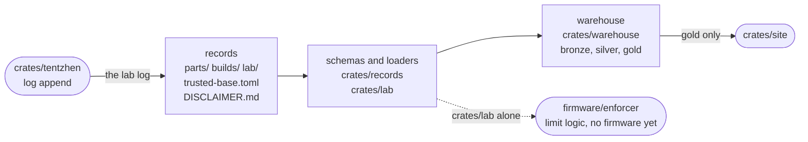

# Architecture

How Tentzhen's records, code and checks fit together, the rules that keep them honest, and the
plan for what comes next. Every rule below names what holds it, and a rule nothing holds says so:
the same grading `verification.md` asks of any claim.

## Layers



| layer | where | what it is |
|---|---|---|
| records | `parts/`, `builds/`, `lab/`, `trusted-base.toml`, `DISCLAIMER.md` | The system of record. Everything else is rebuilt from these. |
| schemas and loaders | `crates/records`, `crates/lab` | Typed schemas that refuse what they don't know, and the checks the records' own rules call for. |
| warehouse | `crates/warehouse`, described in `docs/data-catalogue.md` | Bronze holds each file as read, silver holds typed rows the database constrains, and gold holds views that answer questions. It can be deleted at any time. |
| readers | `crates/site` today | They read gold. |
| firmware | `firmware/enforcer` | The supply enforcer's limit logic, with no standard library and nothing at run time. Its build script compiles the limits in through `crates/lab` alone, so the safety path never depends on the database. The Tock firmware that is to run it is not written. |
| host tools | `crates/tentzhen` | Commands for the bench. `tentzhen log append` writes an entry to the lab log through `crates/records`, chained to the entry before it. |

## Rules

| rule | held by |
|---|---|
| Schema first: every file in `parts/`, `builds/` and `lab/` is loaded into the warehouse, and so are `trusted-base.toml` and `DISCLAIMER.md`, or CI fails. A record is parsed by its schema on the way in; a drawing is kept as it is. A folder's README is not a record. | `every_file_in_the_records_folders_is_loaded` |
| Every schema refuses a key it doesn't know. | `every_table_refuses_a_key_it_does_not_know`, in `crates/records` and in `crates/lab`; for the lab log, the measurement records, the lab-target list and the lab's sourcing, `a_log_entry_keeps_its_shape`, `a_measurement_record_keeps_its_shape`, `a_lab_target_keeps_its_shape` and `a_sourcing_line_keeps_its_shape`; for MNIST's pins and a training run's summary, `the_mnist_pins_name_its_four_files` and `a_run_summary_refuses_a_key_it_does_not_know` in `crates/littlebit`; for a run's integer export, `an_integer_network_refuses_what_does_not_fit` |
| A rule a record states in a comment is a check or a test. | the tests in `crates/lab` and `crates/records`, for `lab/limits.toml`, and for `lab/targets.toml` and `lab/sourcing.toml`, whose comments list what nothing holds. Nothing holds this for new files: `unknown`. |
| Every file the warehouse loads is in bronze with its sha256, and every silver row traces to one. | `every_row_traces_to_the_bytes_it_came_from`, for the eight silver tables with a `record` column; the rest reference one of those by foreign key, directly or through another table. |
| Each lab-log entry names the sha256 of the line before it, so an entry edited, dropped or moved is refused. The chain cannot see a change to the last entry, entries cut from the end, or a chain rewritten from an edit on: the next rule covers those on `main`. | `an_edited_dropped_or_moved_entry_breaks_the_chain` in `crates/records`, and the warehouse's keys on `silver.lab_log_entry` (`the_database_refuses_what_the_records_refuse`) |
| `main`'s lab log only grows: each of its files is the start of the same file in a PR. | the Quality Gate's step "The lab log only grows", which `the_lab_log_step_passes_only_an_append` runs against a scratch repo |
| Two writers on one machine cannot chain to the same entry. | `appends_from_many_threads_keep_one_chain` |
| A claim's `record` referent names a measurement record, `lab/records/<id>.toml`, which lists the claim's subject among the devices it measured. | `a_record_referent_names_a_record_that_measured_its_subject` and `load_holds_claims_to_the_records_on_disk` in `crates/records`; the warehouse's foreign key to `silver.measurement` holds only that the record exists (`the_database_refuses_what_the_records_refuse`) |
| A measurement record cites the lab-log entries it came from, first and last and in that order, by the sha256 of their lines, and its id starts with the first's UTC day. Each device and meter it names has a record, one that is a build version gives the firmware that version pins, and each meter's accuracy is a claim on the meter's own record. | `a_record_names_what_the_catalogue_and_its_log_hold`. The warehouse's keys on `silver.measurement` and `silver.measurement_device` hold that the entries, devices and accuracy claims exist and that each accuracy is on its meter's record, not the order, the day or the firmware (`the_database_refuses_what_the_records_refuse`) |
| A raw ADC code in a record's results (`input_codes`) sits beside the value converted from it (`input_volts`). Nothing holds the reverse, that a value read from an ADC keeps its code: `unknown`. | `a_raw_code_sits_beside_its_converted_value` |
| A merged measurement record never changes. | the Quality Gate's step "A measurement record never changes", which `the_record_step_passes_only_a_new_record` runs against a scratch repo |
| A lab target is one board: a part or a build version with a record, giving a serial no other target gives, naming a person as `approved_by`, and retired only after the day it was listed. | `a_lab_target_keeps_its_shape` and `a_lab_target_names_a_board_the_catalogue_holds` in `crates/records`, and the warehouse's keys and checks on `silver.lab_target` (`the_database_refuses_what_the_records_refuse`) |
| Each flash in the lab log, `firmware.flash`, names the target, the serial read from the board and the image's sha256. Unless its params name the person who approved it in the session (`approved_by`), as CLAUDE.md allows for a board that is not listed, the target is on the lab-target list that day, the serial is the target's, and the image is the firmware the target's build version pins if it pins one. So a target such a flash names stays on the list with the serial it gave. The log keeps a flash the list refuses, and the records stop loading. | `a_flash_is_held_to_the_lab_target_list` and `load_holds_claims_to_the_records_on_disk` in `crates/records`. The warehouse has no key from a flash to its target. |
| A build version that is never a lab target says why, and a lab target listed as it, or as a build that uses it, is refused. `builds/enforcer` says so. | `a_build_that_is_never_a_lab_target_says_why` and `a_lab_target_names_a_board_the_catalogue_holds` in `crates/records`. The warehouse keeps the reason and refuses an empty one, not the target (`the_database_refuses_what_the_records_refuse`). |
| A line of the lab's sourcing, `lab/sourcing.toml`, names a line some build version writes, word for word, and no other line of it names the same. A shop comes with its item number, in that shop's form (on AliExpress a number under 2^51, on Amazon an ASIN, on LCSC a C number); a store may stand alone, as a seller with no listing; `used` is `true` or left out; a part `salvaged_from` a device names no shop and is not also `used`; a stage up to `ordered` names them; a stage is a UTC day, or `true` for a day not given, and the days given run in the stages' order; and `passed_qa` names a measurement record from on or after each day the stages give, which lists its part among the devices it measured. | `a_sourcing_line_keeps_its_shape` and `a_sourcing_line_names_a_line_a_build_writes` in `crates/records`. The warehouse's keys and checks on `silver.sourcing` hold the pairs, the shop, that a salvaged part has no shop and is not also `used`, that a stage's day comes with the stage, the days' order and that the part and the record exist; not the item's form, the record's day or devices, or that two lines name different things (`the_database_refuses_what_the_records_refuse`). |
| The parts list buys for the newest version of each build once, counting a build that another build's newest version uses inside that one, and every line of the lab's sourcing is on it. | `the_parts_list_counts_each_build_once`, `every_sourcing_line_is_on_the_parts_list` |
| A line's status is the last stage it has reached, never typed, with that stage's own day or none; with no stage reached, or no line, it is specced. | `a_status_comes_from_its_stages` |
| A sourcing line for a part sold by authorized sellers only, or whose claims rest on `maker-datasheets`, says where the maker lists its seller (`authorized`) once it names a source or reaches a stage; `authorized` comes with a seller, for a part sold new. | `a_part_that_assumes_an_authorized_seller_names_one` and `a_sourcing_line_keeps_its_shape` in `crates/records`; the warehouse's checks on `silver.sourcing` hold that `authorized` comes with a seller and not beside `used` or `salvaged_from` (`the_database_refuses_what_the_records_refuse`). That the seller is on the maker's list is the writer's word, and a build's own claims on `maker-datasheets` are not held to its parts' sources. |
| The home page, written by hand, carries the nav every generated page does. | `the_home_page_s_nav_is_the_generated_one` |
| A build's line gives its thing's class, one of the letters `crates/records` lists (`Class`), and one thing, a part and its form or a commodity and its form, has one class in every build version that writes it. | `a_line_gives_its_class_by_letter` and `one_thing_has_one_class` in `crates/records`. The warehouse's check on `silver.line` holds the letters, every one `crates/records` lists and no other (`the_database_refuses_what_the_records_refuse`), not that one thing has one class. |
| The parts page shows each thing the bench needs once, grouped by class, and no price. | `the_parts_page_lists_each_thing_once`. No price reaches it only as far as `lab/sourcing.toml` refuses a field it does not know: one written into a store's name, a form or a commodity would, and nothing holds that. |
| An agent flashes only a listed board or one a person approved, and logs every load of code as a flash. The Pico enforcer is never a target, a listing never covers irreversible settings, and a serial names one board. | nothing: `unknown`. Nothing between an agent and a USB port reads the list. A target listed as a bare `RP2350` part cannot be told from the enforcer's. How each kind of board reports a serial is unknown until one arrives. |
| The enforcer compiles in `lab/limits.toml`'s supply limits exactly, as whole millivolts and milliamps, with the file's sha256. A value between two millivolts or milliamps is refused, not rounded. | `the_enforcer_s_limits_are_whole_millivolts_and_milliamps` in `crates/lab`, and `the_enforcer_compiles_in_the_limits_file` |
| The enforcer's rules, for any limits: a setpoint or current limit above `[supply.dps]`'s is refused, not clamped, and a refused input changes nothing; a reading above `[supply]`'s ceilings, a failed read, or a tick with no reading since the tick before trips the output, in any state; the output turns on only by `On`, from off, once a setpoint has been let through; a trip ends only by the button or, under `reenable = "agent"`, the host's clear, and either leaves the output off. | Kani, for one input from any state, reachable or not, so after every sequence of inputs, in the Quality Gate's step "Kani checks the enforcer's rules": `nothing_above_the_limits_reaches_the_dps`, `a_refused_input_changes_nothing`, `a_bad_reading_or_a_silent_tick_trips_the_output_at_once`, `the_output_turns_on_only_by_on_from_off_with_a_setpoint`, `only_the_button_or_an_agent_s_clear_ends_a_trip`; `every_function_in_proofs_is_a_kani_harness` holds that each is marked for Kani to run. On examples: `a_setpoint_above_the_limits_is_refused_not_clamped`, `a_bad_reading_or_a_silent_tick_trips_the_output`, `under_person_only_the_button_ends_a_trip`, `under_agent_a_clear_ends_a_trip_and_leaves_the_output_off` |
| The enforcer needs no standard library and nothing at run time, and reads the limits through `crates/lab` alone. | the Quality Gate's step "The enforcer builds for the RP2350, with no standard library", and `the_enforcer_depends_on_nothing_at_run_time` |
| The numbers the enforcer's hardware claims state follow from its parts' claims and `lab/limits.toml`, and its hardware cut stays under the RP2350's absolute maximum. | `the_enforcer_s_numbers_follow_from_its_parts` |
| The enforcer holds the limits on the bench: it is given every input, and the output switch follows it. | nothing: `unknown`. It runs on no hardware. Its board (`builds/enforcer`) is a draft nobody has built, the Tock firmware that is to feed it is not written, and how long a trip takes and how far off its readings are have not been measured. |
| A claim's `check` names a Kani harness that exists, at the Kani version the Quality Gate installs, with its bound; a `test` names a test that exists, a Rust test by its package or a cocotb test under `gateware/` as `gateware <name>`, and a `proof` a file. | `a_code_referent_names_code_that_exists` |
| The UART carries every byte value back to back, holds each bit for its divisor of cycles and its stop bit a full bit, drops a byte whose stop bit is low, and ignores the line low for less than half a bit; the board's echo design sends back every byte at 115,200 baud, from 25 MHz and from 50 MHz. | cocotb on Verilator, in the Quality Gate's step "The gateware's cocotb tests, on Verilator from OSS CAD Suite 2026-11-21": `uart_carries_every_byte_back_to_back`, `uart_tx_holds_each_bit_a_divisor_and_its_stop_bit_a_full_bit`, `uart_rx_drops_a_byte_whose_stop_bit_is_low`, `uart_rx_ignores_a_glitch_shorter_than_half_a_bit`, `uart_echo_sends_back_every_byte_at_115200_baud` and `uart_echo_at_50_mhz_sends_back_every_byte_at_115200_baud`. On the board, the echo is `measured` at 25 MHz (`2026-11-22-i9-uart-echo`) and at 50 MHz from the PLL (`2026-11-23-i9-pll-echo`). |
| The ECP5's PLL takes only dividers and frequencies inside the ranges Project Trellis's `ecppll` uses, and an output of whole hertz; the board's 50 MHz design elaborates with its PLL at 50 MHz; and each clock from 50 to 80 MHz that `gateware/bringup/pll_echo.py` has `ecppll`'s dividers for, which E12 builds at, comes out of them exactly. | pytest, in the same step: `test_ecppll_dividers_give_50_mhz_from_a_600_mhz_vco`, `test_each_clock_s_ecppll_dividers_give_it`, `test_pll_refuses_what_ecppll_would_not_use`, `test_pll_refuses_an_input_ecppll_would_not_take` and `test_the_pll_echo_elaborates_at_50_mhz` (`gateware/cores/tests/test_ecp5_pll.py`). That the PLL locks and the design runs near 50 MHz is `measured` (`2026-11-23-i9-pll-echo`); Verilator has no model of the PLL. |
| A grade comes from its referents, never typed. | `no_record_can_type_a_grade`, `grades_derive_from_referents`, `every_limit_gets_the_weakest_grade_of_its_claims` |
| A limit rests only on claims that exist, and a rule reads numbers only from the claims its value rests on, so its grade covers them. | `a_value_rests_on_claims_that_exist` and `a_rule_reads_only_the_claims_its_value_rests_on` in `crates/lab`, `the_limits_are_held_to_the_claims_they_cite` in `crates/records`, and the warehouse's foreign key to `silver.claim` (`the_database_refuses_what_the_records_refuse`) |
| A limit with an `at_most` is no more than the number it names, a value of a claim the limit rests on. | `a_value_stays_at_most_the_number_it_names` in `crates/lab`, `the_limits_are_held_to_the_claims_they_cite` in `crates/records`, and the warehouse's foreign keys from `silver.lab_limit_at_most` (`the_database_refuses_what_the_records_refuse`) |
| A limit's policy that cites CLAUDE.md quotes it word for word. | `every_policy_quoting_claude_md_matches_it` |
| A claim's `trusted` referent names an entry in the trusted base. | `a_trusted_referent_names_an_entry_in_the_trusted_base` in `crates/records`, and the warehouse's foreign keys to `silver.trusted_entry` (`the_database_refuses_what_the_records_refuse`) |
| Readers of the warehouse read gold only. | `the_site_reads_only_gold`; the site is the only one so far. |
| Every table and view says what it is, and the catalogue is generated. | `every_table_and_view_says_what_it_is`, `the_catalogue_is_current` |
| The lab crate needs only serde and toml. | `the_lab_crate_needs_only_serde_and_toml` |
| Parsing records needs no database. | `parsing_records_needs_no_database` |
| Every dependency is pinned to one version. | `every_dependency_is_pinned`, for each crate's own; the rest by `Cargo.lock`, which CI builds with `--locked`; the compiler by `rust-toolchain.toml`. Kani by the version its step installs, which `a_code_referent_names_code_that_exists` reads. The workflows' actions by commit: `every_action_is_pinned_by_commit`. A Python project under `models/`: its own dependencies and its Python by `every_python_dependency_is_pinned`, the rest by its `uv.lock`, which nothing in the Quality Gate installs from yet. |
| Every text file is LF in the repo and in every checkout, on any OS, so the bytes the lab log's chain, the Quality Gate's steps and the tests compare are the bytes committed (`.gitattributes`). Only the fonts' licenses are kept byte for byte as committed. | `every_text_file_checks_out_with_lf`, in the checkout it runs in. The Quality Gate's is Linux, so a Windows checkout is held only where its own tests are run. |
| A training run's committed weights are the ones its summary names, and get right the images it says, re-scored on MNIST that is refused unless each file is its pin (`models/littlebit/mnist.toml`). The Quality Gate fetches MNIST; it is never committed. A run is re-scored only with the pixel mapping and the activation grids its summary names. | `e1_weights_are_the_ones_its_summary_names`, `e1_scores_what_its_summary_says`, `r16_weights_are_the_ones_its_summary_names`, `r16_scores_what_its_summary_says`, `e2_and_e3_weights_are_the_ones_their_summaries_name`, `e2_scores_what_its_summary_says`, `e3_scores_what_its_summary_says`, `the_sweep_s_weights_are_the_ones_their_summaries_name`, `the_sweep_scores_what_its_summaries_say`, `e10_weights_are_the_ones_their_summaries_name`, `e10_scores_what_its_summaries_say`, `mnist_refuses_a_changed_file` and `a_run_is_scored_only_as_its_summary_says` in `crates/littlebit`, for E1, r16, E2, E3, the sweep's r4, r8, r32 and r64, the ranks E11's search tried, 40, 42, 43, 44, 48 and 56, and E10 and its start: the runs so far. E10's hidden layers hold no more bits than E7's, and would at one rank more. |
| A LittleBit run's integer export, `integer.json`, is what the exporter writes from the run's committed weights and the training images; its exponents add up along each layer; and the golden model runs it by the steps `crates/littlebit/src/integer.rs` gives: right shifts that round toward minus infinity, latents saturated to an int16, outputs clamped to 0..255, and an overflow an error. | `r16_integer_json_is_what_the_exporter_writes`, `the_sweep_s_integer_json_is_what_the_exporter_writes`, `e10_integer_json_is_what_the_exporter_writes`, `an_integer_network_refuses_what_does_not_fit`, `a_littlebit_layer_computes_what_its_steps_say`, `int8_takes_the_finest_grid_that_holds_the_largest` and `r16_integer_saturates_no_latent_on_the_training_images`, in `crates/littlebit` |
| A baseline's integer network, E2's or E3's, is exported from the run's committed weights and not written out, since only the computer runs it. Its exponents add up along each layer, and a layer with a scale per output has only +1 and -1 for weights. The golden model runs it as `crates/littlebit/src/integer.rs` gives: z = W x + b, or h (S x) + b, then a right shift, outputs clamped to 0..255, and an overflow an error. | `a_baseline_layer_computes_what_its_steps_say` and `a_baseline_network_refuses_what_does_not_fit`, in `crates/littlebit` |
| Check 1 (`docs/littlebit.md`, "Verification"): the integer golden model gets at most 0.5 points fewer of the 10,000 test images right than the float model it was exported from. | `r16_integer_is_within_half_a_point_of_float`, at r = 16; `the_sweep_s_integer_is_within_half_a_point_of_float`, at every other rank run, 4 to 64, with no latent saturated on the training images; `e10_integer_is_within_half_a_point_of_float`, for E10, the wider network; and `e2_and_e3_integer_are_within_half_a_point_of_float`, for the baselines |
| `docs/littlebit.md`'s experiments table and its two plots: each run's bits per weight follow from the bit-accounting formula, at its own widths, and E10's rank is the largest whose hidden layers hold no more bits than E7's; each run's test accuracy is what its integer network gets on the 10,000 test images as the golden model scores it, and its float run's what its summary says; and the plots under `docs/img/` are what `crates/littlebit/src/plots.rs` draws from the table. | `the_littlebit_bit_counts_follow_from_the_formula` in `crates/repo`; `the_experiments_table_s_accuracies_are_what_the_runs_get` and `the_plots_are_what_the_experiments_table_draws` in `crates/littlebit`. The table's LUTs, EBR blocks and Fmax are nextpnr's, `trusted` (`fpga-toolchain`), and no test holds them. |
| A convolution's windows are the patch around each position of its grid, with zeros past the edge; the gateware's test vectors, `gateware/cores/tests/littlebit_vectors.json`, are what the golden model writes, load as their schema, and in every case saturate some latent and clamp some output at each end; Clean Up's conv1 case holds 0 or 1 in every channel but the two inventory counts, 0 to 255, and has a window all at its largest and one all 0. | `windows_take_each_position_s_patch_with_zeros_past_the_edge` and `littlebit_vectors_are_what_the_golden_model_writes`, in `crates/littlebit` |
| r16's first layer behind the UART (`gateware/bringup/littlebit_layer.py`) answers each frame, 0xA5 and 784 inputs, with 0x5A and the golden model's y and z for all 256 outputs; drops bytes before a frame; and drops a frame left part way, answering the next as if alone. The computer's side reads an answer as its frame says, and says where one differs from the golden model. | cocotb on Verilator, in the Quality Gate's gateware step: `littlebit_layer_answers_each_frame_as_the_golden_model_does` and `littlebit_layer_drops_a_frame_left_part_way_and_answers_the_next` (`gateware/bringup/tests/test_littlebit_layer.py`), at a UART divisor of 8 and without the PLL; and `a_board_answer_is_read_as_its_frame_says` in `crates/littlebit`. On the board, at 50 MHz from the PLL, it answered 1,000 MNIST test images exactly as the golden model: `measured` (`2026-11-23-i9-littlebit-layer`). |
| The LittleBit engine computes what the golden model does, every output's y and z, on r16's two hidden layers and on each window of a small convolution, given inputs back to back or with gaps, with its tables in logic (Variant A) and in block RAM (Variant B); a vector takes inputs + rank + outputs + 1 clocks in both; and its sign ROMs read back as `integer.json` has them. | cocotb on Verilator, in the Quality Gate's gateware step: `littlebit_engine_computes_r16_layer_1_as_the_golden_model_does`, `littlebit_engine_computes_r16_layer_2_as_the_golden_model_does`, `littlebit_engine_computes_each_window_of_a_convolution_as_the_golden_model_does` and `littlebit_sign_roms_read_back_r16_layer_1s_v_rows_and_u_columns` (`gateware/cores/tests/test_littlebit.py`). That it is logic and not block RAM, and its size and speed, are nextpnr's (`docs/littlebit.md`, "What the engines cost"). |
| The hardwired kernel computes what the golden model does, every output's y and z, on each of the 121 windows of a layer of Clean Up's conv1's shape, given windows back to back or with gaps, at its latency, with a register after every level of adds and after every 2; it makes no multiply and no memory; its canonical signed digits sum to every value from -128 to 128; and it refuses widths that don't fit and a layer whose a, s or z could pass an int32. | cocotb on Verilator, in the Quality Gate's gateware step: `littlebit_kernel_computes_each_window_of_clean_up_conv1_as_the_golden_model_does` (`gateware/cores/tests/test_littlebit_kernel.py`); and, by pytest in the same step, `test_littlebit_kernel_multiplies_nothing`, `test_csd_digits_sum_to_every_int8_and_its_negation`, `test_channel_widths_follow_the_windows_order`, `test_littlebit_kernel_refuses_a_layer_that_could_pass_an_int32` and `test_littlebit_kernel_refuses_widths_that_dont_fit`. Its size and speed are nextpnr's (`docs/littlebit.md`, "A hardwired kernel for conv1"). |
| The output layer computes the golden model's scores, int32 to both ends, and picks the first of the highest, as the golden model's argmax does; the whole network, r16, scores each image as the golden model does, every score and the digit, on its test vectors and on all 10,000 MNIST test images (check 2), in 1,219 clocks an image, as it counts them and as the test does; in Variant B, E9, so does r16 on its test vectors and on MNIST's first 1,000 test images, in the same clocks. The sweep's other networks, r4, r8, r32 and r64, and E11's r42, score their test vectors as their golden models do, in 1,187 + 2r clocks an image, and so does E10, the wider network, in 2,357. The output layer's and the networks' test vectors are what the golden model computes. | cocotb on Verilator, in the Quality Gate's gateware step: `littlebit_output_layer_scores_r16s_output_layer_as_the_golden_model_does`, `littlebit_output_layer_reaches_both_ends_of_an_int32_and_picks_the_first_of_a_tie`, `littlebit_network_scores_r16s_test_vectors_as_the_golden_model_does`, `littlebit_network_scores_mnist_test_images_as_the_golden_model_does` and `littlebit_network_scores_the_sweep_s_test_vectors_as_the_golden_model_does` (`gateware/cores/tests/test_littlebit_network.py`), the last on MNIST the gate fetches, scored by the golden model as the test runs; and `output_and_network_vectors_are_what_the_golden_model_computes` and `argmax_picks_the_first_of_the_highest`, in `crates/littlebit`. |
| r16 behind the UART (`gateware/littlebit/network.py`) answers each frame, 0xA5 and 784 pixels, with 0x5A, the golden model's 10 scores and digit, and the clocks the network took, 1,219, which leave the serial link out; drops bytes before a frame; and drops a frame left part way, answering the next as if alone. The computer's side reads an answer as its frame says, and says where its scores or digit differ from the golden model's. | cocotb on Verilator, in the Quality Gate's gateware step: `littlebit_network_answers_each_frame_as_the_golden_model_does` and `littlebit_network_drops_a_frame_left_part_way_and_answers_the_next` (`gateware/littlebit/tests/test_network_over_uart.py`), at a UART divisor of 8 and without the PLL; and `a_network_answer_is_read_as_its_frame_says` in `crates/littlebit`. On the board, at 50 MHz from the PLL, it scored 1,000 MNIST test images exactly as the golden model, 1,219 clocks each (check 3): `measured` (`2026-11-23-i9-littlebit-network`). |
| The Clean Up golden model draws JAX's random numbers bit for bit, as `jax.random` draws them at the JAX `models/cleanup/uv.lock` pins: Threefry-2x32 with 20 rounds, which gives Random123's known answers, in JAX's "partitionable" layout; `split`, `bits`, `uniform`, `randint` as int8, int16 and int32, and `permutation`, of 0 to n − 1 or of rows. The vectors it is checked on are what `models/cleanup/random_vectors.py` writes from JAX, are that JAX's, and load as their schema. A draw of n numbers begins with every smaller draw from its key, and a shuffle sorts once below 1,626 elements and twice from there. | `threefry_gives_random123_s_known_answers`, `jax_s_random_numbers_are_these_bit_for_bit`, `the_random_vectors_refuse_a_key_they_do_not_know`, `a_draw_begins_with_every_smaller_draw_from_its_key` and `a_shuffle_sorts_once_below_1626_elements_and_twice_from_there`, in `crates/cleanup`. That the vectors are what JAX draws is `random_vectors.py --check`, run by hand: the Quality Gate has no JAX. |
| What is generated is what its generator writes: build pages, mural SVGs, the catalogue. The site's images are `brand/`'s files, byte for byte. | the Quality Gate's steps, and `the_catalogue_is_current` |
| tentzhen.com serves `site/` as it is on main: published when main's Quality Gate passes on a push, from that commit, while it is still main's head, so an older commit's slower run never publishes over a newer one; never from a fork's branch named main; or by hand from main as it is. | `the_pages_workflow_publishes_only_a_commit_main_s_gate_passed`, which reads the Pages workflow's guard. That GitHub runs it as written is assumed, as the ruleset is. |
| On a pull request, the Quality Gate runs the gateware's cocotb tests only when the pull request changes something they read: `gateware/`, `crates/littlebit/`, `models/littlebit/`, `.github/`, a .cargo folder (there is none yet), the workspace's `Cargo.toml` and `Cargo.lock`, `rust-toolchain.toml`, `.gitattributes`, pytest's config files at the root, or a module or package at the root, which is on their import path (`gateware/conftest.py`). A file moved or removed counts. Every run on main, and every run started by hand, runs them; no other step depends on what changed. | `the_gate_runs_cocotb_on_a_pull_request_only_when_it_changes_what_they_read`, which runs the step "Which steps this run needs" in a scratch repo, and `only_the_cocotb_steps_follow_the_plan`, in `crates/repo`. That the list holds everything the tests read is `unknown`: it is read from their code (paths they open, `cargo run -p tentzhen-littlebit`, the import path), and main's runs, which skip nothing, are the backstop. |
| A published build version never changes. | the Quality Gate's step of that name |
| `main` changes only through a PR that passes the Quality Gate. | the `main-protection` ruleset on GitHub |

The tests that span crates live in `crates/repo`. One of them holds this doc to the code: every
test and path it names up to the proposal below must exist.

## What the introspection shows

- **One claim model.** Parts and builds carry `[[claim]]`, landing in `silver.claim` and
  `silver.referent` and graded by `gold.claim_grades`. The lab's limits cite them
  (`silver.lab_limit_rests_on`), and `gold.limit_grades` takes their bench grade.
- **Only the lab's limits and a record's meters cite claims,** through `rests_on` and
  `accuracy`. Claims have a citation (`<part>#<id>`, `<build>/v<n>#<id>`), but no other record has
  a field that cites one.
- **The trusted base is data,** in `trusted-base.toml`: each entry has an id, and a `trusted`
  referent is that id, held by a foreign key.
- **A `record` referent is a key,** into the measurement records, and none exist yet: nothing has
  touched hardware, so the lab log they cite has no entries either.
- **A measured grade does not look at the meter.** `gold.claim_grades` gives `measured` to any
  claim with a `record` referent, whatever the grade of the claim that gives its meter's accuracy.
- **A lab-log entry, a measurement record or a lab target is only as trustworthy as the machine that
  wrote it.** Every field is what its writer says, a log entry's `by` and a target's or a flash's
  `approved_by` included. So a `measured` grade says that a record and its log entries exist, not
  that anyone touched the bench, and `lab/limits.toml`'s "Raise it only on a measured claim" depends
  on someone reading the record. Commits are signed, but an agent that can commit there signs with
  the person's key: Claude's commits on this repo carry Jon's signature. What `main` adds is that
  neither can change once merged. Nothing checks that an entry's `limits_sha256` names a version of
  `lab/limits.toml`.
- **The enforcer's logic is `checked`, and enforces nothing yet.** `firmware/enforcer` holds its
  rules for any limits, but no hardware runs it, so no limit in `lab/limits.toml` is enforced by
  anything. Its board, `builds/enforcer`, is a draft: its hardware claims are `trusted` from its
  parts' datasheets, with arithmetic a test holds, and none is measured. An agent may clear a trip
  (`reenable = "agent"`, Jon, 2026-09-30), and the enforcer cannot see whether the trip was logged.
- **Nothing is a lab target yet,** so every flash needs a person's approval. The list binds the
  log, not the bench: nothing between an agent and a USB port reads `lab/targets.toml`.
- **The Pico voltage ceiling rests on the RP2350 alone** (`RP2350#io-supply`), 230 mV under its
  rated and absolute maximum of 3.63 V. No claim covers another part on the supply, and
  `pico_3v3.max_amps` rests on nothing (`gold.limit_grades`).
- **Three gold views have no reader:** `grade_coverage`, `where_used` and `limit_grades`
  (`docs/data-catalogue.md`).
- **`main`'s Quality Gate did not run for the merge of #18,** for an unknown cause. The tree was
  the one the PR's run had passed, and the run for #19's merge covered it. The workflow can now be
  started by hand (`workflow_dispatch`).

## Proposal: one claim model

Every graded statement becomes a claim on its subject, in one shape. Step 1 built it for parts and
builds (`crates/records`, `Claim`), step 2 made the trusted base data, and step 3 moved the lab's
facts onto the parts they are about.

```toml
[[claim]]
id = "input-range"
says = "Needs an input of 6-55 V, and at least 1.1 x its output"
trusted = "dps5005"        # an entry in the trusted base
# or any of: test = "...", check = "...", proof = "...", record = "..."
values = { min_input_volts = 6.0, max_input_volts = 55.0, input_ratio = 1.1 }
```

- **Claims live on their subject:** `parts/<part>.toml`, or `builds/<build>/v<n>.toml` as now. Each
  is cited as `<subject>#<id>`, for example `DPS5005#input-range`.
- **The grade comes only from which referents are present.** `proof`, `check` and `test` give
  proven, checked and tested; `record` gives measured; `trusted` gives trusted. There is no `grade`
  field.
- **The trusted base becomes data.** Its entries get ids, so a `trusted` referent is a key, not a
  prefix of a bullet.
- **The warehouse gets one model.** `silver.claim` and `silver.referent` cover every subject, with
  one `gold.claim_grades`, and `gold.limit_grades` reads claims.
- **The lab cites claims.** `lab/limits.toml`'s `rests_on` names claims
  (`rests_on = ["DPS5005#input-range"]`), and its `[fact.*]` tables go away.

Decided with Jon, 2026-09-29:
1. **Numbers a rule reads,** like the DPS5005's 6, 55 and 1.1: a claim's `values` table, whose keys
   end in their unit (`VALUE_UNITS` in `crates/records`), checked by the rule that reads them.
2. **The bench supply** gets a part record (`kind = "product"`), described by requirement like the
   site's other upstream components.
3. **Two axes:** simulation (tested, checked, proven) and the bench (trusted, measured) stay apart,
   as `gold.claim_grades` gives them. A limit's weakest grade is taken on the bench axis.

## Plan

Each step is one PR, done when its check passes:

1. **One claim model** in `crates/records` and the warehouse, with `debug-probe`'s claims migrated.
   Done when `gold.claim_grades` covers parts and builds, and no record can type a grade. Done:
   `a_part_s_claims_are_graded_like_a_build_s`, `no_record_can_type_a_grade`.
2. **The trusted base as data.** Done when every `trusted` referent is a foreign key. Done:
   `trusted-base.toml`, `silver.trusted_entry`,
   `a_trusted_referent_names_an_entry_in_the_trusted_base`.
3. **Lab facts become claims on parts:** `parts/dps5005.toml`, and a bench supply record. Done
   when `lab/limits.toml` has no `[fact.*]` and `gold.limit_grades` gives the same grades as
   before. Done: `parts/dps5005.toml`, `parts/bench-supply.toml`, and
   `every_limit_gets_the_weakest_grade_of_its_claims`, which holds every limit to the grade it had
   before.
4. **A claim under the Pico ceiling:** the RP2350's rated I/O supply range, as a claim on
   `parts/rp2350.toml`. Done when `pico_3v3.max_volts` rests on it. Done, and bounded by it:
   `RP2350#io-supply`, `at_most`, `a_value_stays_at_most_the_number_it_names`.
5. **Measurement records** with the lab log (`roadmap.md`, Phase 0). Done when a `record` referent
   is a foreign key. Two PRs, the log first, since a record cites the entries it came from:
   - **5a. The lab log:** one JSON line per hardware action in `lab/log/<yyyy-mm-dd>.jsonl`, each
     naming the sha256 of the line before it, written by `tentzhen log append`. Done when an entry
     edited, dropped or moved is refused, and so is a change to `main`'s log that is not an
     append. Done: `an_edited_dropped_or_moved_entry_breaks_the_chain`,
     `the_lab_log_step_passes_only_an_append`.
   - **5b. Measurement records:** one file per experiment, `lab/records/<id>.toml`, each citing
     the log entries it came from. Done when a claim's `record` names a record that measured its
     subject, and a merged record cannot change. Done:
     `a_record_referent_names_a_record_that_measured_its_subject`, the warehouse's key from
     `silver.referent` to `silver.measurement`, `the_record_step_passes_only_a_new_record`.
6. **The lab-target list** (`roadmap.md`, Phase 0): the boards an agent may flash without asking,
   one entry per physical board, in `lab/targets.toml`, with nothing listed yet. A board listed as
   a build version takes only the firmware that version pins; one listed as a part takes any
   image. A flash of a board that is not listed loads only when it names the person who approved
   it. Done when an unapproved flash naming a board that is not listed is refused, and each rule is
   held by a test or written as `unknown`. Done: `a_lab_target_keeps_its_shape`,
   `a_lab_target_names_a_board_the_catalogue_holds`, `a_flash_is_held_to_the_lab_target_list`.
7. **The enforcer's limit logic, `checked`** (`roadmap.md`, "Parallel tracks"): `firmware/enforcer`,
   a `no_std` crate with the supply's limits compiled in through `crates/lab`. A trip ends by the
   button, or by the host's clear where `reenable = "agent"`. Done when Kani checks its rules in the
   Quality Gate. Done: `nothing_above_the_limits_reaches_the_dps`,
   `a_refused_input_changes_nothing`, `a_bad_reading_or_a_silent_tick_trips_the_output_at_once`,
   `the_output_turns_on_only_by_on_from_off_with_a_setpoint`,
   `only_the_button_or_an_agent_s_clear_ends_a_trip`, `the_enforcer_compiles_in_the_limits_file`.
8. **The supply build, draft:** `builds/supply/v1.toml`, using `builds/enforcer/v1.toml`.
   `[supply.upstream]` says the DPS5005 can fail above the ceiling and only the enforcer is to hold
   it, so the enforcer measures the output itself and drives a switch that is open unless it holds
   it closed, and a comparator opens the switch whatever the firmware does (Jon, 2026-09-30). The
   button is wired to nothing an agent drives. Its claims cite step 7's harnesses, and the enforcer
   is never a lab target. Done when a claim's `check` that names no harness is refused, and so is a
   lab target that is the enforcer. Done: `a_code_referent_names_code_that_exists`,
   `a_build_that_is_never_a_lab_target_says_why`, `a_lab_target_names_a_board_the_catalogue_holds`,
   `the_enforcer_s_numbers_follow_from_its_parts`.
9. **The enforcer firmware on Tock:** the logic in a kernel capsule, behind Tock's process isolation
   (`verification.md`, "Tock"). How to stop a reflash over USB or SWD is decided first, with a
   person: it may take RP2350 OTP settings, which cannot be undone, and it bears on where a key an
   agent cannot use is kept (`roadmap.md`, TROPIC01). What finishes it is set in its proposal.
10. **The bench:** the first cart, which a person orders; OpenDPS on the DPS5005, which changes its
    flash protection and so needs a person's approval in the session; and measurement records for
    what is unknown: the DPS5005's own draw, the enforcer's measuring error, and how long a trip
    takes. What finishes it is set in its proposal.
