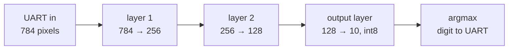
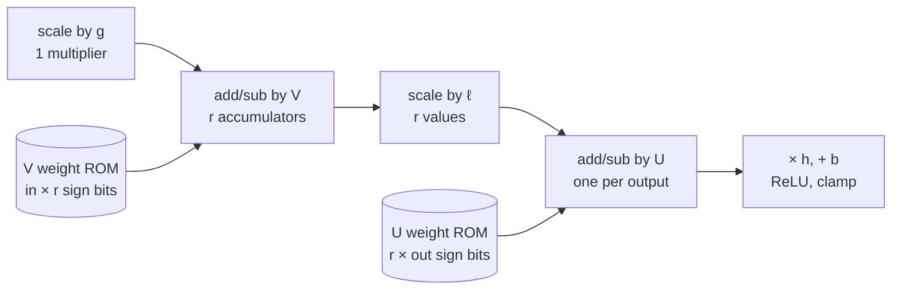

# Project #3: LittleBit × Taalas on a Colorlight i9

Research date for everything below: 2026-11-21, unless a line says otherwise.

A small neural network on the Colorlight i9, with its weights compressed to well under one bit
each and built into the FPGA's logic as constants. It measures what hardwiring low-bit weights buys
and what it costs, on a network small enough to check image by image. Nothing is built yet. It
needs no parts beyond the i9 and an extension board, already ordered for the digitizer
(`lab/sourcing.toml`), and a USB-A port to power them (`scope.md`, "Known part issues").

## What it is for

The point is a chip that runs SocialJax and Concordia as efficiently as possible, to simulate
social conflict and solve it before it happens, and local AI companions in a humanoid robot. Safety
first, and security at the hardware level is very important. (Jon, 2026-11-21.)

What the two run, read from their sources:

- **SocialJax** (cooperativex/SocialJax at 18e2171, Apache-2.0; arXiv 2503.14576) is a suite of
  multi-agent reinforcement-learning environments for sequential social dilemmas, written in JAX.
  Its IPPO baseline's network (`algorithms/utils/networks.py`) is three convolutions of 32 channels
  and a dense layer of 64, then an actor head of 64 that picks one of Clean Up's 9 actions from an
  11 × 11 × 19 observation (`socialjax/environments/cleanup/clean_up.py`). Our count from those
  files: 290,570 parameters with its critic head, 85 % of them in the dense layer, and 286,345 for
  the policy alone. The repo's Clean Up checkpoint is 1,163,141 bytes, the size of 290,570 float32
  numbers and 861 bytes more. That is the same order as this step's 234,752-weight MLP.
- **Concordia** (google-deepmind/concordia at d7da449, Apache-2.0) builds its agents from calls to
  a language model: it "requires access to a standard LLM API", and "You must also provide a text
  embedder for associative memory" (README). Its model registry lists local backends (Ollama,
  Hugging Face, vLLM, Gemma in PyTorch) beside hosted ones, as a search agent read it; not re-read.
  So its compute is language-model inference, the workload Taalas hardwires: its HC1 is "hard-wired
  with Llama 3.1 8B" (taalas.com, "The path to ubiquitous AI", 2026-02-19).

Hardwired weights are constants of the circuit. A chip built this way runs a network that is
already trained: new weights are a new bitstream on the i9, or a new chip in silicon, and training
stays on a computer. So this step tests the inference half: how accuracy, logic and clock speed
move as the bits per weight fall. Whether what it finds carries from a 234,752-weight network to the
ones above is `unknown` until a later step runs one of them.

This step drives nothing but a serial port and an LED. What safety first means for a robot is not
written yet. The rule Tentzhen has so far is the bench's: hard limits live in hardware an AI cannot
reconfigure (`vision.md`, principle 5).

**Security at the hardware level.** Jon names OpenTitan, more for the physical companion
(2026-11-21): "Open source silicon root of trust" (lowRISC/opentitan at 3cc49775, Apache-2.0),
written in SystemVerilog. Its tops are Earl Grey, Darjeeling and English Breakfast, and its FPGA
builds are Earl Grey's for the CW340 board and English Breakfast's for the CW305
(`hw/top_*/chip_*_cw3*.core`). Whether any of its tops fits the i9's LFE5U-45F is not checked, and
it is not part of this step. Tentzhen already has a research track for keys in a TROPIC01 secure
element (`roadmap.md`), and the mesh names an SE050 for its own board (`mesh.md`); whether one part
serves the bench, the mesh and the companion is not weighed. Hardwired weights have one property of
their own here: in silicon they cannot change without a new chip, while on the i9 they change with
the bitstream.

## Where this came from

Jon's spec of 2026-11-21, "LittleBit × Taalas on a Colorlight i9 — Project Spec", written in a
Claude session and brought in the same day. The research questions, the network, the checks, the
experiments and the phases are its. Changed here: the languages follow CLAUDE.md; it builds in this
repo, not a repo of its own; a board run is a measurement record; loading the board follows the
lab-target rules; the spec's open question about the extension board is answered from this repo;
and two bits-per-weight figures, the clock count, the image rate and the preloaded-image count are
worked out again. Phase 5 and research question 5 come from a second Claude session's answer that
Jon brought the same day ("so would i do openroad after the i9?"), kept where its sources were read:
LibreLane's repo and Tiny Tapeout's site.

## Research questions

1. **Quality vs. bits:** how does test accuracy fall as the factor rank r, and so the bits per
   weight, drops, for a fixed network shape?
2. **Same memory, bigger model:** at an equal weight-bit budget, does a wider network at very low
   bits beat a narrower one at higher bits?
3. **Hardwired vs. stored:** for the same weights, how do LUTs, block RAM, maximum clock and latency
   compare when the weights are logic constants (Variant A) and when they are read from block RAM
   (Variant B)?
4. **Hardware fit:** how many binary weights fit in the LFE5U-45F when hardwired, and what runs out
   first: LUTs, routing or timing?
5. **FPGA vs. silicon:** per weight bit, how much area and how many cells does a hardwired layer
   take when laid out as a chip, against the LUTs it takes on the i9?

Out of scope for this step: LLMs, making a chip (Phase 5 lays one out; making one is a stretch
goal), and training on the FPGA. Training runs in PyTorch on a computer; the FPGA only runs
inference.

## Hardware

The design fits one LFE5U-45F and leaves about 30 % of its LUTs free for routing and timing.

| resource | the LFE5U-45F has | budget | used for |
|---|---|---|---|
| LUT4s | 44k | ≤ 30,000 | Variant A's weight ROMs, adders, control, UART |
| block RAM (EBR) | 108 × 18 kbit, 1,944 kbit | ≤ 80 blocks | Variant B's weights, the input image and activation buffers |
| 18 × 18 multipliers | 72 | ≤ 32 | scale vectors and requantization only |
| clock | a 25 MHz oscillator | 50 MHz from the ECP5's PLL | 50 MHz first; higher in E12 |

The chip's figures are Lattice's (FPGA-DS-02012 3.4, Table 1.1; the PDF's sha256 26570f8b…,
read 2026-11-21). The chip is the i9 v7.2's LFE5U-45F-6BG381C (`scope.md`, "Architecture"), so
nextpnr takes `--45k --package CABGA381 --speed 6`. On arrival its JTAG IDCODE tells it from its
siblings without reading the marking: 0x41112043 (`builds/digitizer/v1.toml`, walkthrough).

**The board** is the i9 on any of the three extension boards (`scope.md`, "One i9, three extension
boards"), with nothing wired to the headers. It uses:

- **Clock:** 25 MHz on ball P3.
- **LED:** ball L2, lit when driven low; the same ball is P2 pin 28.
- **UART:** balls J17 (out of the FPGA) and H18 (in), wired to the extension board's DAPLink, which
  gives the computer a USB serial port (`builds/digitizer/v1.toml`, its header notes).
- **Loading a bitstream:** openFPGALoader's `colorlight-i9` board, through the DAPLink as a
  CMSIS-DAP cable (openFPGALoader at 2aafd902, `src/board.hpp`). It writes the FPGA's SRAM by
  default, so a bitstream is gone at power-off; `-f` writes the flash (its README, same commit).

The balls are LiteX's for the i9 v7.2 (litex-boards at 53dc2ed0,
`litex_boards/platforms/colorlight_i5.py`, `_io_v7_2`). An Amaranth platform for the i9 exists in
Muse Lab's own repo, `src/amaranth_boards/colorlight_i9_r7_2.py` (wuxx/Colorlight-FPGA-Projects at
016e5889, Apache-2.0): the chip, the 25 MHz clock on P3, the LED on L2, and the headers, with the
UART's balls on its P5 connector and no UART resource of its own. Its comment says "Some of these
still need verifying". Upstream amaranth-boards has no i9 (at f270d210). All of it is `unknown` on
our board until Gate 0 blinks the LED and echoes a byte.

**Loading the board is a flash.** Loading code into a board counts as flashing it, into SRAM too
(`lab/targets.toml`). The i9 is not a lab target, so until a person lists it, every load needs a
person's approval in the session, and every load is logged as a `firmware.flash`.

## Languages and layout

| piece | language | where |
|---|---|---|
| training, the rank sweep, the weight export | Python, PyTorch: the exception CLAUDE.md names for it | `models/littlebit/` |
| the integer golden model | Rust | `crates/littlebit` |
| the layer engines, the weight-ROM generator, the UART, the top level | Amaranth | `gateware/littlebit/` |
| tests of the gateware | cocotb on Verilator | `gateware/littlebit/tests/` |
| the host: sends images, compares answers, logs, writes the record | Rust, a `tentzhen` command | `crates/tentzhen` |

Each directory is made when its first real file arrives (`roadmap.md`, Phase 0).

The pieces meet at one file: the exported weights (signs, scales, shifts and biases) as JSON. The
golden model and the ROM generator both read it, so they cannot read different weights. The golden
model also writes out the intermediate vectors and scores that the cocotb tests compare against.

Why these for this project: in Amaranth, the ROM generator is Python that builds the circuit from
the JSON, with no Verilog text to template; Rust makes every integer widening explicit and stops a
test on an overflow, which is what "integer-exact" asks of the golden model; and the host writes the
lab log and the records, which are Rust already.

**Toolchain:** Yosys, nextpnr-ecp5, Project Trellis, Verilator, cocotb and Amaranth, pinned with the
rest (`roadmap.md`, Phase 0), plus PyTorch and openFPGALoader. Amaranth's ECP5 platform runs Yosys,
nextpnr-ecp5 and ecppack itself (amaranth at 90449f1e, `amaranth/vendor/_lattice.py`). nextpnr's
`--report` writes a "timing and utilization report in JSON format" (nextpnr at 15b77f5f,
`common/kernel/command.cc`), the source of each run's LUT, EBR and Fmax figures. MNIST is fetched
and checked against a pinned sha256; its terms are not read, so it is not committed. Phase 5 adds
LibreLane, "ASIC implementation flow infrastructure, successor to OpenLane" (Apache-2.0,
librelane/librelane at 8494d4fe), whose README recommends installing it with Nix; Tiny Tapeout's
local-hardening guide runs it in Docker (TinyTapeout/tinytapeout_www at ce1fff22).

## Model

The baseline is a 784 → 256 → 128 → 10 MLP on MNIST, 234,752 weights. The two hidden layers use
LittleBit-style factorized binary weights. The output layer stays dense int8: it has 1,280 weights.

**Layer math.** Each LittleBit layer replaces its weight matrix W (out × in) with two binary factors
and three scale vectors:

```math
y = h \odot \Big( U_s \big( \ell \odot ( V_s^{\top} ( g \odot x ) ) \big) \Big) + b, \qquad U_s \in \{\pm 1\}^{\text{out} \times r},\; V_s \in \{\pm 1\}^{\text{in} \times r}
```

g (length in), ℓ (length r) and h (length out) are learned scales; b is a bias. Multiplying by U_s
or V_s is only addition and subtraction.

**Bit accounting.** Every run reports both numbers, because at this size the scales are a real
share of the budget:

```math
\text{sign bpw} = \frac{r\,(\text{in} + \text{out})}{\text{in} \cdot \text{out}}, \qquad \text{total bpw} = \frac{r\,(\text{in} + \text{out}) + 8\,(\text{in} + \text{out} + r)}{\text{in} \cdot \text{out}}
```

The 8 is for 8-bit scales; it changes if the export uses 16-bit ones. It is the paper's Eq. 16
without the residual path, and with 8 bits a scale where the paper's are FP16, 16 bits each (arXiv
2506.13771v5, Appendix D). Neither counts the bias, an int32 per output: 8,192 bits on layer 1,
about as many as its signs at r = 8.

**Rank sweep for layer 1** (784 → 256, 200,704 weights):

| rank r | sign bits | sign bpw | total bpw, 8-bit scales |
|---|---|---|---|
| 4 | 4,160 | 0.021 | 0.062 |
| 8 | 8,320 | 0.041 | 0.083 |
| 16 | 16,640 | 0.083 | 0.125 |
| 32 | 33,280 | 0.166 | 0.209 |
| 64 | 66,560 | 0.332 | 0.376 |

`tested`: `the_littlebit_bit_counts_follow_from_the_formula` recomputes this table from the formula,
and the experiments' bits-per-weight column from it. Layer 2 (256 → 128) uses the same r. The
baselines have the same shape: dense FP32, dense int8, and plain binary weights (1 bit per weight,
one scale per output).

**Training recipe** (Jon's spec):

1. Train the FP32 MLP (Adam, learning rate 1e-3, cosine decay, about 20 epochs) and record its
   accuracy as the ceiling.
2. Start each LittleBit layer from its FP32 weights: a truncated SVD to rank r, the signs of the
   factors become U_s and V_s, and the magnitudes are folded into g, ℓ and h. The paper's Dual-SVID
   does it this way: a rank-1 approximation of |U′| gives h and one latent scale, one of |V′| gives
   g and another, and ℓ starts as their element-wise product (arXiv 2506.13771v5, section 3.2,
   Eqs. 6–8).
3. Fine-tune with quantization-aware training: sign() in the forward pass, and a straight-through
   estimator in the backward pass (the gradient passed where |w| ≤ 1). About 20 epochs. The paper
   instead uses SmoothSign ("backward gradient: tanh(kx), k = 100"), reporting it better than the
   straight-through estimator, and distils from the full-precision model as teacher (section 4.1,
   Appendix B.2).
4. Fake-quantize activations to uint8 during training (ReLU, then a per-layer power-of-two scale),
   so that the trained model matches the integer hardware.
5. Optional, after the core sweep: the paper's Residual Compensation, which splits the same bit
   budget into two lower-rank paths, the second started on what the first leaves (section 3.3).
   Measure whether two paths beat one at the same bits.

The paper's code (SamsungLabs/LittleBit at 42d658b) is under CC BY-NC 4.0, for non-commercial use
only, so Tentzhen writes its layer from the paper and copies none of that code.

**Fixed-point formats,** fixed at export and the same in the golden model and the gateware:

- Input pixels: uint8, 0–255 scaled to 0–127.
- Scales g, ℓ and h: int8, with one power-of-two shift per vector. Bias: int32.
- Accumulators: int32 everywhere (784 terms of int16 need at most 26 bits).
- Between layers: arithmetic right shift, ReLU, clamp to uint8.
- Output: 10 int32 scores. The predicted digit is their argmax, computed on the FPGA.

Not yet fixed: the U stage's width below assumes its r inputs are int16, so the ℓ-scaled latents are
cut to 16 bits, and how is not in this list. Phase 1 fixes it with the golden model.

## Hardware architecture

The design is time-multiplexed: each LittleBit layer takes one input per clock and updates all its
accumulators at once. That keeps the adders small. Between runs at one rank only the weight ROMs,
the thing being studied, change; a new rank also changes how many accumulators the V stage has.



Layers 1 and 2 each get a LittleBit engine of their own, so they run as a pipeline. The output layer
uses 10 multipliers at once, one per digit. One engine:



The two weight ROMs are what the experiments change. In Variant A they are logic constants
generated from the trained weights; in Variant B the same bits sit in block RAM.

**Per-layer schedule** (r = rank):

1. Scale by g, then add or subtract by V: one input per clock for `in` clocks. Each clock reads one
   row of V (r sign bits) and adds into, or subtracts from, r accumulators.
2. Scale by ℓ, then add or subtract by U: one latent per clock for r clocks. Each clock reads one
   row of U (`out` sign bits) and updates `out` accumulators at once.
3. Scale by h, add the bias, ReLU, clamp to uint8: one output per clock through one multiplier,
   written to the next layer's input buffer.

**Clocks per image.** Counting that schedule for one image, start to finish: layer 1 takes
784 + r + 256 clocks, layer 2 256 + r + 128, and the output layer 128, so 1,552 + 2r; at r = 16 that
is 1,584 clocks, 31.7 µs at 50 MHz. The spec estimated 1,550 + 4r. The on-chip cycle counter gives
the real figure, `unknown` until it does.

**The serial link sets the pace.** At 115,200 baud and 10 bits a byte (8N1, assumed), the 785-byte
request takes 68.1 ms and the 46-byte reply 4.0 ms: at most 13.9 images a second, however fast the
network is. So each run reports two speeds, compute from the cycle counter and end to end. The
DAPLink's top baud rate is `unknown`.

For a throughput test that leaves the link out, the spec preloaded 512 test images into block RAM.
They do not fit: 512 images take 401,408 bytes, and all 108 blocks hold 248,832 (1,944 kbit), so
fewer than 318 images would fit with nothing else in block RAM. The i9's 8 MB of SDRAM (`scope.md`)
or its 8 MB W25Q64 flash (the Amaranth platform above) hold 512, behind a controller this design
does not have yet.

**UART protocol**

| direction | bytes | contents |
|---|---|---|
| computer → FPGA | 1 + 784 | header 0xA5, then 784 uint8 pixels |
| FPGA → computer | 1 + 40 + 1 + 4 | header 0x5A, 10 int32 scores (little-endian), the argmax digit, the cycle count (uint32) |

**Variant A and Variant B in Amaranth**

- **A, hardwired:** the generator writes each ROM as a `Switch` over the row index with a constant
  on each `Case`. Yosys turns it into LUT logic, so the weights become part of the circuit.
- **B, stored:** the same bits are the initial contents of an Amaranth memory, which Yosys maps to
  block RAM. The synthesis log shows whether it landed in EBR.

Both are `unknown` until Phase 2's synthesis reports show them.

Accumulators are 32-bit in the V stages and about 22-bit in the U stages (r terms of int16). For
r = 16 the spec estimates layer 1's U-stage accumulators as the largest block, a few thousand LUTs,
and the hardwired ROMs at about 1,000–1,500 LUTs. Estimates, `unknown` until nextpnr reports them.

## Verification

Every stage must match the integer golden model bit for bit; accuracy is compared only at the step
from float to integer. Four models, three checks:

| check | compares | passes when | its grade |
|---|---|---|---|
| 1. quantization gap | the PyTorch float model vs. the Rust integer golden model | accuracy drops ≤ 0.5 points on the 10,000 MNIST test images | `tested` |
| 2. the gateware | the golden model vs. Verilator, through cocotb | all 10 scores identical on all 10,000 test images | `tested` |
| 3. the board | the golden model vs. the i9 over UART | the same digit and scores on at least 1,000 images | `measured` |

What each figure of a run rests on: its accuracy is computed on the host, so `tested` at best; its
LUTs, EBR blocks and Fmax are nextpnr's, `trusted` with the toolchain (`trusted-base.toml`,
`fpga-toolchain`); its images per second and cycle counts are `measured`. Each board run is a
measurement record, `lab/records/<id>.toml` (CLAUDE.md, "Conventions"), in place of the spec's
`results/runs.csv`. The record's gateware hash covers the weights in both variants, since both are
inside the bitstream.

**The golden model**

- Written in Rust with explicit integer types (i8, i32) and the same shift and rounding steps as the
  gateware: an arithmetic right shift (Rust's `>>` on a signed integer), and no rounding to nearest
  unless the gateware rounds too.
- It reads the same exported JSON the ROM generator reads.
- It can write out every intermediate vector for one image (after g, V, ℓ, U and h), to find a
  mismatch layer by layer.

**cocotb tests**

- Unit tests per block: UART loopback, one accumulator bank, one weight-ROM read against its
  exported column.
- A layer test: one LittleBit layer alone against the golden model, on random uint8 vectors.
- A full-network test: 100 images on every commit, all 10,000 before any board run.
- Waveforms (FST) kept only for failing tests.

**On the board:** the host command sends each image, reads back the 10 scores and the argmax, and
logs any mismatch with the image's index. It also times round trips, for images per second.

## Milestones

Six phases, in order. Each ends on a gate that passes before the next starts. There are no dates.
Phase 0 may run beside Phase 1: it needs only the board and the toolchain.

1. **Phase 0, bring-up.** The toolchain (Open questions), the i9's Amaranth platform, a blinky, then
   a UART echo at 115,200 baud, each load approved and logged. **Gate 0:** the LED blinks, and bytes
   from the computer echo back.
2. **Phase 1, the model on the computer.** Train E1–E3 and the LittleBit sweep; write the golden
   model and the exporter. **Gate 1:** check 1 at r = 16, the integer model within 0.5 points of
   float.
3. **Phase 2, gateware and simulation.** The weight-ROM generator, the layer engine and the top
   level; cocotb on Verilator. **Gate 2:** check 2, bit-exact on all 10,000 test images, and at most
   30,000 LUTs at 50 MHz in nextpnr's report. The first board run waits for this gate.
4. **Phase 3, on the board.** Load E6 (r = 16, Variant A), run the host command, read the cycle
   counts. **Gate 3:** check 3, 1,000 images identical to the golden model.
5. **Phase 4, experiments and write-up.** Run E1–E12, fill the results table, plot accuracy vs.
   bits per weight and LUTs vs. bits. **Gate 4:** the table is full, and both plots are made.
6. **Phase 5, a chip's layout, with no chip made.** The largest hardwired LittleBit layer that fits
   one Tiny Tapeout tile, laid out with LibreLane. Its Classic flow takes Verilog, which Amaranth
   emits, and runs Yosys's synthesis and OpenROAD's placement and routing
   (`librelane/flows/classic.py`) for a standard-cell process (`sky130A` in its README's example).
   The ECP5's own blocks go: no PLL, block RAM or multipliers, so it is Variant A only, and the
   cocotb layer test runs against the Verilog it lays out. A tile is "about 160x100 um", "enough for
   about 1000 digital logic gates" (Tiny Tapeout's FAQ, of its runs TT04 to TT10; the current runs'
   size is not read), with 8 inputs, 8 outputs and 8 bidirectional pins besides the clock and reset
   (same FAQ), so the layer takes its inputs a few bits at a time. It costs nothing. Its figures
   rest on LibreLane, OpenROAD and the process kit, which `trusted-base.toml` does not list yet.
   **Gate 5:** LibreLane finishes the layer with its own checks passing, and its cells and area per
   weight bit stand beside the i9's LUTs per weight bit (research question 5).

Gate 0's echo goes through the same DAPLink serial port as the bench's Phase 1 "hello" over UART
(`roadmap.md`), so whichever runs first settles those pins for both.

**First steps**

- [ ] Read the i9's IDCODE on arrival (`builds/digitizer/v1.toml`).
- [ ] Settle where the toolchain runs (Open questions).
- [ ] Write the i9's Amaranth platform: the clock, the LED and the UART, from the balls above.
- [ ] Blinky, then the UART echo (Gate 0).
- [ ] Train the E1 FP32 baseline and save it.
- [ ] Write the LittleBit layer in PyTorch and run r = 16.

## Experiments

Twelve runs answer research questions 1–4: E1–E3 set the baselines, E4–E8 sweep the rank, E9
compares hardwired and stored, and E10–E12 test the budget and the fit. Question 5 is Phase 5's.
Each cell fills as its run finishes, from the run's record or test.

| run | model (784 → 256 → 128 → 10 unless noted) | variant | layer-1 total bpw | integer test acc (%) | LUTs | EBR blocks | Fmax (MHz) | images/s | status |
|---|---|---|---|---|---|---|---|---|---|
| E1 | FP32 dense (the ceiling) | computer only | 32 | | | | | | planned |
| E2 | int8 dense | computer only | 8 | | | | | | planned |
| E3 | binary dense, one scale per output | computer only | about 1.0 | | | | | | planned |
| E4 | LittleBit r = 4 | A, hardwired | 0.062 | | | | | | planned |
| E5 | LittleBit r = 8 | A, hardwired | 0.083 | | | | | | planned |
| E6 | LittleBit r = 16 | A, hardwired | 0.125 | | | | | | planned |
| E7 | LittleBit r = 32 | A, hardwired | 0.209 | | | | | | planned |
| E8 | LittleBit r = 64 | A, hardwired | 0.376 | | | | | | planned |
| E9 | LittleBit r = 16 | B, block RAM | 0.125 | | | | | | planned |
| E10 | the same weight bits as E7, wider: 784 → 1024 → 512 → 10 | A, hardwired | set to match E7 | | | | | | planned |
| E11 | the largest fit: raise r until place-and-route or 50 MHz fails | A, hardwired | | | | | | | planned |
| E12 | clock push: E6, LittleBit r = 16, at the highest clock that passes | A, hardwired | 0.125 | | | | | | planned |

The headline results are two plots made from this table once it is full: accuracy vs. total bits
per weight (E1–E8), and LUTs vs. sign bits for Variant A (E4–E8, E11).

## Risks

The biggest risk is accuracy at very low rank. If r ≤ 8 collapses, the project still answers its
questions, with r = 16–64 as the low end.

| risk | effect | fallback |
|---|---|---|
| accuracy collapses at low r | E4–E5 unusable | report it as a finding; add residual compensation; keep r ≥ 16 |
| the float and integer models differ by more than 0.5 points | check 1 fails | fake-quantize more stages in training; widen the scales to 16 bits |
| hardwired ROMs blow up the LUT count or the routing | E7–E8 don't fit | move layer 1 to Variant B; hardwire only layer 2 |
| timing fails at 50 MHz | the board runs unreliably | pipeline the accumulator adds; drop to 25 MHz for correctness runs |
| wrong balls for the clock, LED or UART | nothing works on the board | Gate 0, a blinky and an echo, before the network |
| Yosys folds or duplicates ROM logic unexpectedly | Variant A's figures mislead | read the post-synthesis LUT breakdown; synthesize one layer alone and compare |

## Open questions

- 8-bit or 16-bit scales? Start with 8, and switch only if check 1 fails (Jon's spec).
- A simple MLP first, or straight to a small convolutional network? This step assumes the MLP.
- How the ℓ-scaled latents are cut to int16 (Model, "Not yet fixed").
- Where the toolchain runs before the pinned toolchain of `roadmap.md` Phase 0 exists: installed on
  the lab computer, or not until then.
- How a Python or cocotb test becomes a referent: `a_code_referent_names_code_that_exists` finds
  Rust tests only, so checks 1 and 2 need a Rust test that reads their results, or a change to it.
- Whether weights files are committed. Rebuilding a run's bitstream needs its weights file.
- MNIST's terms of use, unread.
- What follows MNIST toward the purpose: a SocialJax policy, from one of the three checkpoints its
  repo ships, is close in size (286,112 weights in its policy against this MLP's 234,752), but it
  starts with three convolutions, which this engine does not do.
- Which part keeps the companion's keys and attests what it runs: OpenTitan, Jon's pick, or the
  TROPIC01 already on the roadmap; and whether one part serves the companion, the bench and the
  mesh.

## Stretch goals

- **Fully unrolled layer:** one small layer computed in a single clock, with no time-multiplexing,
  to find the throughput ceiling of hardwiring.
- **Tiny character model:** a text predictor of a few hundred thousand parameters, using block RAM,
  as the closest thing to an LLM. ecp5-inference already runs one, `stories260K`, on an i9
  (`prior-art.md`, "Hardwired neural networks").
- **Tiny Tapeout:** Phase 5's layer made on a real chip shuttle. SkyWater 130 nm shuttles (TTSKY26d
  and TTSKY26e) close 2026-11-30 and a GF180 one (TTGF26c; GF180 per the FAQ) 2026-12-07, with chips
  expected in May 2027, and runs are listed into 2028 (Tiny Tapeout's chips page, at ce1fff22). A
  tile costs money, so submitting one is Jon's decision; its price is on Tiny Tapeout's calculator,
  not here.
- **Write-up:** the accuracy-vs-bits and LUTs-vs-bits plots, as a post or a workshop paper.

## What exists already

Searched 2026-11-21 (`prior-art.md`, "Hardwired neural networks"). Networks built into an FPGA's
logic are well trodden on Xilinx parts with vendor tools. With open tools on an ECP5, the closest is
pocket-bnn, a binary network with its weights as constants on an ECP5-85F. No project
found puts LittleBit-style low-rank binary factors on an FPGA, and none compares one network's
weights hardwired and in block RAM. On the i9 itself, ecp5-inference runs a small int8 language
model from stored weights. In silicon, a logic-gate network on Tiny Tapeout classifies MNIST in
"10K logic gates".
