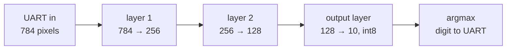
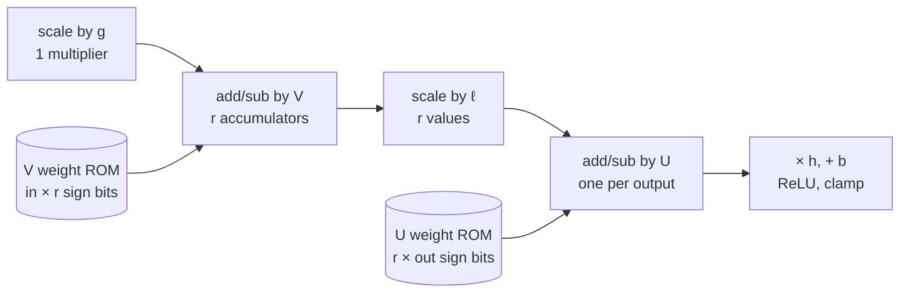
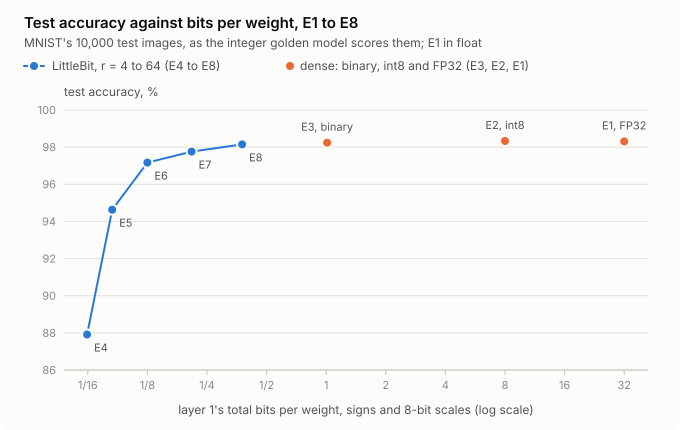
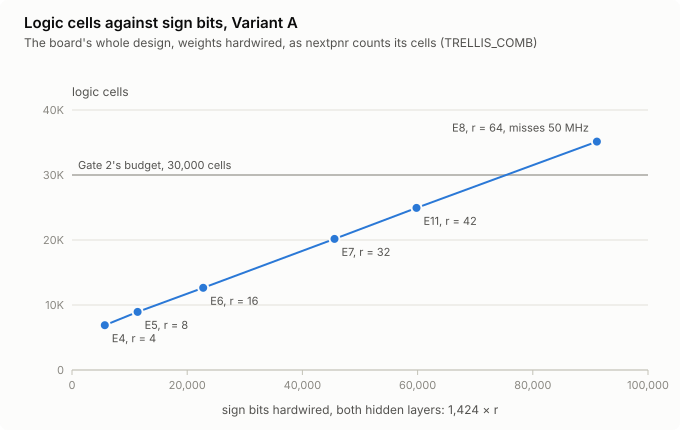

# Project #3: LittleBit × Taalas on a Colorlight i9

Research date for everything below: 2026-11-21, unless a line says otherwise.

A small neural network on the Colorlight i9, with its weights compressed to well under one bit
each and built into the FPGA's logic as constants. It measures what hardwiring low-bit weights buys
and what it costs, on a network small enough to check image by image. Nothing is built yet. It
needs no parts beyond the i9 and an extension board, already ordered for the digitizer
(`lab/sourcing.toml`), and a USB-A port to power them (`scope.md`, "Known part issues").

## What it is for

The point is a chip that runs SocialJax and Concordia as efficiently as possible, to simulate
social conflict and solve it before it happens, and local AI companions in a humanoid robot. Safety
first, and security at the hardware level is very important. (Jon, 2026-11-21.)

What the two run, read from their sources:

- **SocialJax** (cooperativex/SocialJax at 18e2171, Apache-2.0; arXiv 2503.14576) is a suite of
  multi-agent reinforcement-learning environments for sequential social dilemmas, written in JAX.
  Its IPPO baseline's network (`algorithms/utils/networks.py`) is three convolutions of 32 channels
  and a dense layer of 64, then an actor head of 64 that picks one of Clean Up's 9 actions from an
  11 × 11 × 19 observation (`socialjax/environments/cleanup/clean_up.py`). Our count from those
  files: 290,570 parameters with its critic head, 85 % of them in the dense layer, and 286,345 for
  the policy alone. The repo's Clean Up checkpoint is 1,163,141 bytes, the size of 290,570 float32
  numbers and 861 bytes more. That is the same order as this step's 234,752-weight MLP.
- **Concordia** (google-deepmind/concordia at d7da449, Apache-2.0) builds its agents from calls to
  a language model: it "requires access to a standard LLM API", and "You must also provide a text
  embedder for associative memory" (README). Its model registry lists local backends (Ollama,
  Hugging Face, vLLM, Gemma in PyTorch) beside hosted ones, as a search agent read it; not re-read.
  So its compute is language-model inference, the workload Taalas hardwires: its HC1 is "hard-wired
  with Llama 3.1 8B" (taalas.com, "The path to ubiquitous AI", 2026-02-19).

Hardwired weights are constants of the circuit. A chip built this way runs a network that is
already trained: new weights are a new bitstream on the i9, or a new chip in silicon, and training
stays on a computer. So this step tests the inference half: how accuracy, logic and clock speed
move as the bits per weight fall. How much a chip with hardwired signs could still learn, by
changing only its scales, is a first experiment of its own ("Training with the signs fixed").
Whether what it finds carries from a 234,752-weight network to the ones above is `unknown` until a
later step runs one of them.

What "as efficiently as possible" is measured by (Jon, 2026-11-23): beating GPUs on cost for
multi-agent simulations with trained agents, the price of a game step with the game and its policy
running ("The goal: cheaper than a GPU per game step", below).

That is the half the chip is for. Running SocialJax here means running simulations with agents
already trained: the chip runs their fixed policies, and training them stays on a GPU (Jon,
2026-11-23). SocialJax's agents learn by reinforcement learning, which changes the policy with
every update, and hardwired weights can't follow that.

This step drives nothing but a serial port and an LED. What safety first means for a robot is not
written yet. The rule Tentzhen has so far is the bench's: hard limits live in hardware an AI cannot
reconfigure (`vision.md`, principle 5).

**Security at the hardware level.** Jon names OpenTitan, more for the physical companion
(2026-11-21): "Open source silicon root of trust" (lowRISC/opentitan at 3cc49775, Apache-2.0),
written in SystemVerilog. Its tops are Earl Grey, Darjeeling and English Breakfast, and its FPGA
builds are Earl Grey's for the CW340 board and English Breakfast's for the CW305
(`hw/top_*/chip_*_cw3*.core`). Whether any of its tops fits the i9's LFE5U-45F is not checked, and
it is not part of this step. Tentzhen already has a research track for keys in a TROPIC01 secure
element (`roadmap.md`), and the mesh names an SE050 for its own board (`mesh.md`); whether one part
serves the bench, the mesh and the companion is not weighed. Hardwired weights have one property of
their own here: in silicon they cannot change without a new chip, while on the i9 they change with
the bitstream.

## Where this came from

Jon's spec of 2026-11-21, "LittleBit × Taalas on a Colorlight i9 — Project Spec", written in a
Claude session and brought in the same day. The research questions, the network, the checks, the
experiments and the phases are its. Changed here: the languages follow CLAUDE.md; it builds in this
repo, not a repo of its own; a board run is a measurement record; loading the board follows the
lab-target rules; the spec's open question about the extension board is answered from this repo;
and two bits-per-weight figures, the clock count, the image rate and the preloaded-image count are
worked out again. Phase 5 and research question 5 come from a second Claude session's answer that
Jon brought the same day ("so would i do openroad after the i9?"), kept where its sources were read:
LibreLane's repo and Tiny Tapeout's site.

## Research questions

1. **Quality vs. bits:** how does test accuracy fall as the factor rank r, and so the bits per
   weight, drops, for a fixed network shape?
2. **Same memory, bigger model:** at an equal weight-bit budget, does a wider network at very low
   bits beat a narrower one at higher bits?
3. **Hardwired vs. stored:** for the same weights, how do LUTs, block RAM, maximum clock and latency
   compare when the weights are logic constants (Variant A) and when they are read from block RAM
   (Variant B)?
4. **Hardware fit:** how many binary weights fit in the LFE5U-45F when hardwired, and what runs out
   first: LUTs, routing or timing?
5. **FPGA vs. silicon:** per weight bit, how much area and how many cells does a hardwired layer
   take when laid out as a chip, against the LUTs it takes on the i9?

Out of scope for this step: LLMs, making a chip (Phase 5 lays one out; making one is a stretch
goal), and training on the FPGA. Training runs in PyTorch on a computer; the FPGA only runs
inference.

## Hardware

The design fits one LFE5U-45F and leaves about 30 % of its LUTs free for routing and timing.

| resource | the LFE5U-45F has | budget | used for |
|---|---|---|---|
| LUT4s | 44k | ≤ 30,000 | Variant A's weight ROMs, adders, control, UART |
| block RAM (EBR) | 108 × 18 kbit, 1,944 kbit | ≤ 80 blocks | Variant B's weights, the input image and activation buffers |
| 18 × 18 multipliers | 72 | ≤ 32 | scale vectors and requantization only |
| clock | a 25 MHz oscillator | 50 MHz from the ECP5's PLL | 50 MHz first; higher in E12 |

The chip's figures are Lattice's (FPGA-DS-02012 3.4, Table 1.1; the PDF's sha256 26570f8b…,
read 2026-11-21). The chip is the i9 v7.2's LFE5U-45F-6BG381C (`scope.md`, "Architecture"), so
nextpnr takes `--45k --package CABGA381 --speed 6`. On arrival its JTAG IDCODE tells it from its
siblings without reading the marking: 0x41112043 (`builds/digitizer/v1.toml`, walkthrough).

**The board** is the i9 on any of the three extension boards (`scope.md`, "One i9, three extension
boards"), with nothing wired to the headers. Jon has two i9s, each in an extension board of its
own: his #1 and #2, here i9-1 and i9-2 (2026-11-22). The serial a load logs is the extension
board's probe's, not the i9's, so each i9 stays in its own extension board:

| unit | its probe's serial | port on the lab computer | IDCODE |
|---|---|---|---|
| i9-1 | `07000001006000573800001256313848a5a5a5a597969908` | COM3 | 0x41112043, LFE5U-45: lab log seq 9 of 2026-11-22 |
| i9-2 | `07000001005400333800001256313848a5a5a5a597969908` | COM4 | 0x41112043, LFE5U-45: seq 10 |

Gate 0 ran on i9-1: its loads, seq 2 and 4, name i9-1's probe. Gate 0's records name the part and
its revision, not the unit.

i9-2 has run the same blinky bitstream from SRAM (seq 11), with only its own board plugged in. Jon
saw its green LED blink about once a second (seq 12). It wasn't blinking before the load, as Jon
reported afterwards (seq 13). So the blink began with the load. Gate 0's blinky used a power
cycle as its control; this one uses before and after. What i9-2's flash holds is `unknown`.

**The PLL at 50 MHz.** Gate 0 ran at 25 MHz from the oscillator. The design will run at 50
MHz from the ECP5's PLL (the table above). So before the layer engine, Gate 0's echo and blinky ran
on i9-2 from the PLL at 50 MHz (`gateware/bringup/pll_echo.py`, 2026-11-23). The PLL's dividers are
the ones Project Trellis's `ecppll -i 25 -o 50` gives: 25 MHz, times 2, from a 600 MHz VCO.

| | the result | lab log, 2026-11-23 |
|---|---|---|
| before the load | the 25 MHz blinky, and no echo at 115,200 baud | seq 14, 15 |
| after it, at 115,200 baud | all 282 bytes back, in order, twice | seq 17, 19 |
| after it, at 57,600 baud, the rate it would echo at from 25 MHz | the first byte back already wrong | seq 18 |
| the LED, by eye | about once a second, not once every 2 s | seq 20 |

So the PLL locks, and the design runs near 50 MHz: `measured`, `2026-11-23-i9-pll-echo`. How near
isn't measured. Echoing at 115,200 baud only shows the clock is close enough for the UART. nextpnr
derives the 50 MHz constraint from the PLL's dividers by itself, and puts the routed design's limit
at 155.50 MHz. That is its timing model's figure, not a measurement. That the PLL refuses dividers
outside `ecppll`'s ranges is `tested` (`gateware/cores/tests/test_ecp5_pll.py`). So is the echo at
50 MHz and its divisor, 434, in cocotb without the PLL, which Verilator has no model of
(`uart_echo_at_50_mhz_sends_back_every_byte_at_115200_baud`).

**One layer on the board.** r16's first layer, 784 → 256 at rank 16, ran on i9-2 on the layer
engine at 50 MHz from the PLL (`gateware/bringup/littlebit_layer.py`, 2026-11-23). It answered every
input exactly as the golden model computes it: every y, and every z, the int32 before the shift and
clamp, of all 256 outputs. That is `measured`, `2026-11-23-i9-littlebit-layer`:

| | inputs | answered exactly as the golden model | lab log, 2026-11-23 |
|---|---|---|---|
| before the load (the PLL echo) | 1 frame | none: it came back as an echo | seq 21, 22 |
| the test vectors for the layer | 6 | 6 | seq 24 |
| MNIST's first 1,000 test images, shifted as the network shifts them | 1,000 | 1,000, in 180.0 s | seq 25 |

The computer sends a frame, 0xA5 and the layer's 784 input bytes. The design answers 0x5A and, for
each output, y and z, 1,281 bytes: 180 ms an input at 115,200 baud, the serial link's time, not the
engine's. A frame left part way is dropped after 100 ms of silence. `cargo run -p
tentzhen-littlebit -- layer <port> (vectors | mnist <count>)` is the computer's side
(`crates/littlebit/src/board.rs`). In cocotb, without the PLL and at a UART divisor of 8, the same
design answers two frames as the golden model does and drops a part one
(`gateware/bringup/tests/test_littlebit_layer.py`). Built, it takes 6,422 of nextpnr's logic cells,
2 DP16KD blocks for the outputs' FIFO, and closes at 55.99 MHz; the weights stay logic, as the
Yosys log shows (`littlebit_layer.layer.fifo.storage` is the only memory it maps to block RAM).
This is one layer, not check 3, which takes the whole network's scores and digit.

**Load with one board on USB.** openFPGALoader 1.2.0 can't choose between two identical CMSIS-DAP
v1 probes:

- With both plugged in and no index, it refuses: "more than one CMSIS-DAP v1 device".
- `--cable-index` matches the probe's USB interface number, which is 3 on both, so it opens
  whichever probe the system lists first. In seq 9 that was i9-1's.
- Choosing by serial or by USB bus and device isn't supported for these probes.

That is what 1.2.0 did here, and what its source at master does (`src/cmsisDAP.cpp`, read
2026-11-22). So a load is made with only its own board plugged in. The serial it logs is the one
openFPGALoader reports opening.

The board uses:

- **Clock:** 25 MHz on ball P3. From it the ECP5's PLL, EHXPLLL, makes 50 MHz
  (`gateware/cores/ecp5_pll.py`).
- **LED:** ball L2, lit when driven low; the same ball is P2 pin 28.
- **UART:** balls J17 (out of the FPGA) and H18 (in), wired to the extension board's DAPLink, which
  gives the computer a USB serial port (`builds/digitizer/v1.toml`, its header notes).
- **Loading a bitstream:** openFPGALoader's `colorlight-i9` board, through the DAPLink as a
  CMSIS-DAP cable (openFPGALoader at 2aafd902, `src/board.hpp`). It writes the FPGA's SRAM by
  default, so a bitstream is gone at power-off; `-f` writes the flash (its README, same commit).

The balls are LiteX's for the i9 v7.2 (litex-boards at 53dc2ed0,
`litex_boards/platforms/colorlight_i5.py`, `_io_v7_2`). An Amaranth platform for the i9 exists in
Muse Lab's own repo, `src/amaranth_boards/colorlight_i9_r7_2.py` (wuxx/Colorlight-FPGA-Projects at
016e5889, Apache-2.0): the chip, the 25 MHz clock on P3, the LED on L2, and the headers, with the
UART's balls on its P5 connector and no UART resource of its own. Its comment says "Some of these
still need verifying". Upstream amaranth-boards has no i9 (at f270d210). Ours,
`gateware/boards/colorlight_i9.py`, has the clock, the LED and the UART. On our board the clock and
the LED are `measured` (`2026-11-22-i9-blinky`), and so is the UART, TX on J17 and RX on H18
(`2026-11-22-i9-uart-echo`).

**Loading the board is a flash.** Loading code into a board counts as flashing it, into SRAM too
(`lab/targets.toml`). The i9 is not a lab target, so until a person lists it, every load needs a
person's approval in the session, and every load is logged as a `firmware.flash`.

## Languages and layout

| piece | language | where |
|---|---|---|
| training and the rank sweep | Python, PyTorch: the exception CLAUDE.md names for it | `models/littlebit/` |
| SocialJax's Clean Up and its trained policy, played on the computer | Python, JAX, as SocialJax is written: CLAUDE.md's exception for it. `behaviour.py` only reads their outputs, so it is outside the exception, and stays Python until it is written in Rust | `models/cleanup/` |
| the weight export and the integer golden model | Rust | `crates/littlebit` |
| Clean Up's golden model, so far JAX's random numbers | Rust | `crates/cleanup` |
| the layer engine, the output layer, the weight-ROM generator, the whole network | Amaranth | `gateware/cores/littlebit.py` |
| a layer as a hardwired kernel, a window a clock | Amaranth | `gateware/cores/littlebit_kernel.py` |
| the UART | Amaranth | `gateware/cores/uart.py` |
| the top level: the network behind the UART | Amaranth | `gateware/littlebit/network.py` |
| tests of the gateware | cocotb on Verilator, run by pytest | `gateware/cores/tests/` and `gateware/littlebit/tests/` |
| the host: sends inputs, compares answers | Rust, `tentzhen-littlebit`'s commands | `crates/littlebit` |

Each directory is made when its first real file arrives (`roadmap.md`, Phase 0).

The pieces meet at one file: the exported weights (signs, scales, shifts and biases) as JSON,
`models/littlebit/runs/<run>/integer.json`. The golden model and the ROM generator both read it, so
they cannot read different weights. The golden model also writes out the intermediate vectors and
scores that the cocotb tests compare against.

The export is in Rust, not Python, although it's part of the model work (2026-11-22). It needs no
PyTorch, only a run's committed weights and the training images. In Rust, the Quality Gate
re-runs it and fails if the committed file differs (`r16_integer_json_is_what_the_exporter_writes`).
It also measures each layer's latent shift with the golden model's own arithmetic, so the two can't
disagree about it.

Why these for this project: in Amaranth, the ROM generator is Python that builds the circuit from
the JSON, with no Verilog text to template; Rust makes every integer widening explicit and stops a
test on an overflow, which is what "integer-exact" asks of the golden model; and the host writes the
lab log and the records, which are Rust already.

**Toolchain:** Yosys, nextpnr-ecp5, Project Trellis, Verilator, cocotb and Amaranth, pinned with the
rest (`roadmap.md`, Phase 0), plus PyTorch and openFPGALoader. Until that pinned toolchain exists,
training runs in `models/littlebit/`'s uv environment: Python 3.12.15, PyTorch 2.15.0 (its CUDA
13.2 build on Windows and Linux) and NumPy 2.5.5, every package pinned by its `uv.lock`, and
`every_python_dependency_is_pinned` holds the pins it names. Amaranth's ECP5 platform runs Yosys,
nextpnr-ecp5 and ecppack itself (amaranth at 90449f1e, `amaranth/vendor/_lattice.py`). nextpnr's
`--report` writes a "timing and utilization report in JSON format" (nextpnr at 15b77f5f,
`common/kernel/command.cc`), the source of each run's LUT, EBR and Fmax figures. MNIST is fetched
and checked against a pinned sha256; its terms are not read, so it is not committed. Phase 5 adds
LibreLane, "ASIC implementation flow infrastructure, successor to OpenLane" (Apache-2.0,
librelane/librelane at 8494d4fe), whose README recommends installing it with Nix; Tiny Tapeout's
local-hardening guide runs it in Docker (TinyTapeout/tinytapeout_www at ce1fff22). It runs on
GitHub's computers, in LibreLane's Docker image, as Tiny Tapeout's GDS action does, with the
version and the action pinned, not on the lab computer (Jon, 2026-11-21; `prior-art.md`, "A
chip's layout").

## Model

The baseline is a 784 → 256 → 128 → 10 MLP on MNIST, 234,752 weights. The two hidden layers use
LittleBit-style factorized binary weights. The output layer stays dense int8: it has 1,280 weights.

**Layer math.** Each LittleBit layer replaces its weight matrix W (out × in) with two binary factors
and three scale vectors:

```math
y = h \odot \Big( U_s \big( \ell \odot ( V_s^{\top} ( g \odot x ) ) \big) \Big) + b, \qquad U_s \in \{\pm 1\}^{\text{out} \times r},\; V_s \in \{\pm 1\}^{\text{in} \times r}
```

g (length in), ℓ (length r) and h (length out) are learned scales; b is a bias. Multiplying by U_s
or V_s is only addition and subtraction.

**Bit accounting.** Every run reports both numbers, because at this size the scales are a real
share of the budget:

```math
\text{sign bpw} = \frac{r\,(\text{in} + \text{out})}{\text{in} \cdot \text{out}}, \qquad \text{total bpw} = \frac{r\,(\text{in} + \text{out}) + 8\,(\text{in} + \text{out} + r)}{\text{in} \cdot \text{out}}
```

The 8 is for 8-bit scales; it changes if the export uses 16-bit ones. It is the paper's Eq. 16
without the residual path, and with 8 bits a scale where the paper's are FP16, 16 bits each (arXiv
2506.13771v5, Appendix D). Neither counts the bias, an int32 per output: 8,192 bits on layer 1,
about as many as its signs at r = 8.

**Rank sweep for layer 1** (784 → 256, 200,704 weights):

| rank r | sign bits | sign bpw | total bpw, 8-bit scales |
|---|---|---|---|
| 4 | 4,160 | 0.021 | 0.062 |
| 8 | 8,320 | 0.041 | 0.083 |
| 16 | 16,640 | 0.083 | 0.125 |
| 32 | 33,280 | 0.166 | 0.209 |
| 64 | 66,560 | 0.332 | 0.376 |

`tested`: `the_littlebit_bit_counts_follow_from_the_formula` recomputes this table from the formula,
and the experiments' bits-per-weight column from it, E3's binary row too. Layer 2 (256 → 128) uses
the same r. The baselines have the same shape: dense FP32, dense int8, and plain binary weights
(1 bit per weight, one scale per output).

**Training recipe** (Jon's spec):

1. Train the FP32 MLP (Adam, learning rate 1e-3, cosine decay, about 20 epochs) and record its
   accuracy as the ceiling.
2. Start each LittleBit layer from its FP32 weights: a truncated SVD to rank r, the signs of the
   factors become U_s and V_s, and the magnitudes are folded into g, ℓ and h. The paper's Dual-SVID
   does it this way: a rank-1 approximation of |U′| gives h and one latent scale, one of |V′| gives
   g and another, and ℓ starts as their element-wise product (arXiv 2506.13771v5, section 3.2,
   Eqs. 6–8).
3. Fine-tune with quantization-aware training: sign() in the forward pass, and a straight-through
   estimator in the backward pass (the gradient passed where |w| ≤ 1). About 20 epochs. The paper
   instead uses SmoothSign ("backward gradient: tanh(kx), k = 100"), reporting it better than the
   straight-through estimator, and distils from the full-precision model as teacher (section 4.1,
   Appendix B.2).
4. Fake-quantize activations to uint8 during training (ReLU, then a per-layer power-of-two scale),
   so that the trained model matches the integer hardware.
5. Optional, after the core sweep: the paper's Residual Compensation, which splits the same bit
   budget into two lower-rank paths, the second started on what the first leaves (section 3.3).
   Measure whether two paths beat one at the same bits.

The paper's code (SamsungLabs/LittleBit at 42d658b) is under CC BY-NC 4.0, for non-commercial use
only, so Tentzhen writes its layer from the paper and copies none of that code.

**The first LittleBit run, r = 16** (`models/littlebit/littlebit.py` and `train_rank.py`,
2026-11-22). It runs steps 2–4 from E1's committed weights. Whatever the recipe and the paper
leave open was chosen before the run:

- **Dual-SVID's splits.** The paper doesn't say how W's singular values are shared between U′ and
  V′, or how each rank-one fit is split between its two vectors. Here each side takes the square
  root, both times. U and V start as U′ and V′, as the paper has them.
- **The sign.** +1 where the latent weight is ≥ 0, −1 elsewhere, with step 3's straight-through
  gradient rather than SmoothSign.
- **The input.** Pixels enter as ⌊p / 2⌋ / 128, the 0–127 inputs of "Fixed-point formats".
- **The activations.** Each hidden layer's outputs are uint8 times 2^e: ⌊y / 2^e⌋ clamped to
  0–255, the same as the hardware's shift, ReLU and clamp. Each e is fixed before training: the
  smallest that clamps nothing the started model gives on the training images. That is −5 after
  layer 1 and −4 after layer 2.
- **What stays float.** The scales g, ℓ and h and the output layer stay float in training. The
  exporter makes them integers, and check 1 measures what that costs. At r = 16 it costs nothing
  (Verification, "Check 1 passes at r = 16").
- **The training.** E1's settings: Adam at 1e-3, cosine decay to 0 over 20 epochs, batches of 128,
  seed 0, and cross-entropy on the labels. It doesn't distil from E1, as the paper does.

The run gets 9,713 of the 10,000 test images right, 97.13 %, which is 1.18 points under E1. It also
gets 58,798 of the 60,000 training images. Both counts are `tested` by
`r16_scores_what_its_summary_says`, which re-scores the committed weights
(`models/littlebit/runs/r16`) with the signs and the uint8 grid in its own f32 arithmetic. Three
runs gave the same weights, byte for byte, in about 50 s each on the lab computer's GPU (each
summary's `seconds`).

Before any fine-tuning, the network as Dual-SVID started it got 4,710 test images right. That is
PyTorch's count in the summary, and no test re-checks it. In the summary's curve, the test count
moved between 9,418 and 9,686 over the first 19 epochs, and rose as the learning rate fell to 0.
Whether a smaller learning rate or the paper's distillation would do better is `unknown`. A run
that chooses between them should choose on images held out of the training set, not on the test
images.

**The baselines, E2 and E3** (`models/littlebit/train_baseline.py`, 2026-11-23). They follow r16's
recipe in everything but the hidden layers, so a baseline and a LittleBit run differ only there.
Each starts from E1's committed weights, with pixels as ⌊p / 2⌋ / 128, uint8 activations whose
exponents are fixed before training, E1's training settings and a dense output layer. What
differs was chosen before the runs:

- **E2, int8.** The hidden layers are dense. Their weights stay float in training, as the output
  layer's do, and the exporter makes them int8, each matrix on one power-of-two grid, as it makes
  the output layer's. Check 1 measures what that costs.
- **E3, binary.** Each hidden layer is y = h ⊙ (sign(W) x) + b, with one scale per output. W
  starts as E1's weights, each h as the mean of |W| along its output's row, and b as E1's bias.
  That h is the scale that brings h sign(W) closest to W in squared error. The sign and its
  gradient are r16's.

| run | test images right, float | integer | the same digit, float and integer | training images right, float | activation exponents |
|---|---|---|---|---|---|
| E2, int8 | 9,835 (98.35 %) | 9,833 (98.33 %) | 9,992 | 60,000 | −4, −3 |
| E3, binary | 9,824 (98.24 %) | 9,824 (98.24 %) | 9,991 | 60,000 | −4, −4 |

These counts are `tested`. `e2_scores_what_its_summary_says` and `e3_scores_what_its_summary_says`
re-score the committed weights in f32 (`models/littlebit/runs/e2` and `e3`), and
`e2_and_e3_integer_are_within_half_a_point_of_float` exports them as integers and scores them. So
check 1 holds for both: E2 loses 2 images to its int8 weights, and E3 loses none in all, though
its integer and float models pick different digits on 9 images. Two runs of each gave the same weights, byte for byte, in 24 s (E2) and 38 s (E3) on the
lab computer's GPU.

A baseline runs on the computer only, so its integer network is not written to a file. The test
exports it from the committed weights as it scores it (`export::baseline` in `crates/littlebit`).
E2's hidden weights land on a grid of 2^−7, and E3's scales on one of 2^−9.

What the counts show:

- **E2 in float gets 4 more test images right than E1,** 9,835 against 9,831. Several things
  could explain it: the hardware's pixel and activation grids, 20 more epochs, or chance. Which
  one it is, is `unknown`, since no run separates them.
- **E3, at about 1 bit a weight, is 7 images under E1** and 107 above r16's integer model, which
  has 0.125 bits a weight in layer 1.
- **Both get all 60,000 training images right,** as E1 does. r16 gets 58,798.

Each started where its summary says, before fine-tuning: E2 at 9,828 test images right, E3 at
8,535. Those are PyTorch's counts, and no test re-checks them.

**The rest of the rank sweep, E4, E5, E7 and E8** (`models/littlebit/train_rank.py`, 2026-11-23).
These are r16's run at r = 4, 8, 32 and 64, with nothing else changed, each exported as r16 is:

| run | r | test images right, float | integer | the same digit, float and integer | training images right, float / integer | latents saturated, test images | activation exponents |
|---|---|---|---|---|---|---|---|
| E4 | 4 | 8,802 (88.02 %) | 8,791 (87.91 %) | 9,932 | 52,869 / 52,850 | 1 | −5, −5 |
| E5 | 8 | 9,464 (94.64 %) | 9,463 (94.63 %) | 9,974 | 57,036 / 57,018 | 0 | −5, −5 |
| E6 | 16 | 9,713 (97.13 %) | 9,717 (97.17 %) | 9,980 | 58,798 / 58,809 | 0 | −5, −4 |
| E7 | 32 | 9,772 (97.72 %) | 9,776 (97.76 %) | 9,993 | 59,602 / 59,597 | 0 | −5, −5 |
| E8 | 64 | 9,814 (98.14 %) | 9,815 (98.15 %) | 9,993 | 59,887 / 59,886 | 0 | −4, −5 |

`tested`: `the_sweep_scores_what_its_summaries_say` re-scores each run's committed weights in f32
(`models/littlebit/runs/r4`, `r8`, `r32` and `r64`). `the_sweep_s_integer_json_is_what_the_exporter_writes`
and `the_sweep_s_integer_is_within_half_a_point_of_float` check the exports and their counts. E6's
row is r16's, from the tests above. Two runs at each rank gave the same weights, byte for byte, in
about a minute each.

What the counts show:

- **Check 1 holds at every rank.** The largest loss from float to integer is E4's, 11 images.
- **Accuracy falls fast below r = 16.** As integers, r = 8 gets 254 fewer test images right than
  r = 16, and r = 4 gets 926 fewer. This is the plan's first risk, "accuracy collapses at low r"
  (Risks). Whether residual compensation or the paper's distillation would hold it up is
  `unknown`: neither has run.
- **Above r = 16 it gains slowly.** In float, r = 64, at 0.376 bits a weight in layer 1, gets 17
  fewer images right than E1. E3, at 1.010 bits, gets 7 fewer.
- **One latent saturates at r = 4, on one test image.** The latent shift is chosen so that none
  saturates on the training images. On the test images, this one did.

Before fine-tuning, Dual-SVID's starts got 2,906, 4,164, 5,282 and 5,303 test images right at
r = 4, 8, 32 and 64. Those are PyTorch's counts, and no test re-checks them.

**E10, the wider network** (`models/littlebit/e1_fp32.py` and `train_rank.py`, 2026-11-23).
Research question 2 asks whether, at the same weight bits, a wider network at fewer bits a weight
beats a narrower one at more. E10 is the 784 → 1024 → 512 → 10 MLP, made LittleBit as the sweep's
are, at the rank whose hidden layers hold E7's bits. What "the same weight bits" means was fixed
before training: the two hidden layers' bits, signs and 8-bit scales, as "Bit accounting" counts
them. r = 9 is the largest rank whose hidden layers hold no more than E7's:

| run | widths | r | sign bits | 8-bit scales | the hidden layers' bits | the output layer's int8 weights |
|---|---|---|---|---|---|---|
| E7 | 784 → 256 → 128 → 10 | 32 | 45,568 | 11,904 | 57,472 | 10,240 |
| E10 | 784 → 1024 → 512 → 10 | 9 | 30,096 | 26,896 | 56,992 | 40,960 |
| E10's shape at r = 10 | 784 → 1024 → 512 → 10 | 10 | 33,440 | 26,912 | 60,352 | 40,960 |

`tested`: `the_littlebit_bit_counts_follow_from_the_formula` recomputes this table from the widths,
and `e10_weights_are_the_ones_their_summaries_name` recomputes E10's and E7's hidden-layer bits from
their committed runs. The output layer can't be held to E7's. It stays dense int8, and with 512
inputs its weights alone hold 30,720 bits more than E7's, more than the hidden layers could give
up. So E10 holds more bits in all, and the budget is the hidden layers'. Neither counts the biases.

E10 needs a start of its own shape, as the sweep starts from E1. E10's start is that MLP, dense in
FP32, trained as E1 was (`e1_fp32.py`, given the widths). E10 is r16's run on it at r = 9, with
nothing else changed (`train_rank.py`, given the start), and it is exported as r16 is:

| run | test images right, float | integer | the same digit, float and integer | training images right, float / integer | latents saturated, test images | activation exponents |
|---|---|---|---|---|---|---|
| E10's start, dense FP32 | 9,856 (98.56 %) | — | — | 60,000 / — | — | — |
| E10, r = 9 | 9,555 (95.55 %) | 9,546 (95.46 %) | 9,976 | 57,827 / 57,803 | 0 | −5, −5 |
| E7, r = 32 | 9,772 (97.72 %) | 9,776 (97.76 %) | 9,993 | 59,602 / 59,597 | 0 | −5, −5 |

`tested`: `e10_scores_what_its_summaries_say`, `e10_integer_json_is_what_the_exporter_writes` and
`e10_integer_is_within_half_a_point_of_float` (`models/littlebit/runs/e10-start` and `e10`). Two
runs of each gave the same weights, byte for byte, in 17 s for the start and 55 s for E10. Moving
the shape out of the two scripts left E1, r16 and E2 as they were: run again, each gave its
committed weights, byte for byte.

What it answers, for research question 2:

- **At E7's bits, the wider network loses.** E10 gets 9,546 test images right as integers, 230
  fewer than E7's 9,776. Its dense start gets 25 more than E1, 9,856 against 9,831, so the width
  helps in float and not at this budget.
- **Its scales hold nearly half its bits.** At these widths E10's 8-bit scales hold 26,896 bits,
  against E7's 11,904. That leaves its signs 30,096 bits, at r = 9, against E7's 45,568 at
  r = 32. Whether that is why it loses is `unknown`.
- **As integers it lands between E5 and E6,** r = 8 and r = 16 of the narrow network: 9,463 and
  9,717.
- **Check 1 holds,** 9 images fewer as integers.

That is one recipe at one seed, without the paper's distillation or residual compensation, at one
budget. Whether a wider network would win with them, or at a larger budget, is `unknown`. Before
fine-tuning, E10's Dual-SVID start got 4,849 test images right, PyTorch's count, which no test
re-checks.

**Fixed-point formats,** fixed at export and the same in the golden model and the gateware:

- Input pixels: uint8, 0–255 scaled to 0–127.
- Scales g, ℓ and h: int8, with one power-of-two shift per vector. Bias: int32.
- Accumulators: int32 everywhere (784 terms of int16 need at most 26 bits).
- The ℓ-scaled latents: each V sum times its int8 ℓ, a product of at most 33 bits, then an
  arithmetic right shift by the layer's latent shift, saturated to int16.
- Between layers: arithmetic right shift, ReLU, clamp to uint8.
- The output layer's weights: int8, with one power-of-two shift for the whole matrix.
- Output: 10 int32 scores. The predicted digit is their argmax, computed on the FPGA.

Every right shift is arithmetic, so it rounds toward minus infinity, and nothing rounds to nearest
while the network runs. The exporter rounds to nearest only once, when it turns the float weights
into integers. The golden model follows these steps in `crates/littlebit/src/integer.rs`, and
`a_littlebit_layer_computes_what_its_steps_say` works one small layer by hand against it.

How the exporter chooses each value (`crates/littlebit/src/export.rs`):

- **Scales and output weights.** Each vector, or the output matrix, gets the finest power-of-two
  grid that holds its largest value in 127 steps
  (`int8_takes_the_finest_grid_that_holds_the_largest`).
- **Latent shifts.** Each layer's is the smallest that saturates no latent on the 60,000 training
  images (`r16_integer_saturates_no_latent_on_the_training_images`). At r = 16 that is 10 for
  layer 1 and 9 for layer 2. No latent saturates on the test images either
  (`r16_integer_is_within_half_a_point_of_float`).
- **Output shifts.** These put each layer's outputs on the grid it trained on, so an output is
  ⌊y / 2^e⌋ clamped to 0–255, as in training.

A layer's exponents add up to that grid, and `Network::parse` refuses a file where they don't
(`an_integer_network_refuses_what_does_not_fit`). At r = 16, layer 1's add up to −5:

- pixels −7
- g −8
- ℓ −7
- latent shift +10
- h −8
- output shift +15

The 33-bit ℓ product is wider than one of the ECP5's 18 × 18 multipliers takes. How the gateware
forms it is Phase 2's to decide.

## Hardware architecture

The design is time-multiplexed: each LittleBit layer takes one input per clock and updates all its
accumulators at once. That keeps the adders small. Between runs at one rank only the weight ROMs,
the thing being studied, change; a new rank also changes how many accumulators the V stage has.



Layers 1 and 2 each get a LittleBit engine of their own, so they run as a pipeline. The output layer
uses 10 multipliers at once, one per digit: each input, one a clock, is multiplied by its column of
the weights and added into 10 accumulators that start from the biases. Then the argmax reads the
10 scores one a clock and keeps the first of the highest, as the golden model does
(`DenseEngine` and `LittleBitNetwork` in `gateware/cores/littlebit.py`). One engine:



The two weight ROMs are what the experiments change. In Variant A they are logic constants
generated from the trained weights; in Variant B the same bits sit in block RAM.

**Per-layer schedule** (r = rank), as the engine runs it (`gateware/cores/littlebit.py`):

1. Scale by g, then add or subtract by V: one input per clock for `in` clocks, and one more. Each
   input's row of V (r sign bits) adds it into, or subtracts it from, r accumulators.
2. Scale by ℓ: one latent per clock for r clocks, each shifted, saturated to int16 and kept.
3. Add or subtract by U, scale by h, add the bias, ReLU, clamp to uint8: one output per clock for
   `out` clocks. Each clock reads one row of U (r sign bits) and sums the r latents by it in one
   adder tree, then one multiplier scales the sum.

The plan first had stage 2 read U's columns and update `out` accumulators at once. Synthesized for
r16's first layer, those 256 accumulators came to 18,778 LUT4s and 3,106 carry cells (Yosys, OSS
CAD Suite 2026-11-21, 2026-11-23): more than both layers' budget. Summing each output's r latents
in stage 3 instead brought the layer to 5,973 of nextpnr's logic cells. Each stage also keeps its
values for a clock between reading a ROM and the arithmetic after it. Without those registers,
nextpnr's first routes of the two layers reached 40.72 and 44.80 MHz, short of 50.

**Clocks per image.** The engine takes in + r + out + 1 clocks a vector, and its last output comes
2 clocks after that. With inputs back to back, that is `tested`: 1,057 clocks for r16's layer 1
and 401 for its layer 2 (`littlebit_engine_computes_r16_layer_1_as_the_golden_model_does`,
`littlebit_engine_computes_r16_layer_2_as_the_golden_model_does`). Run one after another, the
three layers would take 1,554 + 2r clocks. The network overlaps them instead. Each engine hands
its outputs to the next as it makes them, one a clock, and the next takes them as they come:

- Layer 2 takes its first input 784 + 1 + r + 3 clocks after layer 1 takes the first pixel.
- The output layer takes its first input 256 + 1 + r + 3 clocks after that.
- It then takes its 128 inputs, adds the last a clock later, and runs the argmax in 10.

That makes 1,187 + 2r clocks from the first pixel to the digit: 1,219 at r = 16, 24.4 µs at
50 MHz. It is `tested` as both the design's cycle counter and the test count it
(`littlebit_network_scores_r16s_test_vectors_as_the_golden_model_does`). The spec estimated
1,550 + 4r. On the board the counter reported 1,219 for each of the 1,006 images it was sent,
`measured`, `2026-11-23-i9-littlebit-network`. At exactly 50 MHz that is 24.38 µs, or 41,017
images a second if the link kept up. The PLL's clock is `measured` only as close enough to 50 MHz
for the UART at 115,200 baud (`2026-11-23-i9-pll-echo`), not to how many places.

**The serial link sets the pace.** At 115,200 baud and 10 bits a byte (8N1, assumed), the 785-byte
request takes 68.1 ms and the 46-byte reply 4.0 ms: at most 13.9 images a second, however fast the
network is. So each run reports two speeds, compute from the cycle counter and end to end. End to
end, the board run managed 13.73 images a second, 1,000 images in 72.8 s, `measured`,
`2026-11-23-i9-littlebit-network`. The DAPLink's top baud rate is `unknown`.

For a throughput test that leaves the link out, the spec preloaded 512 test images into block RAM.
They do not fit: 512 images take 401,408 bytes, and all 108 blocks hold 248,832 (1,944 kbit), so
fewer than 318 images would fit with nothing else in block RAM. The i9's 8 MB of SDRAM (`scope.md`)
or its 8 MB W25Q64 flash (the Amaranth platform above) hold 512, behind a controller this design
does not have yet.

**UART protocol**

| direction | bytes | contents |
|---|---|---|
| computer → FPGA | 1 + 784 | header 0xA5, then 784 uint8 pixels as MNIST stores them; the FPGA shifts them |
| FPGA → computer | 1 + 40 + 1 + 4 | header 0x5A, 10 int32 scores (little-endian), the argmax digit, the cycle count (uint32, little-endian) |

The top level, `gateware/littlebit/network.py`, keeps a frame's pixels in a FIFO until the last one
arrives. Then it feeds them to the network back to back, so the cycle count covers the network
alone, not the serial link. A frame left part way is dropped after 100 ms of silence, as the one
layer's was. In cocotb, without the PLL and at a UART divisor of 8, it answers two frames as the
golden model does, each in 1,219 clocks, and drops a part one
(`gateware/littlebit/tests/test_network_over_uart.py`). `cargo run -p tentzhen-littlebit --
network <port> (vectors | mnist <count>)` is the computer's side (`crates/littlebit/src/board.rs`):
it sends each image as a frame, checks each answer's scores and digit against the golden model's,
and reports the clocks the network counted.

**Variant A and Variant B in Amaranth**

- **A, hardwired:** the generator, `ROM` in `gateware/cores/littlebit.py`, builds each ROM as a
  tree of 2:1 multiplexers on the constant rows, one level per bit of the row index. Yosys turns it
  into LUT logic, so the weights become part of the circuit. The plan had a `Switch` over the row
  index with a constant on each `Case`. But Yosys's `proc_rom` pass turns such a `Switch` into a
  memory, and once the engine registered a ROM's output, `synth_ecp5` put layer 1's ROMs in 4
  DP16KD blocks of block RAM: Variant B, not A. A tree of multiplexers is no `Switch`, and gave no
  block RAM.
- **B, stored:** the same bits are the initial contents of an Amaranth memory, `StoredROM`, which
  Yosys maps to block RAM. That holds for every table whose row an engine keeps in a register a
  clock before using it: each hidden layer's g, V, U, h and bias, and the output layer's weights.
  ℓ's r values are read on the clock they're used, and stay logic. So do the output layer's 10
  biases, which are where its accumulators start. A memory gives its row a clock after it is
  asked, so each is asked a clock early, for the row the engine will need next. The row then goes
  into the same register as in Variant A, and the network takes the same clocks. Each memory is
  marked `ram_style = "block"`, and the Yosys log shows where each landed ("E9, the weights in
  block RAM", below). `python -m gateware.littlebit.network --variant B <build-dir>` builds it.

**What the engines cost.** nextpnr's report for each of r16's two engines alone, at 50 MHz
(OSS CAD Suite 2026-11-21, seed 1; `python -m gateware.cores.littlebit` writes one as Verilog,
2026-11-23):

| r16 | logic cells (TRELLIS_COMB) | flip-flops | 18 × 18 multipliers | block RAM | Fmax after routing |
|---|---|---|---|---|---|
| layer 1, 784 → 256 | 5,973 | 1,093 | 5 | 0 | 58.64 MHz |
| layer 2, 256 → 128 | 4,236 | 1,055 | 5 | 0 | 60.12 MHz |

Those are the toolchain's figures, `trusted` with it (`trusted-base.toml`, `fpga-toolchain`), and
the engines alone, with no UART, output layer or top level. Together they take 10,209 of the
30,000 cells Gate 2 allows. The spec estimated layer 1's U-stage accumulators at a few thousand
LUTs, and the hardwired ROMs at about 1,000–1,500.

**What the whole network costs.** The board's design: r16's two engines, its output layer, the
argmax, the cycle counter, the pixel FIFO, the UART, the blinky and the PLL
(`python -m gateware.littlebit.network <build-dir>`, OSS CAD Suite 2026-11-21, 2026-11-23).
nextpnr reports:

| r16, the board's design | logic cells (TRELLIS_COMB) | flip-flops | 18 × 18 multipliers | block RAM | Fmax after routing |
|---|---|---|---|---|---|
| `littlebit_network` | 12,640 | 3,050 | 20 | 1 DP16KD | 55.63 MHz |

That is within Gate 2's 30,000 at 50 MHz, `trusted` with the toolchain (`fpga-toolchain`). The one
DP16KD is the pixel FIFO. The Yosys log maps one memory to block RAM,
`littlebit_network.network.pixels.storage`, so the weights stay logic. The bitstream's sha256 is
754c51aef2aabe3598296aacbada86a962afd274002b39c0ab929c387d52047b. Rebuilt from main at 34dedf8,
it came out the same, byte for byte, and that is the bitstream check 3 ran on (Verification,
"Check 3 passes at r = 16").

**What each rank costs.** Each rank of the sweep is the same board design built from its own
integer network (`python -m gateware.littlebit.network <build-dir>
models/littlebit/runs/r<r>/integer.json`, OSS CAD Suite 2026-11-21, 2026-11-23). r16, built the
same way on this branch, came out as the bitstream above, byte for byte. nextpnr reports:

| run | r | logic cells (TRELLIS_COMB) | flip-flops | 18 × 18 multipliers | block RAM | Fmax after routing | bitstream's sha256 |
|---|---|---|---|---|---|---|---|
| E4 | 4 | 6,889 | 1,616 | 18 | 1 DP16KD | 55.27 MHz | `ed3d189e…` |
| E5 | 8 | 8,939 | 2,086 | 20 | 1 DP16KD | 50.06 MHz | `b41e697e…` |
| E6 | 16 | 12,640 | 3,050 | 20 | 1 DP16KD | 55.63 MHz | `754c51ae…` |
| E7 | 32 | 20,172 | 4,973 | 20 | 1 DP16KD | 50.43 MHz | `1b92ff46…` |
| E8 | 64 | 35,139 | 8,815 | 20 | 1 DP16KD | 49.55 MHz, short of 50 | none to load |

These are the toolchain's figures, `trusted` with it (`fpga-toolchain`). None of these bitstreams
but r16's has been loaded onto a board. What they show:

- **The logic grows with the rank, about linearly.** Across the five builds, each step of r adds
  about 470 cells, on top of about 5,000 for the rest: (35,139 − 6,889) / (64 − 4) = 471. That's
  arithmetic on these five figures, not a model of the logic.
- **E8 doesn't fit the plan.** At r = 64, its 35,139 cells are over the 30,000 that Gate 2 allows,
  though they're 80 % of the chip's 43,848, so the chip isn't full. Its route also misses 50 MHz,
  at 49.55. nextpnr stops with an error when a clock is missed. A bitstream packed from its
  output anyway is not one to load, and none is kept.
- **So, for research question 4,** at r = 64 timing runs out before the chip's logic does, and
  routing completes. The largest rank that fits, E11, is r = 42 ("E11, the largest rank that
  fits", below).
- **Two ranks only just close.** r = 8 reaches 50.06 MHz and r = 32 reaches 50.43, slower than
  r = 4 and r = 16. Why is `unknown`. nextpnr's placement is a seeded search, and each build ran
  at its default seed.
- **E4 uses 18 multipliers, and the rest 20.** Why is `unknown` too.

The clocks an image are the cocotb test's: each rank's network scores its six test images as its
golden model does, in 1,187 + 2r clocks, which is 1,195, 1,203, 1,251 and 1,315
(`littlebit_network_scores_the_sweep_s_test_vectors_as_the_golden_model_does`). That test runs
r16's six images through each network. Only r16 has run all 10,000 MNIST test images in cocotb
(check 2) and 1,000 on the board (check 3).

**E11, the largest rank that fits** (2026-11-23). "Fits" means the whole board design places,
routes and closes at 50 MHz in nextpnr, at its default seed, as the experiments table has it.
How to search was fixed before the first build:

1. Raise r from 32, which fit, in steps of 8, to the first rank that doesn't.
2. Then bisect between the last that fit and the first that didn't, down to a step of 1.
3. Train each rank tried as the sweep's were, export it, check it, and build it once.

r = 56 was built alongside 40 and 48, before the bisection. It isn't part of the search, and
its build didn't finish. nextpnr's router was still running 32 minutes in, and was stopped. For
comparison, r = 64's whole build took 11 minutes alone, while r = 56 shared the computer with
other builds for part of its time. Whether r = 56 routes at this seed is `unknown`. Its
accuracy is in the sweep's tests: 9,794 test images right as integers, 9,795 in float.

| r | test images right, integer (float) | logic cells | flip-flops | Fmax after routing | |
|---|---|---|---|---|---|
| 32 | 9,776 (9,772) | 20,172 | 4,973 | 50.43 MHz | fits (E7) |
| 40 | 9,771 (9,771) | 23,915 | 5,936 | 51.34 MHz | fits |
| 48 | 9,791 (9,792) | 27,266 | 6,895 | 49.11 MHz | misses 50 MHz |
| 44 | 9,803 (9,803) | 25,429 | 6,417 | 47.35 MHz | misses |
| 42 | 9,795 (9,796) | 24,934 | 6,174 | 50.29 MHz | **fits: E11** |
| 43 | 9,805 (9,802) | 25,326 | 6,296 | 49.68 MHz | misses |

The rows are in the order the search built them. Each design took 20 of the 18 × 18 multipliers
and 1 DP16KD, the pixel FIFO, and each routed. So E11 is r = 42: the largest rank this search
found that fits, with r = 43 the smallest that doesn't. r = 42's bitstream is `e55ea4b7…`, and
no board has run it. The test counts are `tested`, by the sweep's tests above, which take in
every rank committed here. The build figures are nextpnr's, `trusted` (`fpga-toolchain`).

What it answers:

- **Research question 4, what runs out first: timing.** At r = 42, 24,934 cells are 57 % of the
  chip, within Gate 2's 30,000 budget. Every design the search built routed, and so did
  r = 64's. The 50 MHz clock is what stops the rank rising.
- **How many binary weights fit:** at r = 42 the two hidden layers hold 42 × (784 + 256) +
  42 × (256 + 128) = 59,808 sign bits. They stand for the hidden layers' 233,472 weights, at 0.261
  total bits a weight in layer 1.
- **The boundary is not sharp.** Fmax doesn't fall steadily with r: r = 40 closes at 51.34 MHz,
  r = 44 misses at 47.35, and r = 8 and r = 32 only just close. Each figure is one route at one
  seed, so another seed could move the line by a rank or more. Whether a rank above 42 would
  close at another seed is `unknown`. E12, the clock push, is the experiment that varies the
  clock.
- **Accuracy has flattened by here.** From r = 40 to r = 48, the integer models get 9,771 to
  9,805 test images right, against r = 64's 9,815 and E1's 9,831 in float.

Like the sweep's, the search ranks are committed (`models/littlebit/runs/r40` to `r56`) and
held by the same tests. r = 42 also has a network case in the test vectors, and cocotb runs it
like the sweep's: 1,271 clocks an image
(`littlebit_network_scores_the_sweep_s_test_vectors_as_the_golden_model_does`).

**E9, the weights in block RAM** (2026-11-23). E9 is E6's network, r16's integer.json, in Variant
B: every table an engine keeps a row of is in block RAM ("Variant A and Variant B in Amaranth",
above). It is built as E6 is, with `--variant B` (OSS CAD Suite 2026-11-21). nextpnr reports
both, built from the same commit:

| r16, the board's design | logic cells (TRELLIS_COMB) | flip-flops | 18 × 18 multipliers | block RAM | Fmax after routing | clocks an image | bitstream's sha256 |
|---|---|---|---|---|---|---|---|
| E6, Variant A | 12,640 | 3,050 | 20 | 1 DP16KD | 55.63 MHz | 1,219 | `754c51ae…` |
| E9, Variant B | 7,400 | 3,080 | 20 | 14 DP16KD | 54.35 MHz | 1,219 | `2f70c963…` |

The 14 blocks are the pixel FIFO, one for each of the hidden layers' 10 tables, and 3 for the
output layer's weights, whose rows are 80 bits wide. The Yosys log maps all 11 tables' memories
to block RAM, each `via $__DP16KD_` or `via $__PDPW16KD_`. A second build of E9 gave the same
bitstream, byte for byte. Adding Variant B left Variant A's design as it was: built again from
this commit, E6 gave the bitstream above, byte for byte. Its RTLIL, the file Yosys reads, is the
same as before but for its notes of source lines, and so is r = 42's.

The clocks are cocotb's. In both variants, r16 scores its six test images as the golden model
does, in 1,219 clocks each. Variant B also does so on MNIST's first 1,000 test images, and each
hidden layer computes as the golden model does, as does the convolution, with its gaps
(`littlebit_network_scores_r16s_test_vectors_as_the_golden_model_does`,
`littlebit_network_scores_mnist_test_images_as_the_golden_model_does`, and the layer tests). The
build figures are nextpnr's, `trusted` (`fpga-toolchain`). No board has run E9.

What it answers, for research question 3, at r = 16:

- **Logic: Variant B takes 5,240 fewer cells, 41 % fewer.** The two variants differ only in where
  the tables are and in how they are asked for a row (`gateware/cores/littlebit.py`). So the
  5,240 cells are what the tables cost as logic, less what B adds to ask a clock early.
- **Block RAM: 13 blocks more,** 14 of the chip's 108, within the plan's 80.
- **Clock: both close at 50 MHz,** B at 54.35 MHz and A at 55.63. Each is one route at the default
  seed, so whether B is slower at other seeds is `unknown`.
- **Latency: the same, 1,219 clocks an image.** Variant B asks each memory a clock early, so it
  spends no clock more. It does take no input on its first clock after a reset, while its
  memories read their first rows.

Two builds came before this one:

- **The first fed each memory's output straight into the arithmetic,** the memory's own read
  register standing in for the engine's. It took 8,109 cells and 10 blocks, and missed 50 MHz,
  at 47.54. nextpnr's slowest path started at layer 1's g memory: 5.61 ns from the clock to its
  output, then the multiplier and an accumulator, 21.03 ns in all against the 20 ns a clock has.
  Asking each memory a clock early put the engine's register back between the memory and the
  arithmetic.
- **The second left the choice to Yosys,** with no `ram_style`. It put four of the tables in
  logic: layer 1's h, and layer 2's g, U and h, each of 2,048 bits or fewer. Yosys's memory_libmap
  costs a ROM in logic at a sixteenth a bit and a DP16KD at 128, and keeps the logic unless a block
  costs less (`StoredROM`'s docstring). That build took 8,033 cells and 10 blocks, and closed at
  57.48 MHz. E9 marks every table for block RAM, so that all the weights are stored, as Variant B
  is defined.

**E12, the highest clock that closes** (2026-11-23). E12 is E6, r16 in Variant A, at a clock
above 50 MHz. "Closes" means what "fits" meant for E11: the whole board design places, routes and
meets its clock in nextpnr, at its default seed. The PLL makes only some clocks from the 25 MHz
oscillator: 25 MHz × CLKFB / CLKI, with the PFD and VCO in range. From 50 to 80 MHz, it makes 15
whole numbers of hertz, rising from 50 in steps of 3.125 MHz or less. ecppll's dividers for each
are in `gateware/bringup/pll_echo.py` (`ECPPLL`), and each gives its clock exactly
(`test_each_clock_s_ecppll_dividers_give_it`). How to search was fixed before the first build:
build at each clock, rising from 53.125 MHz, and stop after two misses in a row. E12 is the
highest that closed. Each was built with `--clock-mhz` (OSS CAD Suite 2026-11-21), and nextpnr
took the PLL's clock as its target ("Derived frequency constraint", in its log):

| clock | logic cells (TRELLIS_COMB) | flip-flops | Fmax after routing | |
|---|---|---|---|---|
| 53.125 MHz | 12,635 | 3,050 | 57.96 MHz | closes |
| 55 MHz | 12,648 | 3,050 | 58.35 MHz | closes |
| 56.25 MHz | 12,646 | 3,050 | 58.21 MHz | closes |
| 59.375 MHz | 12,632 | 3,052 | 59.78 MHz | **closes: E12** |
| 60 MHz | 12,703 | 3,052 | 52.93 MHz | misses |
| 62.5 MHz | 12,629 | 3,052 | 55.25 MHz | misses |

Each took 20 of the multipliers and 1 DP16KD, the pixel FIFO, and each routed. E12's bitstream is
`13ee59f5…`, and a second build gave it byte for byte. At 50 MHz the design is still E6's: its
RTLIL is the same as before but for its notes of source lines. The build figures are nextpnr's,
`trusted` (`fpga-toolchain`). No board has run E12, or any clock but 50 MHz.

What it shows:

- **r16 closes at 59.375 MHz in nextpnr, 18.75 % past 50.** At 1,219 clocks an image, that is
  20.5 µs an image, or 48,708 images a second if nothing else held it back, against 41,017 at
  50 MHz. On the board the serial link holds it to 13.9 images a second at either clock ("The
  serial link sets the pace", above).
- **E6's 55.63 MHz is not the most r16 reaches.** Built for 50 MHz, it reached 55.63; built for
  59.375, the same design reached 59.78. Why a higher target gave a faster route is `unknown`
  until nextpnr's source is read.
- **The edge is not sharp.** 59.375 MHz closes and 60 misses, 0.625 MHz apart, and 60's route was
  the slowest of the six, at 52.93. Each figure is one route at one seed. Whether 60 MHz or more
  would close at another seed is `unknown`, and nothing above 62.5 MHz was built.
- **Whether the board keeps up is `unknown`.** nextpnr's timing is the toolchain's model of the
  chip. The PLL is `measured` only at 50 MHz (`2026-11-23-i9-pll-echo`). A board run at
  59.375 MHz, scored against the golden model as check 3 was, would make E12 `measured`.

**E10 on the board's design** (2026-11-23). E10, the wider network at E7's bits ("E10, the wider
network", in Model), is built as the sweep's ranks are, from its own integer network
(`python -m gateware.littlebit.network <build-dir> models/littlebit/runs/e10/integer.json`, OSS
CAD Suite 2026-11-21). nextpnr reports, beside E7:

| run | widths | r | logic cells (TRELLIS_COMB) | flip-flops | 18 × 18 multipliers | block RAM | Fmax after routing | clocks an image | bitstream's sha256 |
|---|---|---|---|---|---|---|---|---|---|
| E7 | 784 → 256 → 128 → 10 | 32 | 20,172 | 4,973 | 20 | 1 DP16KD | 50.43 MHz | 1,251 | `1b92ff46…` |
| E10 | 784 → 1024 → 512 → 10 | 9 | 17,455 | 2,258 | 20 | 1 DP16KD | 53.52 MHz | 2,357 | `c7fc7532…` |

The build figures are nextpnr's, `trusted` (`fpga-toolchain`), and a second build of E10 gave the
same bitstream, byte for byte. The clocks are cocotb's: E10 scores r16's six test images as its
golden model does, in 2,357 clocks each
(`littlebit_network_scores_the_sweep_s_test_vectors_as_the_golden_model_does`). That is
784 + 1 + 9 + 3 for layer 1, 1,024 + 1 + 9 + 3 for layer 2 and 512 + 1 + 10 for the output layer,
as the network's schedule counts them (Clocks per image, above). No board has run E10.

So at E7's bits, E10 fits the board, in 2,717 fewer cells and at a faster clock than E7. It takes
1,106 more clocks an image, 47.1 µs at 50 MHz, or 21,213 images a second. It gets 230 fewer test
images right.

## Verification

Every stage must match the integer golden model bit for bit; accuracy is compared only at the step
from float to integer. Four models, three checks:

| check | compares | passes when | its grade |
|---|---|---|---|
| 1. quantization gap | the PyTorch float model vs. the Rust integer golden model | accuracy drops ≤ 0.5 points on the 10,000 MNIST test images | `tested` |
| 2. the gateware | the golden model vs. Verilator, through cocotb | all 10 scores identical on all 10,000 test images | `tested` |
| 3. the board | the golden model vs. the i9 over UART | the same digit and scores on at least 1,000 images | `measured` |

**Check 1 passes at r = 16** (2026-11-22). Run from `models/littlebit/runs/r16/integer.json`, the
integer golden model gets 9,717 of the 10,000 test images right. That is 4 more than the float
model's 9,713, not fewer, and the two pick the same digit on 9,980 of the images. On the training
images the integer model gets 58,809 right, against the float model's 58,798. Both are `tested`, by
`r16_integer_is_within_half_a_point_of_float` and
`r16_integer_saturates_no_latent_on_the_training_images`. So 8-bit scales were enough at this rank.

**Check 2 passes at r = 16** (2026-11-23). On Verilator, the network's gateware (`LittleBitNetwork`)
scored all 10,000 MNIST test images exactly as the golden model does: every one of the 10 scores,
and the digit. Each image took 1,219 clocks. That is `tested`, by
`littlebit_network_scores_mnist_test_images_as_the_golden_model_does`, which the Quality Gate runs
on every commit. In the gate it takes 356 s of real time for the 10,000 images. With nextpnr's
12,640 logic cells at 55.63 MHz (What the whole network costs), Gate 2 passes.

**Check 3 passes at r = 16** (2026-11-23). On i9-2, at 50 MHz from the PLL, the whole network
(`gateware/littlebit/network.py`) scored MNIST's first 1,000 test images exactly as the golden
model does: every one of the 10 scores, and the digit. The network counted 1,219 clocks for every
image. That is `measured`, `2026-11-23-i9-littlebit-network`, so Gate 3 passes:

| | images | scored exactly as the golden model | lab log, 2026-11-23 |
|---|---|---|---|
| before the load (r16's first layer), the network's test vectors | 6 frames | none: the host command refused image 1's answer, which started 0x01 | seq 26 |
| the network's test vectors for r16 | 6 | 6, 1,219 clocks each | seq 28 |
| MNIST's first 1,000 test images, as MNIST stores them | 1,000 | 1,000, 1,219 clocks each, in 72.8 s | seq 29 |

974 of the board's 1,000 digits are MNIST's labels. The golden model gets the same 974 by
construction, since the scores are identical. Which bytes the host command read before the load
is `unknown`: the layer design answers 1,281 bytes a frame, and the command reads 46.

What each figure of a run rests on: its accuracy is computed on the host, so `tested` at best; its
LUTs, EBR blocks and Fmax are nextpnr's, `trusted` with the toolchain (`trusted-base.toml`,
`fpga-toolchain`); its images per second and cycle counts are `measured`. Each board run is a
measurement record, `lab/records/<id>.toml` (CLAUDE.md, "Conventions"), in place of the spec's
`results/runs.csv`. The record's gateware hash covers the weights in both variants, since both are
inside the bitstream.

**The golden model**

- Written in Rust with explicit integer types (i8, i32) and the same shift and rounding steps as the
  gateware: an arithmetic right shift (Rust's `>>` on a signed integer), and no rounding to nearest
  unless the gateware rounds too.
- It reads the same exported JSON the ROM generator reads.
- It gives every intermediate vector for one image, after g, V, ℓ, U and h (`integer::Trace`), to
  find a mismatch layer by layer. It writes them out for the cocotb tests:
  `cargo run -p tentzhen-littlebit -- vectors` writes `gateware/cores/tests/littlebit_vectors.json`
  (`crates/littlebit/src/vectors.rs`), and `littlebit_vectors_are_what_the_golden_model_writes`
  fails if the committed file is not what it writes. No MNIST image is in them, since MNIST's files
  are never committed: the inputs are drawn from a fixed seed.
- For a convolution, it takes the window around each position of the grid, with zeros past the
  edge, as Flax's default "same" padding does (`integer::windows`; `tested` by
  `windows_take_each_position_s_patch_with_zeros_past_the_edge`).

**cocotb tests**

- Unit tests per block: UART loopback, one accumulator bank, one weight-ROM read against its
  exported column. The UART's are written (`gateware/cores/tests/test_uart.py`), with one of the
  board's echo design (`gateware/bringup/tests/test_uart_echo.py`). So is the ROM read, of r16
  layer 1's V and U (`littlebit_sign_roms_read_back_r16_layer_1s_v_rows_and_u_columns`). The
  accumulator bank has no test of its own: the layer tests check its sums through every output.
  `docs/architecture.md`, "Rules", lists them.
- A layer test: one LittleBit layer alone against the golden model. Written
  (`gateware/cores/tests/test_littlebit.py`), on r16's two hidden layers, each given all zeros, all
  at the top of its range, and 4 random vectors, back to back. It also runs on a small convolution:
  a made-up 3 × 3 layer from 2 channels to 4 at rank 3, given the 25 windows of a 5 × 5 grid with
  gaps between inputs. Every output's y and z must be the golden model's, and every case
  saturates some latents and clamps some outputs at each end. The engine takes the windows as the
  golden model builds them; gateware that builds them from a grid is not written yet. Each layer
  test runs in both variants, the tables in logic and in block RAM.
- A kernel test: the hardwired kernel, a made-up layer of Clean Up's conv1's shape, against the
  golden model on the 121 windows of an observation's grid
  (`gateware/cores/tests/test_littlebit_kernel.py`, "A hardwired kernel for conv1").
- An output-layer test: r16's output layer alone against the golden model, given all zeros, all
  255 and 4 random inputs. A made-up layer from 4 inputs to 5 is tested too: its scores reach both
  ends of an int32, and some tie, so the argmax must pick the first of the highest
  (`gateware/cores/tests/test_littlebit_network.py`).
- A full-network test: r16 against the golden model, every score and the digit of each image, on
  its test vectors and on all 10,000 MNIST test images, in the same file. The plan asked for 100
  images on every commit and all 10,000 before any board run. The gate runs all 10,000 on every
  commit. MNIST is never committed, so the golden model scores the images as the test runs, into
  the test's own temporary folder (`cargo run -p tentzhen-littlebit -- mnist-vectors <count>
  <file>`). The sweep's other networks, r4, r8, r32 and r64, are each given r16's six test images,
  and checked for every score, the digit and 1,187 + 2r clocks an image
  (`littlebit_network_scores_the_sweep_s_test_vectors_as_the_golden_model_does`). So are E11's
  r42, and E10, the wider network, in its own count of 2,357 clocks. r16 in Variant B,
  E9, is given its test vectors and MNIST's first 1,000 test images, as the board was given in
  check 3. Its arithmetic is Variant A's, and every image reads every row of every table, so the
  gate doesn't spend another 10,000 images on it. A top-level test
  sends r16 frames over the UART
  (`gateware/littlebit/tests/test_network_over_uart.py`).
- Waveforms (FST) kept only for failing tests.

**On the board:** the host command sends each image, reads back the 10 scores and the argmax, and
logs any mismatch with the image's index. It also times round trips, for images per second.

**Grading a training run** (decided by Claude at Jon's request, 2026-11-22). A run's weights and
summary are committed, in `models/littlebit/runs/<run>/`: `weights.f32`, every parameter as
little-endian float32, and `summary.json`, what was run and what it scored, with the weights'
sha256. A Rust test in `crates/littlebit` re-scores the committed weights with its own arithmetic
and checks the summary's counts, on MNIST the Quality Gate fetches and the test refuses unless
each file is its pin (`models/littlebit/mnist.toml`). The gate does not retrain: GitHub's runners
have no GPU, and a GPU's and a CPU's float products differ, so a retrain there would grade another
model. Weights are committed because a grade must be re-checkable, and because rebuilding a run's
bitstream needs them. They are small: E1's are 0.9 MB, and the largest, E10's dense start's,
5.3 MB. Gateware tests stay cocotb, as the language
policy has them, and a cocotb test is a referent as a Rust test is, named `gateware <name>`:
`a_code_referent_names_code_that_exists` finds them, and the Quality Gate runs them on Verilator
from OSS CAD Suite's Linux build of 2026-11-21, the lab computer's day. A Rust test wrapping
cocotb's results would only add a layer.

## Milestones

Six phases, in order. Each ends on a gate that passes before the next starts. There are no dates.
Phase 0 may run beside Phase 1: it needs only the board and the toolchain.

1. **Phase 0, bring-up.** The toolchain (Open questions), the i9's Amaranth platform, a blinky, then
   a UART echo at 115,200 baud, each load approved and logged. **Gate 0:** the LED blinks, and bytes
   from the computer echo back.
2. **Phase 1, the model on the computer.** Train E1–E3 and the LittleBit sweep; write the golden
   model and the exporter. **Gate 1:** check 1 at r = 16, the integer model within 0.5 points of
   float. Check 1 passed on 2026-11-22 (Verification). E2 and E3 ran on 2026-11-23 (Model, "The
   baselines, E2 and E3"), and so did the sweep's other ranks, 4, 8, 32 and 64 ("The rest of the
   rank sweep").
3. **Phase 2, gateware and simulation.** The weight-ROM generator, the layer engine and the top
   level; cocotb on Verilator. **Gate 2:** check 2, bit-exact on all 10,000 test images, and at most
   30,000 LUTs at 50 MHz in nextpnr's report. The network's first board run waits for this gate.
   Two smaller board runs come before it, by Jon's choice (2026-11-22). The first is the PLL at
   50 MHz, done (The board). The second is one layer from the engine, checked against the golden
   model: r16's first layer, done (The board, "One layer on the board"). Gate 2 passed at r = 16
   on 2026-11-23 (Verification, "Check 2 passes at r = 16").
4. **Phase 3, on the board.** Load E6 (r = 16, Variant A), run the host command, read the cycle
   counts. **Gate 3:** check 3, 1,000 images identical to the golden model. Gate 3 passed at
   r = 16 on 2026-11-23 (Verification, "Check 3 passes at r = 16").
5. **Phase 4, experiments and write-up.** Run E1–E12, fill the results table, plot accuracy vs.
   bits per weight and LUTs vs. bits. **Gate 4:** the table is full, and both plots are made.
   Gate 4 passed on 2026-11-23 (Experiments, "The two plots").
6. **Phase 5, a chip's layout, with no chip made.** The largest hardwired LittleBit layer that fits
   one Tiny Tapeout tile, laid out with LibreLane. Its Classic flow takes Verilog, which Amaranth
   emits, and runs Yosys's synthesis and OpenROAD's placement and routing
   (`librelane/flows/classic.py`) for a standard-cell process (`sky130A` in its README's example).
   The ECP5's own blocks go: no PLL, block RAM or multipliers, so it is Variant A only, and the
   cocotb layer test runs against the Verilog it lays out. A tile is "about 160x100 um", "enough for
   about 1000 digital logic gates" (Tiny Tapeout's FAQ, of its runs TT04 to TT10; a sky130A tile is
   now 161.00 × 111.52 µm, `prior-art.md`, "A chip's layout"), with 8 inputs, 8 outputs and 8 bidirectional pins besides the clock and reset
   (same FAQ), so the layer takes its inputs a few bits at a time. It costs nothing. Its figures
   rest on LibreLane, OpenROAD and the process kit, which `trusted-base.toml` does not list yet.
   **Gate 5:** LibreLane finishes the layer with its own checks passing, and its cells and area per
   weight bit stand beside the i9's LUTs per weight bit (research question 5).

Gate 0's echo goes through the same DAPLink serial port as the bench's Phase 1 "hello" over UART
(`roadmap.md`), so whichever runs first settles those pins for both. Gate 0 ran first
(`2026-11-22-i9-uart-echo`).

**First steps**

- [x] Read the i9's IDCODE on arrival (`builds/digitizer/v1.toml`): 0x41112043, lab log seq 1 of
  2026-11-22. Its incoming-QA record is not written yet.
- [ ] Settle where the toolchain runs (Open questions).
- [x] Write the i9's Amaranth platform: the clock, the LED and the UART, from the balls above
  (`gateware/boards/colorlight_i9.py`).
- [x] Blinky, then the UART echo (Gate 0): `2026-11-22-i9-blinky` and `2026-11-22-i9-uart-echo`.
- [x] Train the E1 FP32 baseline and save it (`models/littlebit/e1_fp32.py`, 2026-11-22): 9,831 of
  the 10,000 test images, 98.31 %, `tested` by `e1_scores_what_its_summary_says`, which re-scores
  the committed weights (`models/littlebit/runs/e1`). Six runs gave the same weights, byte for
  byte.
- [x] Write the LittleBit layer in PyTorch and run r = 16 (`models/littlebit/littlebit.py` and
  `train_rank.py`, 2026-11-22): 9,713 of the 10,000 test images, 97.13 %, in float, `tested` by
  `r16_scores_what_its_summary_says`, which re-scores the committed weights
  (`models/littlebit/runs/r16`).
- [x] Write the exporter and the integer golden model, then run check 1 at r = 16 (Gate 1)
  (`crates/littlebit`, 2026-11-22): 9,717 of the 10,000 test images, 97.17 %, against the float
  model's 97.13 %, `tested` by `r16_integer_is_within_half_a_point_of_float`.
- [x] Run Gate 0's echo and blinky at 50 MHz from the PLL (`gateware/bringup/pll_echo.py`,
  2026-11-23): `measured`, `2026-11-23-i9-pll-echo`.
- [x] Write the layer engine and the weight-ROM generator, and test them against the golden model in
  cocotb, a small convolution among the tests (`gateware/cores/littlebit.py`, 2026-11-23):
  `tested` by the layer tests above.
- [x] Run one layer from the engine on the board, ahead of Gate 2
  (`gateware/bringup/littlebit_layer.py`, 2026-11-23): r16's first layer answered 1,000 MNIST test
  images exactly as the golden model, `measured`, `2026-11-23-i9-littlebit-layer`.
- [x] Write the output layer, the whole network, its top level over the UART and the full-network
  test, then pass Gate 2 (`gateware/cores/littlebit.py`, `gateware/littlebit/network.py`,
  2026-11-23). The network scored all 10,000 test images exactly as the golden model, `tested` by
  `littlebit_network_scores_mnist_test_images_as_the_golden_model_does`. nextpnr reports 12,640
  logic cells at 55.63 MHz.
- [x] Write the host command for the network's frames, then run the network on the board (Gate 3)
  (`crates/littlebit/src/board.rs`, 2026-11-23): it scored 1,000 MNIST test images exactly as the
  golden model, 1,219 clocks each, `measured`, `2026-11-23-i9-littlebit-network`. Next, Phase 4:
  the experiments, E2 to E12.
- [x] Train the baselines E2 (int8) and E3 (binary, one scale per output), and export them as
  integers (`models/littlebit/train_baseline.py`, 2026-11-23). E2 got 9,833 of the 10,000 test
  images right as integers (9,835 in float). E3 got 9,824 both ways. Both are `tested` by
  `e2_and_e3_integer_are_within_half_a_point_of_float`.
- [x] Run the sweep's other ranks, E4, E5, E7 and E8, export them and build each for the board
  (`models/littlebit/train_rank.py` and `gateware/littlebit/network.py`, 2026-11-23). Check 1
  holds at every rank, `tested` by `the_sweep_s_integer_is_within_half_a_point_of_float`. r = 4
  falls to 87.91 % as integers. r = 64 misses both 50 MHz in nextpnr and Gate 2's cell budget
  (Hardware architecture, "What each rank costs").
- [x] Find the largest rank that fits, E11, by raising r from 32 and then bisecting
  (2026-11-23): r = 42 closes at 50.29 MHz in nextpnr, and r = 43 misses, at 49.68 (Hardware
  architecture, "E11, the largest rank that fits").
- [x] Write Variant B, the tables in block RAM, and build r16 in it, E9
  (`gateware/cores/littlebit.py`, 2026-11-23): 7,400 logic cells and 14 DP16KD at 54.35 MHz in
  nextpnr, against Variant A's 12,640 cells at 55.63 MHz, in the same 1,219 clocks an image
  (Hardware architecture, "E9, the weights in block RAM").
- [x] Push r16's clock, E12, through the clocks the PLL makes from 25 MHz (2026-11-23): it closes
  at 59.375 MHz in nextpnr, and misses at 60 and 62.5 (Hardware architecture, "E12, the highest
  clock that closes").
- [x] Train E10, the 784 → 1024 → 512 → 10 network at r = 9, whose hidden layers hold no more
  bits than E7's, from a dense start of its own; export it and build it (2026-11-23). It gets
  9,546 test images right as integers, 230 fewer than E7, in 17,455 logic cells at 53.52 MHz
  (Model, "E10, the wider network"; Hardware architecture, "E10 on the board's design").
- [x] Fill the experiments table and draw its two plots, accuracy against bits per weight and
  logic cells against sign bits (`crates/littlebit/src/plots.rs`, 2026-11-23). The table's
  accuracies are `tested` against the runs, and the plots against the table (Experiments, "The
  two plots"). Gate 4 passes. Next: Phase 5, a hardwired layer laid out as a chip.
- [x] At Jon's request, fine-tune r16 with its signs fixed and only its scales free, on MNIST,
  inverted MNIST and Fashion-MNIST (`models/littlebit/train_frozen.py`, 2026-11-23). On
  Fashion-MNIST the scales get about three quarters of the way from training the output layer
  alone to training everything ("Training with the signs fixed").
- [x] Play SocialJax's Clean Up with its own trained policy on the computer, the float baseline
  for the first real workload (`models/cleanup/`, 2026-11-23): 524.2 a game when the agents draw
  from the policy, and 0 when they take its most likely action, so the chip is to give the 9
  scores and the computer to draw ("After MNIST: Clean Up's policy", "The float baseline"). Next:
  compress the policy, and the convolutions' integer export and golden model.

## Experiments

Twelve runs answer research questions 1–4: E1–E3 set the baselines, E4–E8 sweep the rank, E9
compares hardwired and stored, and E10–E12 test the budget and the fit. Question 5 is Phase 5's.
Each cell fills as its run finishes, from the run's record or test.

| run | model (784 → 256 → 128 → 10 unless noted) | variant | layer-1 total bpw | integer test acc (%) | LUTs | EBR blocks | Fmax (MHz) | images/s | status |
|---|---|---|---|---|---|---|---|---|---|
| E1 | FP32 dense (the ceiling) | computer only | 32 | 98.31 (float) | — | — | — | — | done |
| E2 | int8 dense | computer only | 8 | 98.33 (float 98.35) | — | — | — | — | done |
| E3 | binary dense, one scale per output | computer only | 1.010 | 98.24 (float 98.24) | — | — | — | — | done |
| E4 | LittleBit r = 4 | A, hardwired | 0.062 | 87.91 (float 88.02) | 6,889 | 1 (the pixel FIFO) | 55.27 | 1,195 clocks each, 41,841 at 50 MHz | built; not run on the board |
| E5 | LittleBit r = 8 | A, hardwired | 0.083 | 94.63 (float 94.64) | 8,939 | 1 (the pixel FIFO) | 50.06 | 1,203 clocks each, 41,563 at 50 MHz | built; not run on the board |
| E6 | LittleBit r = 16 | A, hardwired | 0.125 | 97.17 (float 97.13) | 12,640 | 1 (the pixel FIFO) | 55.63 | 13.73 end to end; 1,219 clocks each, 41,017 at 50 MHz | Gate 3 passed |
| E7 | LittleBit r = 32 | A, hardwired | 0.209 | 97.76 (float 97.72) | 20,172 | 1 (the pixel FIFO) | 50.43 | 1,251 clocks each, 39,968 at 50 MHz | built; not run on the board |
| E8 | LittleBit r = 64 | A, hardwired | 0.376 | 98.15 (float 98.14) | 35,139 | 1 (the pixel FIFO) | 49.55, short of 50 | 1,315 clocks each; 50 MHz not met | over the cell budget, and short of 50 MHz |
| E9 | LittleBit r = 16 | B, block RAM | 0.125 | 97.17 (float 97.13): E6's integer network | 7,400 | 14 (13 for the weights, 1 the pixel FIFO) | 54.35 | 1,219 clocks each, 41,017 at 50 MHz | built; not run on the board |
| E10 | LittleBit r = 9, wider: 784 → 1024 → 512 → 10, its hidden layers' bits within E7's | A, hardwired | 0.038 | 95.46 (float 95.55) | 17,455 | 1 (the pixel FIFO) | 53.52 | 2,357 clocks each, 21,213 at 50 MHz | built; not run on the board |
| E11 | LittleBit r = 42, the largest fit: r raised until place-and-route or 50 MHz fails | A, hardwired | 0.261 | 97.95 (float 97.96) | 24,934 | 1 (the pixel FIFO) | 50.29 | 1,271 clocks each, 39,339 at 50 MHz | built; not run on the board |
| E12 | clock push: E6, LittleBit r = 16, at the highest clock that passes, 59.375 MHz | A, hardwired | 0.125 | 97.17 (float 97.13) | 12,632 | 1 (the pixel FIFO) | 59.78, clocked at 59.375 | 1,219 clocks each, 48,708 at 59.375 MHz | built; not run on the board |

A dash marks a figure that a computer-only run doesn't have. E3's 1.010 bits a weight are its
signs and one 8-bit scale per output, (784 × 256 + 8 × 256) / (784 × 256). Like the LittleBit
formula, it counts no bias, and no power-of-two exponent.

The table's accuracies are what the runs get: each integer network as the golden model scores it,
and each float run's count, from its summary, on the 10,000 test images (`tested`,
`the_experiments_table_s_accuracies_are_what_the_runs_get`). Its LUTs, EBR blocks and Fmax are
nextpnr's, `trusted` (`fpga-toolchain`). Its clocks an image are cocotb's, and the images a second
beside them are worked out from those clocks at the clock named. E6's 13.73 images a second end to
end is the one measured on a board (`2026-11-23-i9-littlebit-network`).

**The two plots** (2026-11-23), drawn from this table by `cargo run -p tentzhen-littlebit --
plots` (`crates/littlebit/src/plots.rs`). `the_plots_are_what_the_experiments_table_draws` fails
if either file is not what the table draws. Each image's description lists every value it plots,
and the table above gives them too.



- **Accuracy holds to about 1/4 bit a weight, then falls.** From E8's 0.376 bits to E6's 0.125,
  the integer networks lose 98 test images, 98.15 % to 97.17 %. From there to E4's 0.062 bits
  they lose 926 more, to 87.91 %.
- **The dense baselines sit level from 1 bit to 32.** E3's binary weights, E2's int8 and E1's
  FP32 get 98.24 %, 98.33 % and 98.31 %, within 9 images of each other. E8, at 0.376 bits, is 9
  images under E3.



- **The cells grow about in line with the sign bits,** some 470 a step of r, 0.33 a sign bit, on
  top of about 5,000 for the rest of the design ("What each rank costs", in Hardware
  architecture).
- **E8 is the only one past Gate 2's 30,000 cells,** and the only one that misses 50 MHz.
  Timing stops the rank before the cells do: E11, r = 42, the largest that closes, takes 24,934
  ("E11, the largest rank that fits").

## Training with the signs fixed

Jon asked whether this helps training as well as inference (2026-11-23). Hardwired weights can't
be trained where they are: in Variant A, a new weight is a new bitstream. But a LittleBit layer
keeps its magnitudes apart from its signs, in the scale vectors g, ℓ and h. A chip could keep
those, the biases and the output layer in registers or block RAM, and its signs in logic. At
r = 16 that is 3,130 values beside 22,784 signs. This experiment asks how much such a chip could
learn by changing only those (`models/littlebit/train_frozen.py`, 2026-11-23).

All of it was fixed before the first run. Each run starts from r16 as committed and keeps r16's
activation exponents, as the hardware's shifts are fixed. It trains by r16's recipe, unchanged.
There are three tasks:

- **MNIST,** the control.
- **MNIST inverted,** each pixel p made 255 − p: the same digits, light on dark.
- **Fashion-MNIST** (zalandoresearch/fashion-mnist, MIT licence, read 2026-11-23): MNIST's
  format, with 10 kinds of clothing in place of the digits. Its four files came from the repo's
  `data/fashion`, matched the MD5s its README lists, and are pinned by sha256 in the script. Like
  MNIST's, they are never committed.

There are four regimes, by what may train:

- **nothing**;
- **the output layer** alone, 1,290 values;
- **the scales,** each hidden layer's g, ℓ, h and bias and the output layer, 3,130 values, with
  every sign fixed;
- **everything,** 25,914 values, so signs can flip. A new bitstream could hold that.

| task | nothing trained | the output layer | the scales, signs fixed | everything | signs flipped by "everything", of 22,784 |
|---|---|---|---|---|---|
| MNIST | 9,713 | 9,730 | 9,731 | 9,707 | 1,978 |
| MNIST, inverted | 108 | 8,771 | 9,024 | 9,526 | 3,392 |
| Fashion-MNIST | 340 | 7,269 | 8,301 | 8,667 | 4,813 |

The figures are test images right, of 10,000, in float. They are PyTorch's counts on the GPU, and
`unknown`: the runs are not committed, and no test re-checks them. Two runs of each gave the same
weights, byte for byte, in 22 to 54 s each. Untrained, the script's r16 is the committed one: its
weights' sha256 is r16's, and it gets r16's 9,713.

What it shows:

- **Fixed signs still learn much of a new task.** On Fashion-MNIST, the scales get 8,301 test
  images right. That is 1,032 more than the output layer alone and 366 fewer than training
  everything, about three quarters of the way from one to the other. On inverted MNIST they get
  253 more than the output layer and 502 fewer than everything, a third of the way.
- **On inverted MNIST, that is the training's limit, not the scales'.** The inverted input is
  127/128 − x, since ⌊(255 − p)/2⌋ = 127 − ⌊p/2⌋. So negating layer 1's g and moving its bias makes
  the network r16 on MNIST again, with every sign as it was. Built that way, with nothing trained,
  it gets 9,713 of the inverted test images right, and picks the same digit as r16 does on MNIST
  for all 10,000 (`train_frozen.py <mnist> <fashion> inverted built <out>`). Training from r16
  found 9,024. The network built here has every g of layer 1 on the far side of zero from r16's.
  Whether another recipe would reach it, or one as good, is `unknown`.
- **The control stays put.** On MNIST, no regime moves r16 by more than 18 images.
- **Training everything flips about a fifth of the signs** on Fashion-MNIST, 4,813 of 22,784, and
  that is what buys the last 366 images. A chip whose signs are fixed gives those up.

What it doesn't show:

- **The scales are floats here.** On the chip they would be int8, and the biases int32. What that
  costs is `unknown` until an export measures it.
- **How a chip would compute the gradients** is not designed: a backward pass through U and V for
  each training image, beside the forward pass this gateware runs.
- **Whether this holds beyond MNIST-sized networks** is `unknown`.

## After MNIST: Clean Up's policy

The first real objective after MNIST passes Gate 3 is SocialJax's Clean Up policy hardwired into
the i9, and its convolutions come early, not when that step starts (Jon, 2026-11-22). The game runs
on the computer: each step it sends an agent's 11 × 11 × 19 observation over the UART, the i9 gives
the 9 actions' scores, and the computer draws an action from them and plays it. The plan had the i9
pick the action itself, but the trained policy taking its most likely action never scores ("The
float baseline", below). Agents on the i9 and on the computer can share a game. The check is
MNIST's: the hardwired policy gives the golden model's 9 scores on every observation, and its game
score stands beside the float policy's.

The policy as SocialJax builds it (`algorithms/utils/networks.py` at 18e2171). Flax's convolutions
default to stride 1 and "same" padding (google/flax at v0.10.7, the version SocialJax pins,
`flax/linen/linear.py`), so the grid stays 11 × 11 through all three:

| layer | kernel | channels in | channels out | positions | weights | MACs per decision |
|---|---|---|---|---|---|---|
| conv 1 | 5 × 5 | 19 | 32 | 121 | 15,200 | 1,839,200 |
| conv 2 | 3 × 3 | 32 | 32 | 121 | 9,216 | 1,115,136 |
| conv 3 | 3 × 3 | 32 | 32 | 121 | 9,216 | 1,115,136 |
| dense | 1 × 1 | 3,872 | 64 | 1 | 247,808 | 247,808 |
| actor 1 | 1 × 1 | 64 | 64 | 1 | 4,096 | 4,096 |
| actor 2 | 1 × 1 | 64 | 9 | 1 | 576 | 576 |
| total | | | | | 286,112 | 4,321,952 |

`tested`: `the_clean_up_policy_counts_follow_from_its_shapes` recomputes the table from its shapes,
and the two bit rates below. Biases, 233 more, are left out, as the MNIST counts leave them out.

What it means for the plan:

- **The convolutions are the time, not the logic.** They hold 12 % of the weights and do 94 % of the
  arithmetic, since each kernel runs at every one of the 121 positions: about 18 times the MNIST
  network's 234,752 multiply-accumulates per input. Hardwiring them is cheap in LUTs; they cost
  time, and buffers between layers (11 × 11 × 32 activations, 3,872 bytes at uint8).
- **So Phase 2's engine is a hardwired matrix applied to a stream of vectors** from the start: an MLP
  layer streams one vector, a convolution its 121 windows of the grid (the 5 × 5 or 3 × 3 patch
  around each position, flattened). The cocotb layer test includes a small convolution against the
  golden model, and the MNIST network runs as the one-vector case.
- **Low rank saves little on the convolutions' matrices.** Conv 1's is 32 × 475, and at r = 16 its
  sign bits per weight would be 0.534, against MNIST layer 1's 0.083. Whether they stay int8 or
  binary, or are factorized at all, is an experiment of this step. The dense layer, 64 × 3,872, is
  where LittleBit pays: 0.254 at r = 16.
- **How long a decision takes** is `unknown` until the engine is designed: it depends on how many
  multiply-accumulates it does in a cycle.
- **Running SocialJax needs JAX,** pinned at `jax[cuda12]==0.6.2`. Its CUDA build has no Windows
  wheel, so the lab computer runs JAX 0.6.2 on the CPU instead, which is fast enough to play the
  game ("The float baseline", below).

**The float baseline** (`models/cleanup/`, 2026-11-23). This is SocialJax's own trained policy
playing Clean Up on the computer, the figure the hardwired policy is to stand beside.

- **The checkpoint and the game.** SocialJax's checkpoint for Clean Up was trained by IPPO with
  individual rewards from seed 30, as one network shared by all 7 agents
  (`checkpoints/clean_up_seed30_reward_individual.pkl` at 18e2171). It is played as it was
  trained: 7 agents, 1,000 steps, individual rewards. `models/cleanup/fetch.py` clones SocialJax at
  that commit, outside the repo, and checks the checkpoint's sha256.
- **Loading it safely.** The checkpoint is a pickle, and unpickling can run any code a file names.
  `pickletools`, which runs nothing, read the classes this one names: NumPy's array
  reconstruction, its array and its dtype. `models/cleanup/policy.py` refuses any other. It runs
  the network as SocialJax builds it, with Flax's own layers.
- **The environment.** JAX 0.6.2 on the CPU, Flax 0.10.7, chex, NumPy and Pillow, the versions
  SocialJax pins, are all its environments import (`models/cleanup/uv.lock`).
- **How the games were played.** All 100 at once, seeded 0 to 99, each agent acting one of three
  ways, fixed before the first game:

| how an agent acts | games | return, mean (sd) | the actions taken most |
|---|---|---|---|
| drawn from the policy, as SocialJax plays it | 100 | 524.2 (211.6) | up 41 %, zap_clean 24 % |
| the policy's most likely action | 100 | 0.0 in every game | zap_clean 71 %; up never |
| uniformly at random | 100 | 4.0 (17.0) | each about 11 % |

A game's return is its 7 agents' rewards summed over its 1,000 steps. Out of 700,000 actions in
each mode, the policy's most likely one was `up` none of the time, and `zap_clean` 497,680 times.
These are `play.py`'s figures, and `unknown`: its output is not committed, and no test re-checks
it, since the game runs in JAX and nothing in Rust plays it. A second run of each mode gave the
same returns, game by game.

What it means for the plan:

- **The chip can't pick the most likely action.** That never eats an apple: the agents fire the
  cleaning beam, turn and move down, and never move up. The policy is trained to be drawn from,
  so the i9 gives the 9 scores, as the MNIST network gives its 10, and the computer draws the
  action. A chip that draws for itself, from its own noise, is a later choice.
- **The input is mostly bits.** Over every step of the 100 drawn games, 14 of the observation's 19
  channels were never above 1, and 3 more, channels 3, 4 and 18, were 0 throughout. The other 2,
  16 and 17, are inventory counts and reached 81. If that holds, each of the 121 cells takes 14
  bits and a byte for each count, 30 bits, so an observation is 3,630 bits, against 2,299 bytes as
  19 uint8s a cell.
- **The scores, not the action, are what to match.** The golden model and the gateware compare the
  9 scores exactly, as MNIST's 10 are. The game score then tests how much the compression costs.

**JAX's random numbers, in Rust** (`crates/cleanup`, 2026-11-23). For a hardwired game to be checked
against SocialJax's step for step, its golden model has to draw the random numbers JAX draws, and
then the gateware the golden model's. So that comes first. JAX 0.6.2 draws with Threefry-2x32, 20
rounds of 32-bit adds, rotations and exclusive-ors (`jax/_src/prng.py`), which is cheap in LUTs and
needs no multiplier. Its layout is the one JAX calls "partitionable", the default since 0.5.0
(`jax/_src/config.py`), and SocialJax doesn't change it: nothing at 18e2171 sets JAX's PRNG
options. In this layout the i-th number drawn from a key is the hash of the counter i.

- **What the game draws.** Clean Up's randomness all goes through four calls: `split`; `uniform`, for
  apple regrowth and dirt spawning (`clean_up.py`, lines 1051 to 1068); `randint`, as int8 for
  the agents' first facings (line 1363) and in the type of the agents' positions for a respawn's
  facing (`movement.py`, line 147); and `permutation`, of spawn points at a reset and a respawn
  (`clean_up.py`, lines 1323 and 1325; `movement.py`, line 140), and of the agents, as a random
  order that settles who wins a contested cell (`movement.py`, line 61). Zapping draws nothing.
- **A quirk to copy.** Each step draws three times from one key, for apple regrowth, the dirt's noise
  and the dirt's chance, and a draw from a key begins with every smaller draw from the same key. So
  the three repeat each other's first numbers. A match has to repeat them too.
- **What is matched.** `crates/cleanup/src/random.rs` gives the same bits as JAX for the hash, a
  seed's key, `split`, `bits`, `uniform`, `randint` as int8, int16 and int32, at the ends of each
  type and on empty and reversed ranges, and `permutation`, both of 0 to n − 1 and of rows. It
  matches on 9 keys, at sizes from 1 to 1,700, a shuffle sorting once and twice: `tested`,
  `jax_s_random_numbers_are_these_bit_for_bit`, against the vectors `models/cleanup/
  random_vectors.py` writes from JAX itself. The hash also gives Random123's three known answers
  (`threefry_gives_random123_s_known_answers`). Breaking the split's order or `randint`'s multiplier
  on purpose failed the test (by hand, once each). That the vectors are JAX's is
  `random_vectors.py --check`, run by
  hand: the Quality Gate has no JAX.
- **What is left for the game.** Two places in it compute in floats: the chance an apple regrows, one
  float32 division and multiplication a step, compared with uniform draws; and the dirt's noise,
  a uniform draw times 10⁻⁴ added to each cell's label, which is then sorted. Both are small, and
  IEEE float32 rounds them one way. Whether XLA's GPU build divides with the same rounding as
  its CPU build is `unknown`, so the CPU is the reference. The policy's own draw, a categorical one
  through Gumbel noise and a float logarithm, is not one to copy: the integer policy will be drawn
  from in a way the chip and its golden model can both do exactly, with a JAX copy of it.

The biggest risk is accuracy at very low rank. If r ≤ 8 collapses, the project still answers its
questions, with r = 16–64 as the low end.

| risk | effect | fallback |
|---|---|---|
| accuracy collapses at low r | E4–E5 unusable | report it as a finding; add residual compensation; keep r ≥ 16 |
| the float and integer models differ by more than 0.5 points | check 1 fails | fake-quantize more stages in training; widen the scales to 16 bits |
| hardwired ROMs blow up the LUT count or the routing | E7–E8 don't fit | move layer 1 to Variant B; hardwire only layer 2 |
| timing fails at 50 MHz | the board runs unreliably | pipeline the accumulator adds; drop to 25 MHz for correctness runs |
| wrong balls for the clock, LED or UART | nothing works on the board | Gate 0, a blinky and an echo, before the network |
| Yosys folds or duplicates ROM logic unexpectedly | Variant A's figures mislead | read the post-synthesis LUT breakdown; synthesize one layer alone and compare |

## The goal: cheaper than a GPU per game step

Jon, 2026-11-23: "the goal is to beat gpus at cost for this exact type of ml, basically solving
societal conflict before it actually happens irl". That means multi-agent simulations run with
agents already trained. The order: first match JAX, then "eventually build a system that is
completely optimized for the fpga/an asiic". So the measure is cost per game step, the hardware's
price over its life plus its energy, with the game and its trained policy both running. Speed
alone isn't the measure.

**The bar on the GPU** (`models/cleanup/bench.py`, 2026-11-24, 00:20 to 00:23 UTC). This is
SocialJax's Clean Up on the lab computer's RTX 4070 Ti: driver 621.01, WSL2's Ubuntu 24.04, JAX
0.6.2 with its CUDA 12 build (the `cuda` extra in `models/cleanup/pyproject.toml`).

- **How each row is timed.** A run of 1,000 steps is compiled, run once to warm up, then timed 5
  times; the table gives the median, then the slowest to the fastest.
- **How the power is read.** nvidia-smi's `power.draw.instant`, read every 100 ms, which nvidia-smi's
  own help gives as accurate to within 5 W. It is the board alone, not the computer around it.
- **The two loads.** Moves drawn at random time the game alone. With the policy, every agent's move
  is drawn from SocialJax's trained policy, all 7 agents of every game each step. A game step is 7
  agents' moves.

| games at once | random moves, game steps a second | with the policy, game steps a second | board watts, with the policy | millijoules a game step, with the policy |
|---|---|---|---|---|
| 1 | 4,041 (3,369 to 5,376) | 4,330 (4,264 to 4,412) | 59 | 13.6 |
| 16 | 58,957 (50,112 to 68,037) | 45,937 (32,205 to 48,048) | 92 | 2.29 |
| 256 | 430,364 (429,806 to 430,713) | 164,390 (164,183 to 164,724) | 233 | 1.42 |
| 1,024 | 613,662 (612,195 to 616,270) | 177,885 (177,616 to 178,549) | 255 | 1.44 |

Idle, with JAX loaded, the board drew 27 W. With random moves at 1,024 games it drew 160 W, 0.26 mJ
a game step. These are `bench.py`'s figures, and `unknown`: no record or test holds them. An earlier
run, timed once a row, gave 179,348 game steps a second with the policy at 1,024 games, and 620,407
with random moves. new-melting-pot (YoungMoolahBaby/new-melting-pot) measured about 630,000 random
game steps a second at 1,024 games on the same card, on JAX 0.12.

What it means for the plan:

- **The bar is 1.44 mJ, and 1/177,885 of a second, a game step.** That's with the policy at 1,024
  games. Fewer games at once cost more a step: 13.6 mJ with one game.
- **The policy is most of the time.** At 1,024 games it takes about 71 % of a step: 1 −
  177,885/613,662. A chip that runs the policy alone, beside a GPU running the game, could at most
  bring a step to the game's own 613,662 a second.
- **The whole computer draws more than the board.** How much is `unknown`. So is the i9's energy a
  game step, until a design runs; its power is measured on the bench, within `lab/limits.toml`.
  Prices are what was paid, not a shop's listing (CLAUDE.md).
- **The GPU's bar can rise.** A hand-written CUDA port of another JAX environment, Craftax, ran tens
  of times faster than JAX on its author's own figures (`prior-art.md`, "Simulations in
  hardware"). So a claim to beat a GPU names which GPU program it beats. This one is SocialJax's.
- **One i9 is unlikely to beat it on speed alone.** Rough arithmetic, `unknown` until built: put
  the whole game on the chip, with the policy at rank 16 on every layer. Make each layer a
  hardwired kernel that positions stream through, and pipeline the layers. Then conv 1 takes 121
  clocks a move, at a position a clock, and convs 2 and 3 and the dense layer take about 484 each.
  At 59.375 MHz that is about 120,000 moves a second, or 17,500 game steps: about 10 times short
  of the GPU, anywhere from 3 to 30 times. Games are independent, so boards add up. Whether a
  few i9s cost less a step than one GPU is the question the measurements answer.

**The plan.** Each step is a PR, and its claims carry their grades.

1. **Match JAX.** First JAX's random numbers in Rust (`crates/cleanup`). Then:
   - Clean Up's game in Rust, step for step against trajectories SocialJax plays.
   - The integer policy: LittleBit on the convolutions and the dense layer, playing as the float
     policy does ("Whether a student plays as the teacher does"). Its draw is defined so that the
     chip and the golden model both make it exactly, with a JAX copy that matches them.
   - The game and the policy in gateware, checked in cocotb against the golden model, then on the
     i9.

   One cheap early check: synthesize conv 1 with the real policy's signs and read nextpnr's LUTs and
   clock, to replace the guess of a LUT a weight with a figure.
2. **Measure the cost a game step on both.** The i9's power on the bench, the GPU's as above, and
   what each cost.
3. **Build for the FPGA or an ASIC.** Shape the game and the policy for the hardware, judged by
   whether it plays as the trained agents do ("Whether a student plays as the teacher does")
   rather than bit for bit against JAX.

**What exists already** (searched 2026-11-23; `prior-art.md`, "Simulations in hardware"):

- **Environments written in HDL:** FPGA-Gym. They are single-agent, with the policy on the host.
- **A whole game and network on FPGAs:** IBM's Atari neuroevolution, on 432 Xilinx FPGAs.
- **FPGA actors and trainers for RL:** FA3C, FIXAR and LearningGroup.
- **Threefry in HDL:** rial and LoWA. Neither claims to match JAX's streams.
- **A JAX environment rebuilt, Threefry streams and all, and checked exactly against a pinned JAX:**
  EnvPool's Craftax port, in C++ on a CPU.

Not found:

- a multi-agent social-dilemma game run on one chip with its policy;
- hardware matched bit for bit with JAX;
- any of it on open tools and an ECP5;
- low-rank binary factors in an RL policy, with its return measured;
- a published cost per game step, policy included, against a GPU.

## How small the policy can get

The compression sweep, 2026-11-24. Smaller students are trained to act as SocialJax's policy does,
and each is scored by playing the game. This was moved ahead of the game's golden model because it
is the biggest lever on cost: what a move computes sets the hardware for everything after it (Jon,
2026-11-24, agreeing the order).

**How it was run.** The bar, set before the first run: a student keeps the policy's score if its
mean return is at least 90 % of the teacher's on the same games. That bar has since been replaced:
a student must play as the teacher does, not only score as it does, and under the new bar none of
these students does ("Whether a student plays as the teacher does", below).

- **The evaluation games.** All 1,000 seeded 1,000 to 1,999. The bar was first set over 100 games.
  It became 1,000 after the teacher's own 100-game means came out at 521.0 and 481.0 on two sets of
  seeds, and before any student was scored.
- **The teacher's games.** `models/cleanup/rollouts.py` records the teacher playing 100 games,
  seeded 0 to 99, on the GPU. That gives 700,000 observations, each with the teacher's logits.
- **Training.** `models/littlebit/distill.py` trains each student in PyTorch to the teacher's
  action distribution, by KL divergence. The recipe is the same for all, fixed before the first
  run: Adam at 10⁻³, cosine-decayed over 20 epochs of 4,096, from seed 0.
- **Where a student starts.** One of the teacher's shape starts from its weights, and its LittleBit
  layers from Dual-SVID of them. The others start from PyTorch's own initialization, "fresh".
- **Scoring.** `rollouts.py` plays each student on the evaluation games, its moves drawn from its
  logits, as SocialJax plays, on the GPU.
- **Round 2: one step of DAgger.** A student plays 100 games of its own, seeded 200 to 299, and the
  teacher's logits are recorded for every observation it meets. The student is then trained
  again, fresh, on the teacher's games and its own.

Every LittleBit student keeps the 9 logits' layer in float: 576 multiply-adds and 576 weights.
Activations are float throughout; the integer form is the next step. The difference is each
student's return less the teacher's, game by game on the same seeds, with its standard error.

| student | convolutions | LittleBit | a move computes | it holds | return | of the teacher | difference | keeps it |
|---|---|---|---|---|---|---|---|---|
| teacher | 32, 32, 32 | — | 4,321,952 multiply-adds | 286,112 weights | 479.4 | | | |
| t32 | 32, 32, 32 | — | 4,321,952 multiply-adds | 286,112 weights | 483.6 | 101 % | +4.2 ± 8.2 | yes |
| w16 | 16, 16, 16 | — | 1,605,744 multiply-adds | 140,784 weights | 446.2 | 93 % | −33.1 ± 7.8 | yes |
| w8 | 8, 8, 8 | — | 665,816 multiply-adds | 71,576 weights | 453.3 | 95 % | −26.1 ± 7.6 | yes |
| w4 | 4, 4, 4 | — | 300,396 multiply-adds | 37,836 weights | 435.9 | 91 % | −43.4 ± 7.7 | not settled: 0.6 standard errors over the bar |
| dense-r16 | 32, 32, 32 | the dense layer, r = 16 | 4,074,144 multiply-adds and 62,976 sign additions | 38,304 weights and 62,976 sign bits | 466.7 | 97 % | −12.7 ± 8.1 | yes |
| dense-r4 | 32, 32, 32 | the dense layer, r = 4 | 4,074,144 multiply-adds and 15,744 sign additions | 38,304 weights and 15,744 sign bits | 461.6 | 96 % | −17.8 ± 8.1 | yes |
| all-r16, all-r8, all-r4 | 32, 32, 32 | every layer, from the teacher | — | — | 0.0 in every game | 0 % | | no: never trained |
| all-r16-fresh | 32, 32, 32 | every layer, r = 16, fresh | 2,285,616 sign additions, 148,691 scalings | 83,376 sign bits, 5,291 scales | 413.8 | 86 % | −65.5 ± 7.9 | no |
| all-r4-fresh | 32, 32, 32 | every layer, r = 4, fresh | 571,404 sign additions, 144,311 scalings | 20,844 sign bits, 5,231 scales | 390.4 | 81 % | −89.0 ± 7.3 | no |
| w8-all-r8 | 8, 8, 8 | every layer, r = 8 | 631,704 sign additions, 81,883 scalings | 14,424 sign bits, 1,843 scales | 386.6 | 81 % | −92.7 ± 7.5 | no |
| w8-all-r4 | 8, 8, 8 | every layer, r = 4 | 315,852 sign additions, 80,423 scalings | 7,212 sign bits, 1,823 scales | 386.9 | 81 % | −92.5 ± 7.3 | no |
| w8, DAgger | 8, 8, 8 | — | 665,816 multiply-adds | 71,576 weights | 525.4 | 110 % | +46.0 ± 8.1 | yes |
| w8-all-r4, DAgger | 8, 8, 8 | every layer, r = 4 | 315,852 sign additions, 80,423 scalings | 7,212 sign bits, 1,823 scales | 468.6 | 98 % | −10.8 ± 7.7 | yes |
| all-r16-fresh, DAgger | 32, 32, 32 | every layer, r = 16 | 2,285,616 sign additions, 148,691 scalings | 83,376 sign bits, 5,291 scales | 469.1 | 98 % | −10.2 ± 7.7 | yes |

**From one training run to the next.** The two DAgger students that matter most were trained
again from seeds 1 and 2, on the same data. The seed sets both the starting weights and the order
of the batches. (A first retrain at seed 0 gave the same held-out KL to 4 digits, so it showed
only that training repeats, as new-melting-pot pointed out.)

| student, with DAgger | seed 0 | seed 1 | seed 2 | against the teacher, game by game |
|---|---|---|---|---|
| w8 | 525.4 | 517.5 | 512.9 | +46.0 ± 8.1, +38.1 ± 8.5, +33.5 ± 8.5 |
| w8-all-r4 | 468.6 | 446.3 | 488.7 | −10.8 ± 7.7, −33.1 ± 7.5, +9.3 ± 7.9 |

So w8 outscores its teacher in all three runs, each by at least 3.9 standard errors. w8-all-r4
keeps 93 to 102 % and clears the bar in all three, the closest by 2.1 standard errors. Its score
moves about twice as far between runs as w8's.

How these are known:

- **The scripts' figures, `unknown`.** They come from `rollouts.py` and `distill.py`, one training
  run per student but for the two above, and no test re-checks them. The students' files are kept
  outside the repo, in `D:\tentzhen-data\cleanup\`, and none is committed.
- **What the counts follow.** The arithmetic and weight counts are `distill.py`'s `costs`: a
  LittleBit layer adds r (fan-in + out) signs and scales fan-in + r + out values at each position.
- **Pairing hardly helps.** On the same seed, a student's return and the teacher's correlate at only
  0.0 to 0.12. So the standard errors are about what independent games would give.

What it means for the plan:

- **The convolutions can be 8 wide, not 32.** That is 6.5 times less arithmetic. After one DAgger
  step, that student scores 34 to 46 more a game than its teacher, in each of three training runs.
  Why a student outscores its teacher is `unknown`.
- **The whole policy can be LittleBit.** At 8 wide and r = 4 it is 7,212 sign bits and 1,823
  scales, and after one DAgger step it keeps 93 to 102 % of the score over three training runs.
  That is 316,000 sign additions and 80,000 scalings a move, against the teacher's 4.3 million
  multiply-adds.
- **One round of DAgger lifted two fully LittleBit students more than rank did.** The fully
  LittleBit students sat at 81 to 86 % whatever their rank. One round of DAgger lifted the two it
  was run on, w8-all-r4 and all-r16-fresh, to 98 %. Why is `unknown`, and a later DAgger step, on
  500 games, made w8-all-r4 worse ("Longer training, and one step of DAgger").
- **Dual-SVID from the teacher fails when every layer is factorized.** The factorized network starts
  near random, at a KL of 1.77 nats, and never recovers. Started fresh, the same shapes train.
  Factorizing only the dense layer from the teacher also starts near random, at 1.77, but it
  trains back, to 97 %. Why the whole network doesn't is `unknown`.
- **The same seeds make different games on the CPU and the GPU.** On the CPU the teacher replays
  seeds 0 to 99 exactly, 524.2 as `play.py` first gave. On the GPU the same seeds score 481.0.
  Why they differ is `unknown`. The CPU is the one to match bit for bit.
- **Next.** The integer form, and a bar on behaviour, not score: the next section.

## Whether a student plays as the teacher does

The integer form of w8-all-r4 changed the bar. Started from w8-all-r4's DAgger student and
calibrated, untrained, it scored 737 a game, 152 % of the teacher. It got there by playing another
game. 5.8 of its 7 players do a tenth of the cleaning or more, against the teacher's 4.0; they zap
1.7 times as often; and the river holds 18 % less dirt. The chip
is to simulate the agents it was given, so a student that scores higher by acting differently is a
different agent. So the bar from here: a student must play as the teacher does, measure by measure,
and its score is one measure of 30 (Jon, 2026-11-24, agreeing to the recommendation).

**How it is measured.**

- **What a game records.** Besides each game's return, `models/cleanup/rollouts.py` records each
  agent's apples, how often it took each of the 9 actions, and how often it was zapped. For the
  town, it records the river's dirt and the apples on the map each step, and the dirt the beams
  removed. Clean Up starts the next game inside its own 1,000th step, so what is read from the
  game's state counts 999 steps a game.
- **The 30 measures.** `models/cleanup/behaviour.py` adapts new-melting-pot's report and
  comparison (its `sims/jaxtown/coop_report.py` and `compare.py` at 480062a, Apache-2.0):
  - the return;
  - each player's apples and clean beams, ranked within the game, most first;
  - zaps fired, and times zapped;
  - how many players fired at least a tenth of the clean beams;
  - the dirt removed;
  - the dirt, and the apples on the map, each step on average;
  - the share of each of the 9 actions.
- **The rule, set before any student was compared.** A student matches a measure if its mean over
  the 1,000 evaluation games is within 3 standard errors of the difference between two independent
  1,000-game means of the teacher's: 3 × √2 × the teacher's standard deviation / √1,000. It plays as
  the teacher does if it matches all 30. With 30 measures, the teacher itself would fail one by
  chance about 8 % of the time.
- **The rule on the teacher itself.** On 1,000 other games, seeded 3,000 to 3,999, the teacher
  matches all 30. The closest call is the dirt removed: 4.6 less, against a tolerance of 6.5.
- **Every policy was played again.** GPU runs don't repeat. The teacher on the evaluation games,
  by the same program twice, scored 485.5 and 484.9, and only 579 of the 1,000 games came out the
  same. The earlier program, before these records were added, gave 479.4, with 537 games the same.
  Why is `unknown`. So each policy here was played again by the same program, and each run counts
  as an independent sample, as the √2 assumes.

The held-out KL and the same top action are `distill.py`'s, on the last 5 % of a student's
training observations. For a DAgger student those are the end of its own games, not the teacher's,
so its figures are on other observations than the rest's. "Where it misses" counts the measures
missed of each kind:

- apples and beams, of the 7 ranked players each;
- zaps, fired and received;
- the town: the cleaners, the dirt removed, and the dirt and apples a step;
- actions, the 9 shares.

w8-all-r4's DAgger student at seed 0 was trained twice, the second time with the same held-out KL
to 4 digits. Its two rows differ by 2 measures, which shows how much the count moves on its own.

| student | started from | measures that match, of 30 | return | held-out KL, nats | same top action | where it misses |
|---|---|---|---|---|---|---|
| teacher, seeds 1,000 to 1,999 | — | the reference | 485.5 | — | — | — |
| teacher, seeds 3,000 to 3,999 | — | 30 | 480.0 | — | — | — |
| t32 | the teacher | 30 | 484.5 | 0.001 | 99.5 % | — |
| t32-fresh | fresh | 27 | 471.3 | 0.125 | 83.7 % | apples 1; beams 1; actions 1 |
| w16 | fresh | 6 | 442.4 | 0.131 | 82.0 % | return; apples 5; beams 5; zaps 2; the town 3; actions 8 |
| w8 | fresh | 18 | 453.7 | 0.137 | 80.9 % | return; apples 3; beams 3; the town 1; actions 4 |
| w4 | fresh | 19 | 429.5 | 0.149 | 80.2 % | return; apples 6; beams 2; actions 2 |
| dense-r16 | the teacher | 23 | 464.0 | 0.127 | 84.9 % | beams 1; zaps 1; the town 1; actions 4 |
| dense-r4 | the teacher | 24 | 457.6 | 0.149 | 81.6 % | return; apples 1; beams 1; zaps 1; actions 2 |
| all-r16-fresh | fresh | 3 | 410.2 | 0.160 | 79.3 % | return; apples 5; beams 6; zaps 2; the town 4; actions 9 |
| all-r4-fresh | fresh | 11 | 392.9 | 0.182 | 78.8 % | return; apples 6; beams 6; zaps 1; the town 1; actions 4 |
| w8-all-r8 | fresh | 14 | 388.8 | 0.174 | 77.1 % | return; apples 5; beams 1; zaps 1; the town 1; actions 7 |
| w8-all-r4 | fresh | 3 | 385.7 | 0.200 | 77.3 % | return; apples 6; beams 7; zaps 1; the town 3; actions 9 |
| w8, DAgger, seed 0 | fresh | 16 | 523.9 | 0.138 | 82.5 % | return; apples 6; beams 2; the town 1; actions 4 |
| w8, DAgger, seed 1 | fresh | 14 | 520.9 | 0.163 | 81.7 % | return; apples 6; beams 3; the town 3; actions 3 |
| w8, DAgger, seed 2 | fresh | 16 | 516.7 | 0.146 | 82.2 % | return; apples 6; beams 3; actions 4 |
| w8-all-r4, DAgger, seed 0 | fresh | 13 | 473.6 | 0.244 | 74.3 % | apples 3; beams 3; zaps 1; the town 2; actions 8 |
| w8-all-r4, DAgger, seed 0 again | fresh | 11 | 471.7 | 0.244 | 74.3 % | apples 3; beams 4; zaps 1; the town 3; actions 8 |
| w8-all-r4, DAgger, seed 1 | fresh | 15 | 454.3 | 0.255 | 73.5 % | return; apples 3; beams 3; the town 1; actions 7 |
| w8-all-r4, DAgger, seed 2 | fresh | 7 | 490.1 | 0.248 | 75.1 % | apples 5; beams 6; zaps 2; the town 2; actions 8 |
| all-r16-fresh, DAgger | fresh | 8 | 467.3 | 0.102 | 85.8 % | apples 3; beams 7; zaps 2; the town 2; actions 8 |
| w8-all-r4, integer, calibrated only | w8-all-r4, DAgger, seed 0 again | 1 | 737.1 | 0.386 | 69.7 % | return; apples 7; beams 7; zaps 2; the town 3; actions 9 |
| w8-all-r4, integer, trained 20 epochs | w8-all-r4, DAgger, seed 0 again | 14 | 440.8 | 0.231 | 76.2 % | return; apples 4; beams 4; zaps 1; the town 1; actions 5 |

**What it showed.**

- **No student trained to a new shape plays as the teacher does.** t32 does, but t32 started from
  the teacher's own weights and still picks the teacher's likeliest action 99.5 % of the time: it
  is the teacher. Closest of the rest:
  - t32-fresh, the teacher's own shape trained from scratch, at 27 of 30;
  - dense-r4 and dense-r16, which keep the teacher's convolutions, at 24 and 23.
- **The recipe limits faithfulness before size does.** Every float student started fresh and
  trained on the teacher's games alone, from 4 to 32 wide, ends at a held-out KL of 0.12 to 0.15
  nats a move, and picks the teacher's likeliest
  action 80 to 84 % of the time. Even at the teacher's size, this recipe doesn't make a faithful
  student.
- **The students' cleaners clean less.** Of the 20 students besides t32, 19 fire fewer clean beams
  than the teacher from the player who fires the most, 17 of them by more than the tolerance. 18 do
  from the second, 16 by more than the tolerance.
- **The students hedge.** On the teacher's held-out observations, the teacher's choice of action
  has an entropy of 0.80 nats. Nine students were measured besides t32:
  - those with float convolutions, 0.93 to 0.96;
  - w8-all-r4's DAgger student, 1.05;
  - its integer forms, 1.03 trained and 1.29 calibrated only.

  Where the clean beam is the teacher's likeliest action, a third of the observations, the teacher
  gives it 0.58 and the students 0.44 to 0.53. Whether this is why they clean less is `unknown`.
- **Sharpening doesn't fix it.** Each of four students had its logits scaled by the k that gives
  it the teacher's entropy on the teacher's held-out observations, which is the same as scaling its
  logits layer. All four play further from the teacher, and score less. Their cleaners fire more
  beams but clear less dirt, and they zap less. The scaling also raises each one's KL, on the
  teacher's last 35,000 observations, for all four:

  | student, its logits × k | k | measures that match, of 30 | return | KL before, then after | dirt cleared a beam |
  |---|---|---|---|---|---|
  | t32-fresh | 1.240 | 6 | 373.3 | 0.125, 0.137 | 0.208 |
  | w8, DAgger, seed 0 | 1.224 | 4 | 429.9 | 0.107, 0.117 | 0.212 |
  | w8-all-r4, DAgger, seed 0 | 1.422 | 3 | 304.9 | 0.187, 0.211 | 0.194 |
  | w8-all-r4, integer, trained | 1.372 | 5 | 299.0 | 0.177, 0.200 | 0.203 |

  The DAgger students trained on those observations, so their KLs are compared only before and
  after the scaling. new-melting-pot suggested checking the KL alongside the measures.
- **Beams fired stand for cleaning within one policy, not across policies.** In the teacher's
  games, a game's beams and the dirt they cleared correlate at 0.79 and 0.77 on the two sets of
  seeds, with 0.244 dirt cleared a beam in both. The sharpened students clear 0.21 a beam. So the
  dirt removed is measured, not inferred from the beams.
- **The extra score came from playing another game.** w8's DAgger students outscore the teacher,
  517 to 524 a game. At seed 0, players 2 to 7 eat more apples, and players 1 and 2 fire 18 and 19
  fewer beams. The calibrated integer student's 737 goes further. Every player eats more, and the
  cleaning moves from players 1 and 2 to players 3 to 7.
- **The integer form, trained, is no further from the teacher than its float start.** Trained 20
  epochs, it matches 14 of 30. Its float start, the second training of w8-all-r4's DAgger student
  at seed 0, matches 11, and the first training 13. But that start wasn't faithful either.
- **KL on recorded games doesn't rank the students.** On the same held-out observations, w16, at
  0.131, matches 6 measures, and dense-r4, at 0.149, matches 24.

How these are known: `unknown`. These are `rollouts.py`'s, `behaviour.py`'s and `distill.py`'s
figures, one run each, and no test re-checks them. The entropies, the counts across students, the
sharpened students and their KLs come from throwaway scripts. They are kept with the students' files
in `D:\tentzhen-data\cleanup\scripts\`, outside the repo.

What it means for the plan:

- **No student is chosen for the hardware yet.** A hardwired layer's cost on the i9 follows from
  its shape and from its weights' values. How much from each is `unknown` until one is
  synthesized. So synthesizing w8-all-r4's shape, for nextpnr's LUTs and clock, can go ahead
  meanwhile: it measures exactly that.
- **Next, the recipe, on the teacher's own shape.** Make a fresh t32 play as the teacher does, then
  shrink it ("A recipe that makes a faithful student", below). To try:
  - more of the teacher's games than 100;
  - more rounds of DAgger;
  - longer training;
  - and, for new-melting-pot's question, whether the cleaners spend less time at the river or fire
    less while there.

## A recipe that makes a faithful student

The next step was to fix the recipe on the teacher's own shape before shrinking it (Jon,
2026-11-24). Each student below starts fresh and is scored on the behaviour bar on both sets of
seeds. The scoring seeds stay apart from every training seed:

- the teacher's first 100 games, seeded 0 to 99;
- 400 more, seeded 10,000 to 10,399, recorded for this;
- the DAgger games, seeded 200 to 299.

`distill.py` now keeps the recorded observations in the computer's memory and moves each batch to
the GPU as it is used, since 500 games' are 8.2 GB. The change is meant to move only where the
observations wait, not which batches are drawn or the arithmetic on them. Nothing checks that a
run matches one from before it.

The held-out KL is on the last 5 % of the training observations. With 500 games, that is the last
25 of the teacher's first 100; with 100, the last 5.

Every student trained at the same rate, 0.001, falling to 0 on a cosine, in batches of 4,096, from
seed 0. The KLs are those of the last epoch.

| student | games trained on | epochs | a move computes | it holds | KL, training, then held out | same top action, held out | measures that match, seeds 1,000 on, then 3,000 on | return, both |
|---|---|---|---|---|---|---|---|---|
| t32-fresh | 100 | 20 | 4,321,952 multiply-adds | 286,112 weights | 0.079, 0.125 | 83.7 % | 27, not played | 471.3 |
| t32-fresh | 100 | 100 | 4,321,952 multiply-adds | 286,112 weights | 0.042, 0.101 | 86.6 % | 30, 28 | 499.9, 494.0 |
| t32-fresh | 500 | 20 | 4,321,952 multiply-adds | 286,112 weights | 0.052, 0.057 | 89.7 % | 30, 30 | 492.8, 487.7 |
| w8 | 500 | 20 | 665,816 multiply-adds | 71,576 weights | 0.076, 0.081 | 87.7 % | 30, 30 | 476.5, 468.4 |
| w4 | 500 | 20 | 300,396 multiply-adds | 37,836 weights | 0.092, 0.093 | 86.4 % | 27, 26 | 475.3, 462.1 |
| w8-dense-r4 | 500 | 20 | 603,864 multiply-adds, 4,128 sign additions and 1,036 scalings | 9,624 weights, 4,128 sign bits and 1,036 scales | 0.106, 0.102 | 84.8 % | 16, 19 | 463.1, 457.6 |
| w8-all-r8 | 500 | 20 | 576 multiply-adds, 631,704 sign additions and 81,883 scalings | 576 weights, 14,424 sign bits and 1,843 scales | 0.126, 0.114 | 83.5 % | 3, 2 | 530.9, 535.4 |
| w8-all-r4 | 500 | 20 | 576 multiply-adds, 315,852 sign additions and 80,423 scalings | 576 weights, 7,212 sign bits and 1,823 scales | 0.139, 0.127 | 82.2 % | 11, 10 | 483.8, 478.8 |

The teacher's returns on the two sets of seeds are 485.5 and 480.0. w8-dense-r4 is w8 with
LittleBit on the dense layer alone, which holds 61,952 of w8's 71,576 weights.

What it showed:

- **More of the teacher's games made a faithful student.**
  - Trained 100 epochs on the same 100 games, t32-fresh matches all 30 measures on the
    evaluation seeds. On the second set it matches 28: there it removes more dirt than the
    teacher (+7.7, against a tolerance of 6.6) and leaves less in the river. It learned those 100
    games better than the games it never saw: a KL of 0.042 on its training observations, against
    0.101 held out.
  - Trained 20 epochs on 500 games, it matches all 30 on both sets of seeds. Its KL is 0.052 on its
    training observations and 0.057 held out.
- **It still hedges, a little.** On the last 35,000 observations of the teacher's first 100 games,
  which all three held out, the teacher's entropy is 0.80 nats. The 500-game student's is 0.87,
  the 100-epoch one's 0.90, and the first t32-fresh's 0.94. So the bar's 1,000 games can't see a
  difference that size.
- **8 wide is faithful, and 4 wide nearly.** Trained on the 500 games, w8 matches all 30 measures
  on both sets of seeds, with 6.5 times less arithmetic than the teacher's shape. w4, with 14
  times less, matches 27 and 26. On both sets its player 1 fires fewer cleaning beams than the
  teacher's, 11.8 and 10.4 fewer, and it moves right less often.
- **No LittleBit student plays as the teacher does yet, and each misses differently.**
  - w8-dense-r4 matches 16 and 19. Its player 1 eats 14.6 fewer apples and fires 12 to 14 fewer
    cleaning beams. Everyone zaps less, 6.0 and 5.6 fewer zaps a game.
  - w8-all-r4 matches 11 and 10. Its player 1 fires 15 and 13 fewer cleaning beams, and players 3
    to 7 fire 16 to 33 more. It zaps 7.5 and 7.9 more, and has 4.34 and 4.40 cleaners, against
    the teacher's 4.02.
  - w8-all-r8 matches 3 and 2, the same drift as w8-all-r4's but further. Players 2 to 7 fire 21 to
    53 more cleaning beams and eat more apples, and the river holds 6.1 and 8.3 less dirt a step.
    It scores 530.9 and 535.4, against the teacher's 485.5 and 480.0. As with w8's DAgger
    students ("Whether a student plays as the teacher does"), the higher score comes from playing
    another game.
- **The LittleBit students aren't memorizing.** Each one's KL on its training observations is no
  lower than held out: 0.139 and 0.127 for w8-all-r4. The 100-epoch t32-fresh's, on 100 games,
  were 0.042 and 0.101. In their last epochs, the LittleBit students' training KLs still fell, by
  up to 0.001 an epoch, as the rate went to 0. Their held-out KLs moved by up to 0.012 from one
  epoch to the next. Whether longer training, DAgger or another start would close the gap is
  `unknown`.
- **KL ranks the float students, not the LittleBit ones.** All the 500-game students trained on
  the same files in the same order, so they are measured on the same held-out observations. The
  float students' KLs, 0.057, 0.081 and 0.093, rank them as their matches do: 60, 60 and 53 of 60.
  The LittleBit students' don't. w8-dense-r4, at 0.102, matches 35, w8-all-r8, at 0.114, matches
  5, and w8-all-r4, at 0.127, matches 21.

How these are known: `unknown`. These are `distill.py`'s, `rollouts.py`'s and `behaviour.py`'s
figures, one training run each, and no test re-checks them. The entropies and the table are
throwaway scripts'. They are in `D:\tentzhen-data\cleanup\scripts\`, where `recipe_table.py` reads
each student's `summary.json` and its behaviour records.

What it means for the plan:

- **The cheapest faithful student is w8, in float.** It is the shape to make LittleBit from.
- **Next: longer training, then DAgger, on the 500 games.** The LittleBit students' training KLs
  were still falling when the rate reached 0. One round of DAgger lifted the two fully LittleBit
  students it was run on from 81–86 % to 98 % of the score ("How small the policy can get"),
  though not their play to the teacher's.
- **Not first: starting from w8's own weights.** Dual-SVID of a trained network is how the
  teacher's own shape starts. But with every layer factorized, the network it gave began near
  random, at a KL of 1.77, and never recovered ("How small the policy can get"). Whether w8's
  weights would do better is `unknown`.

## Longer training, and one step of DAgger

The recipe's next step was to train the LittleBit students longer, then to run DAgger on the 500
games. Each run below is the recipe above with one change:

- **Longer:** 100 or 300 epochs, with the rate falling to 0 on a cosine over all of them.
- **DAgger:** the student trained 100 epochs plays 100 games of its own, seeded 200 to 299, and
  the teacher labels every observation in them. A fresh student then trains 100 epochs on the
  teacher's 500 games and those 100.

| student | games trained on | epochs | KL, training, then held out | same top action, held out | measures that match, seeds 1,000 on, then 3,000 on | return, both |
|---|---|---|---|---|---|---|
| w8-dense-r4 | 500 | 20 | 0.106, 0.102 | 84.8 % | 16, 19 | 463.1, 457.6 |
| w8-dense-r4 | 500 | 100 | 0.088, 0.086 | 86.7 % | 30, 28 | 491.3, 473.6 |
| w8-dense-r4 | 500 | 300 | 0.081, 0.082 | 87.2 % | 22, 23 | 482.1, 472.9 |
| w8-all-r4 | 500 | 20 | 0.139, 0.127 | 82.2 % | 11, 10 | 483.8, 478.8 |
| w8-all-r4 | 500 | 100 | 0.134, 0.118 | 83.6 % | 25, 22 | 471.9, 472.5 |
| w8-all-r4 | 500 | 300 | 0.120, 0.114 | 83.8 % | 25, 24 | 486.2, 477.7 |
| w8-all-r4, DAgger | 500, and 100 of its own | 100 | 0.139, 0.201 | 75.4 % | 16, 16 | 433.4, 424.4 |

The 20-epoch rows are the recipe's, from the table above. The DAgger student's held-out
observations are the last 30 of its own 100 games, states the student reached rather than the
teacher. So its held-out KL can't be compared with the others'.

What it showed:

- **100 epochs helped both.**
  - w8-dense-r4 went from 16 and 19 matches to 30 and 28. On the second set it misses two by a
    hair: player 6's apples, +2.70 against a tolerance of 2.69, and how often it moves left,
    +0.0033 against 0.0030.
  - w8-all-r4 went from 11 and 10 to 25 and 22.
- **300 epochs did not help more.** w8-all-r4 matched 25 and 24. w8-dense-r4 fell to 22 and 23,
  though its KLs are the lowest of any LittleBit student here.
  - **The shift is systematic.** The same seven measures fail on both sets of seeds:
    - it fires 5.1 and 5.3 fewer zaps a game, of the teacher's 116, and is zapped less;
    - it turns right, moves right, moves down, stays and zaps less often.

    On the first set it also moves up more: 0.022 more of its moves.
  - **Only in its own games.** It was checked on the last 35,000 observations of the teacher's
    games seeded 10,300 to 10,399, which every 500-game student trained on. There, each of its
    mean action probabilities is within 0.0015 of the teacher's, about as close as w8's. So the
    drift shows only in the states it reaches by itself. Why it grew with longer training is
    `unknown`.
- **One step of DAgger made w8-all-r4 worse.** It matches 16 and 16, and scores 433.4 and 424.4,
  89 % and 88 % of the teacher's.
  - It drifts the way w8-dense-r4 did at 300 epochs, but further: 9.0 and 8.1 fewer zaps a game,
    more moves up, and fewer turns.
  - Its player 1 eats about 30 fewer apples.

  The first round of DAgger, from students trained on 100 games, had lifted their scores ("How
  small the policy can get"). Why this one didn't is `unknown`.
- **A lower KL again did not mean closer play.**
- **Each row is one training run, from seed 0.** How much the matches vary from one seed to the
  next hasn't been measured. So it is `unknown` whether 300 epochs is worse than 100, or whether 30
  and 28 was a lucky run. A second seed of w8-dense-r4 at 100 epochs was started, then stopped
  (next section).

How these are known: `unknown`. These are `distill.py`'s, `rollouts.py`'s and `behaviour.py`'s
figures, one training run each, and no test re-checks them. The action probabilities on the
teacher's states come from a throwaway script, `shares_on_teacher.py`. It is in
`D:\tentzhen-data\cleanup\scripts\`, with `recipe_table.py`, which makes the table, and the runs'
`recipe.sh` and `dagger.sh`.

## The training needs more compute

Jon stopped the training here (2026-11-24). Doing it seriously takes a lot more compute than this
one GPU, so the next step is getting that compute.

What a run costs on this computer, by `distill.py`'s own clock: one RTX 4070 Ti (12 GB), and 32 GB
of memory.

| run | time |
|---|---|
| one student, 100 epochs on 500 games | 1,083 and 1,158 seconds, about 19 minutes |
| w8-dense-r4, 300 epochs | 2,349 seconds |
| w8-all-r4, 300 epochs | 7,677 seconds |
| DAgger's 600 games, 100 epochs | 2,581 seconds |
| scoring one student on 2,000 games, the same GPU through WSL | 1 to 6 minutes |

At 300 epochs, w8-all-r4's epochs took 2.2 times as long as at 100. Other work ran on the computer
at the same time, and why it slowed is `unknown`.

What limits it:

- **One run at a time.** Every answer above is one seed. Telling a recipe's effect from the spread
  between seeds takes several seeds of each recipe. For scale, five seeds of four recipes for three
  student shapes is 60 runs. That is about 19 to 43 hours here, one after another, before DAgger
  rounds add data.
- **Memory.** `distill.py` holds every observation in the computer's memory: 100 games' are 1.6
  GB, so 500 games' are 8.2 GB. On 32 GB, shared with everything else, that sets the most it can
  train on at about 1,500 games, unless it reads them from disk as it goes.
- **The GPU is shared.** Other work on this computer uses it too.

Both limits are arithmetic on the times and sizes above.

Where more compute could come from: GPUs rented by the hour, research-compute programs, or a
bigger GPU here. None has been looked into yet, and spending on any of them is Jon's decision.
Once there is more compute, `distill.py` would run several students side by side, and read the
games from disk so the data can grow.

The gateware does not wait for the training. conv2's and conv3's kernels take w8-all-r4's shape,
and new weights change only their values.

## What w8-all-r4 costs on the i9, as the engine stands

Each of w8-all-r4's five LittleBit layers was built as the MNIST layers' engine
(`gateware/cores/littlebit.py`, "Hardware architecture"), with its own real signs and int8 scales,
then sized by Yosys and nextpnr. It is the shape's cost, not a chosen student's: none plays as the
teacher does yet. The student is w8-all-r4's integer form, trained 20 epochs.

- **How its integers were made.** A throwaway script follows the MNIST exporter's rules where
  they apply (`crates/littlebit/src/export.rs`): g, l and h int8, each on its finest grid; the
  signs, the latents' signs; the latent shift, the smallest that saturates no latent on 2,000
  recorded observations; the output shift, from the activation exponents the student trained
  with. It is for sizing only. Nothing checks that these integers compute what the student does.
  The script and its output are in `D:\tentzhen-data\cleanup\scripts\` and
  `D:\tentzhen-build\synth-cleanup\`, outside the repo.
- **How each was built.** Each engine alone, as r16's were sized ("What the engines cost"):
  `python -m gateware.cores.littlebit`, then Yosys's `synth_ecp5` and nextpnr-ecp5 for the
  LFE5U-45 in its CABGA381 package, speed 6, at 50 MHz, seed 1. The tools are OSS CAD Suite
  2026-11-21, and the gateware is the fork's main at 7356992 (YoungMoolahBaby/tentzhen).

| layer | in → out | r | Variant A: logic cells, flip-flops, multipliers | Fmax | Variant B: logic cells, block RAMs | Fmax | clocks a move |
|---|---|---|---|---|---|---|---|
| conv1 | 5 × 5 × 19 = 475 → 8 | 4 | 1,488, 332, 4 | 61.45 MHz | 866, 5 | 62.69 MHz | 59,048 |
| conv2 | 3 × 3 × 8 = 72 → 8 | 4 | 938, 326, 4 | 59.13 MHz | 823, 5 | 58.46 MHz | 10,285 |
| conv3 | 72 → 8 | 4 | 934, 325, 4 | 60.63 MHz | 828, 5 | 55.41 MHz | 10,285 |
| dense | 11 × 11 × 8 = 968 → 64 | 4 | 2,260, 351, 4 | 57.48 MHz | 888, 5 | 56.04 MHz | 1,037 |
| actor | 64 → 64 | 4 | 1,047, 330, 4 | 64.16 MHz | 811, 5 | 61.10 MHz | 133 |
| all five | | | 6,667, 1,664, 20 | | 4,216, 25 | | 80,788 |

The cells, flip-flops, multipliers, block RAMs and clock are nextpnr's figures, `trusted` with the
toolchain (`trusted-base.toml`, `fpga-toolchain`). The clocks are the engine's: a vector takes
inputs + rank + outputs + 1 clocks, given an input every clock. That is `tested` for MNIST's layers
(`gateware/cores/tests/test_littlebit.py`), and here each conv layer runs it once at each of the
grid's 121 positions. The 9 logits' layer, the windows fed to the convolutions, the sampler and
the game are not counted.

What it means:

- **Small, but slow.** The whole policy's engines take 15 % of the i9's logic, so it fits many
  times over. But conv1 alone takes 59,048 clocks a move. With one engine a layer, each working on
  a later move than the one before, a move comes every 59,048 clocks. At 57.48 MHz, the slowest
  engine's clock, that is 973 moves a second, 139 game steps.
- **The multipliers run out first.** Every engine uses 4 of the i9's 72 multipliers, so at most 18
  fit. Shared out by each layer's clocks, so that no engine waits, 72 multipliers make 12,807
  moves a second, 1,830 game steps. That is arithmetic on the figures above, not a design that was
  built, and it is the most this engine can give. It is about 97 times short of the GPU's 177,885
  ("The goal").
- **A hardwired kernel is what would change it.** The engine multiplies by a general multiplier
  because it reads each scale from a table. With each scale a constant of the circuit, a multiply
  by it becomes a few additions in logic, and a window's inputs could all be taken in one clock.
  What that costs in cells, and how fast it closes, is `unknown` until one is built. That is the
  next gateware step: conv1 as such a kernel, sized the same way ("A hardwired kernel for conv1",
  below).

## A hardwired kernel for conv1

The engine reads each scale from a table and multiplies by it, one input a clock. The hardwired
kernel, `WindowKernel` (`gateware/cores/littlebit_kernel.py`), makes every integer of the layer a
constant of the circuit and takes a whole window each clock. It computes what the golden model
computes, as the engine does.

- **Each input bit is a constant to add.** Input i's bit b stands for g_i × 2^b. Every 4 bits
  index a table of the 16 sums their constants make, so each bit of a sum is one of the ECP5's
  4-input LUTs.
- **Each bit is added once, not once a latent.** An input's row of V is a pattern of 4 signs.
  Negating the row and g_i together where its first sign is −, the 475 rows fall into at most 8
  patterns. Each pattern's inputs are summed once, and each latent adds or subtracts the 8 sums.
- **Most of an observation is bits.** Of a cell's 19 values, 17 are 0 or 1 by how SocialJax
  builds them, from one-hots and booleans. The other 2, the inventory counts, are int8s, taken
  here as bytes (`clean_up.py` at 18e2171, `_get_obs` and `combine_channels`). So conv1's window is
  425 bits and 50 bytes, 825 bits in all. In the first 50,000 recorded observations of the
  teacher's games, the 17 held only 0 and 1, and the inventory counts 0 to 34. That count is
  `unknown`, a throwaway script's, `obs_values.py` in `D:\tentzhen-data\cleanup\scripts\`.
- **No multipliers.** The multiplies by ℓ and h are shifts and adds, by each constant's canonical
  signed digits.
- **A new window every clock.** Its 8 outputs come out together, 21 clocks later with a register
  after every level of adds, or 12 with one after every 2.

That it matches the golden model is `tested`
(`littlebit_kernel_computes_each_window_of_clean_up_conv1_as_the_golden_model_does`). The test
uses a new case of the test vectors, `clean-up-conv1` (`crates/littlebit/src/vectors.rs`): a
made-up layer of conv1's shape on an 11 × 11 grid of an observation's values. Its 121 windows go in
back to back, then with gaps. Every y and z must be the golden model's, at the kernel's latency,
with registers after every level and after every 2. Another test checks that the kernel makes no
multiply and no memory (`test_littlebit_kernel_multiplies_nothing`).

Each build is the kernel in `Alone`, which loads a window a bit a clock through 825 flip-flops and
shifts the outputs out through 64 more. Then Yosys's `synth_ecp5` and nextpnr-ecp5 size it, as the
engines were, for the LFE5U-45 in its CABGA381 package, speed 6, at 50 MHz, seed 1, with OSS CAD
Suite 2026-11-21. w8-all-r4's integers are the section above's, for sizing only. The made-up layer
is `clean-up-conv1`, so its builds can be made again from the repo alone:
`python -m gateware.cores.littlebit_kernel gateware/cores/tests/littlebit_vectors.json 3 <out.v>
rows alone <every>`.

| conv1 as | adds between registers | latency | logic cells | flip-flops | multipliers | block RAMs | Fmax | clocks a move |
|---|---|---|---|---|---|---|---|---|
| the engine, Variant A, w8-all-r4's integers | | | 1,488 | 332 | 4 | 0 | 61.45 MHz | 59,048 |
| the kernel, w8-all-r4's integers | 1 | 21 | 5,785 | 5,990 | 0 | 0 | 153.92 MHz | 121 |
| the kernel, w8-all-r4's integers | 2 | 12 | 6,011 | 3,814 | 0 | 0 | 117.73 MHz | 121 |
| the kernel, the made-up layer | 1 | 21 | 7,274 | 7,389 | 0 | 0 | 160.72 MHz | 121 |
| the kernel, the made-up layer | 2 | 12 | 7,748 | 4,684 | 0 | 0 | 105.22 MHz | 121 |

The cells, flip-flops, multipliers, block RAMs and clock are nextpnr's figures, `trusted` with the
toolchain (`trusted-base.toml`, `fpga-toolchain`). The kernel's include `Alone`'s 889 flip-flops.
Its clocks a move are its 121 windows, one a clock. The script that built them is
`synth_kernel.sh`, in `D:\tentzhen-data\cleanup\scripts\`.

What it means:

- **conv1 takes 488 times fewer clocks.** It goes from 59,048 clocks a move to 121, for 3.9 times
  the engine's logic cells and none of the multipliers, which ran out first. It closes at 153.92
  MHz, not 61.45. At that clock, conv1 alone could take 1.27 million moves a second, 181,700 game
  steps, against the GPU's 177,885 for the whole policy ("The goal"). That is arithmetic on
  nextpnr's figures, not a policy built. The windows fed to the kernel, the four other layers,
  the logits, the sampler and the game are not counted.
- **A register after every level of adds is the better build.** It is the faster, and the
  smaller in logic, for more flip-flops. The i9 has as many flip-flops as LUTs, 43,848.
- **The weights' values move the cost.** w8-all-r4's conv1 takes 5,785 logic cells, and the
  made-up layer, its scales drawn across the whole of int8, 7,274.
- **Next: conv2 and conv3 as kernels.** In the engine they now take the most clocks, 10,285 a move
  each. Their 72 inputs a window are uint8 activations, bytes, not bits. Then the gateware that
  makes each window from an observation, and the whole policy, checked against the golden model
  end to end before anything goes on the board.

## Open questions

- Where the training's compute comes from: GPUs rented by the hour, research compute, or a bigger
  GPU here. That is Jon's decision, and any of them that costs money needs Jon's OK ("The training
  needs more compute").
- 8-bit or 16-bit scales? Start with 8, and switch only if check 1 fails (Jon's spec). It passed
  with 8 at every rank run, r = 4 to 64 (Model, "The rest of the rank sweep").
- A simple MLP first, or straight to a small convolutional network? This step assumes the MLP.
- Where the toolchain runs before the pinned toolchain of `roadmap.md` Phase 0 exists: installed on
  the lab computer, or not until then.
- MNIST's terms of use, unread.
- Which part keeps the companion's keys and attests what it runs: OpenTitan, Jon's pick, or the
  TROPIC01 already on the roadmap; and whether one part serves the companion, the bench and the
  mesh.

## Stretch goals

- **Fully unrolled layer:** one small layer computed in a single clock, with no time-multiplexing,
  to find the throughput ceiling of hardwiring.
- **Tiny character model:** a text predictor of a few hundred thousand parameters, using block RAM,
  as the closest thing to an LLM. ecp5-inference already runs one, `stories260K`, on an i9
  (`prior-art.md`, "Hardwired neural networks").
- **Tiny Tapeout:** Phase 5's layer made on a real chip shuttle. SkyWater 130 nm shuttles (TTSKY26d
  and TTSKY26e) close 2026-11-30 and a GF180 one (TTGF26c; GF180 per the FAQ) 2026-12-07, with chips
  expected in May 2027, and runs are listed into 2028 (Tiny Tapeout's chips page, at ce1fff22). A
  tile costs money, so submitting one is Jon's decision; its price is on Tiny Tapeout's calculator,
  not here.
- **Write-up:** the accuracy-vs-bits and LUTs-vs-bits plots, as a post or a workshop paper.

## What exists already

Searched 2026-11-21 (`prior-art.md`, "Hardwired neural networks"). Networks built into an FPGA's
logic are well trodden on Xilinx parts with vendor tools. With open tools on an ECP5, the closest is
pocket-bnn, a binary network with its weights as constants on an ECP5-85F. No project
found puts LittleBit-style low-rank binary factors on an FPGA, and none compares one network's
weights hardwired and in block RAM. On the i9 itself, ecp5-inference runs a small int8 language
model from stored weights. In silicon, a logic-gate network on Tiny Tapeout classifies MNIST in
"10K logic gates".

For the goal of running simulations more cheaply than a GPU, searched 2026-11-23 (`prior-art.md`,
"Simulations in hardware"): environments in HDL and whole single-agent games on FPGAs exist, and so
does a JAX environment matched exactly outside JAX, in C++. A multi-agent social dilemma on one chip
with its policy, matched bit for bit with JAX, was not found ("The goal", above).
